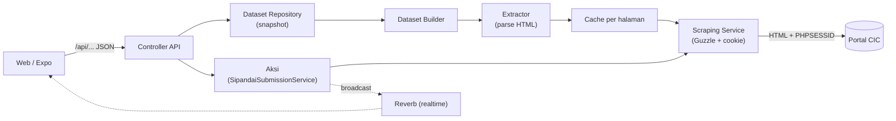
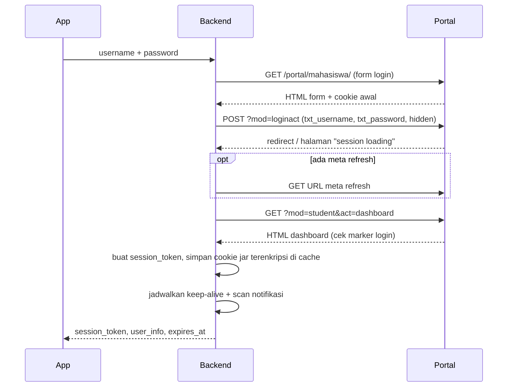
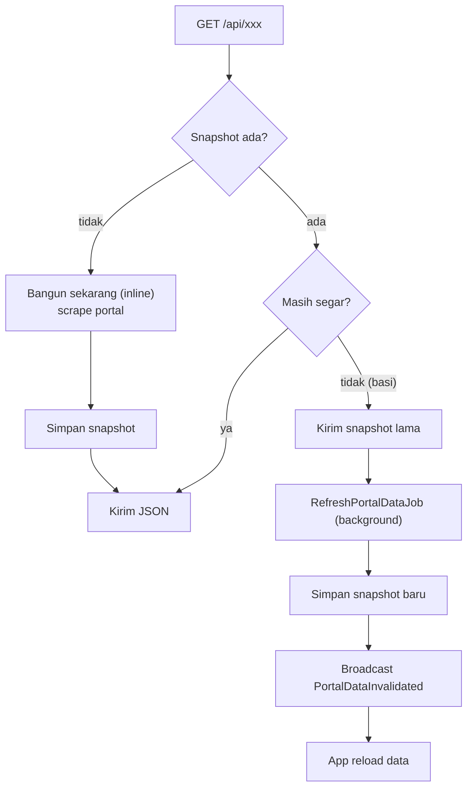
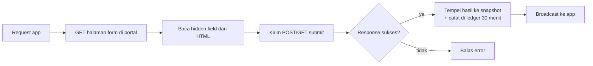
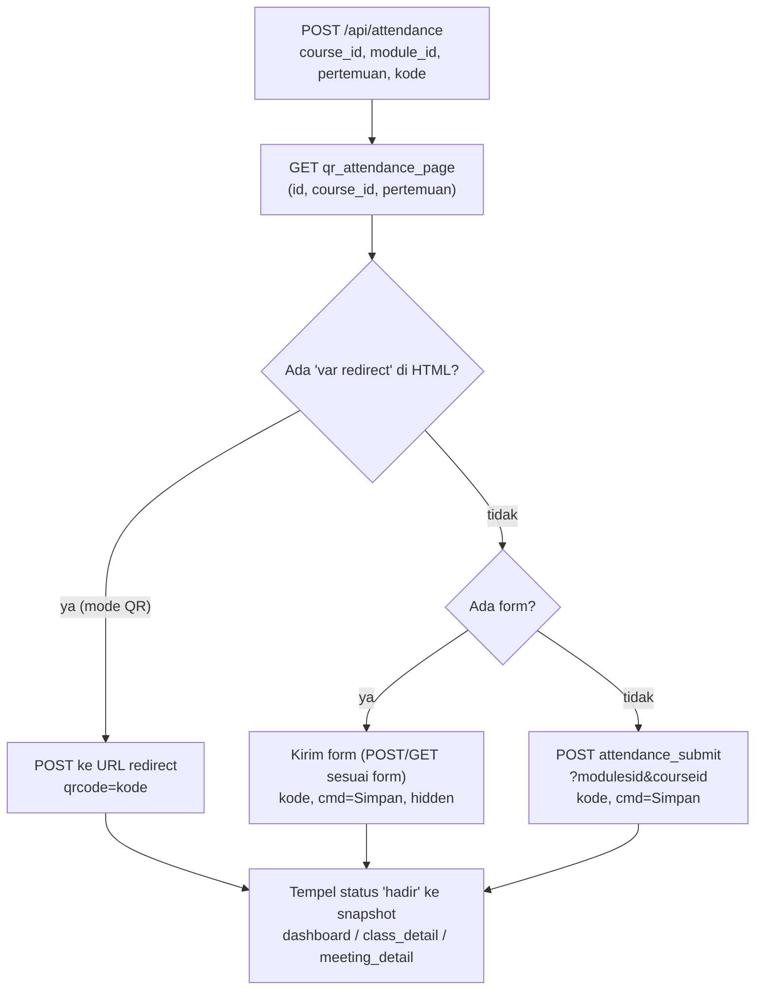
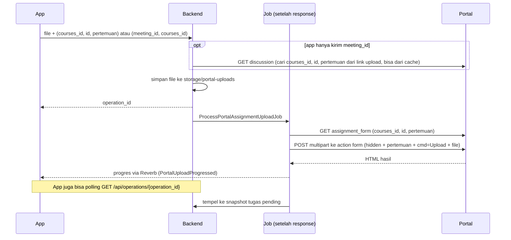
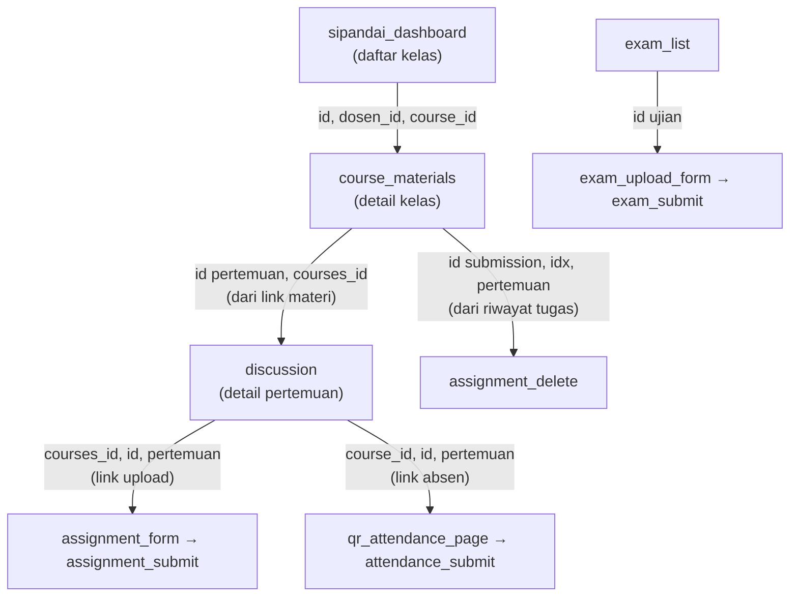

# Peta Alur Portal CIC

Dokumen ini menjelaskan bagaimana backend mengambil data dan menjalankan aksi di portal kampus, langkah demi langkah.

- **Portal kampus**: `https://my.cic.ac.id` (env `CAMPUS_BASE_URL`), terdiri dari dua aplikasi:
  - **Mahasiswa** `/portal/mahasiswa/`: profil, jadwal, keuangan, SKS, password
  - **SIPANDAI (LMS)** `/portal/sipandai/`: kelas, materi, absen, tugas, ujian
- Keduanya memakai **satu cookie `PHPSESSID`** dari login mahasiswa.
- Semua URL didaftarkan di [config/portal.php](config/portal.php) (bagian `endpoints`) dan diakses lewat `PortalEndpointRegistry::url('<key>')`.

Daftar isi:

1. [Gambaran besar](#1-gambaran-besar)
2. [Login & sesi](#2-login--sesi)
3. [Alur baca data (umum)](#3-alur-baca-data-umum)
4. [Alur per fitur data](#4-alur-per-fitur-data)
5. [Alur aksi (tulis ke portal)](#5-alur-aksi-tulis-ke-portal)
6. [Proses background](#6-proses-background)
7. [Rantai ID antar halaman](#7-rantai-id-antar-halaman)
8. [Lampiran: katalog URL portal](#8-lampiran-katalog-url-portal)
9. [Catatan scaling](#9-catatan-scaling)

---

## 1. Gambaran besar



Prinsipnya:

- **App tidak pernah bicara langsung ke portal.** Portal hanya mengembalikan HTML dan butuh cookie yang dipegang server.
- **Baca data** selalu lewat snapshot, jadi cepat. Kalau datanya sudah basi, snapshot lama tetap dikirim lalu diperbarui di background.
- **Aksi** (absen, upload, hapus) selalu langsung ke portal, lalu hasilnya ditempelkan ke snapshot supaya UI langsung berubah.

---

## 2. Login & sesi

### Login — `POST /api/auth/login`



### Sesi aktif

| Kejadian | Yang terjadi |
|---|---|
| Setiap request API | Sesi dicek **lokal** (aktif & belum idle), tanpa ke portal |
| Tiap 20 menit (`RefreshPortalSessionJob`) | `GET dashboard` supaya `PHPSESSID` tidak expired |
| Portal ternyata membalas halaman login | Sesi langsung dianggap mati → API balas `401` |
| Idle 2 jam (`CAMPUS_SESSION_IDLE_TIMEOUT`) | Sesi diakhiri, keep-alive berhenti |
| `CAMPUS_AUTO_RELOGIN=true` | Backend login ulang sendiri pakai kredensial terenkripsi |

### Logout — `POST /api/auth/logout`

`GET ?mod=logout` (mahasiswa) → `GET /portal/sipandai/controllers/logout.php` → hapus sesi di backend.

---

## 3. Alur baca data (umum)

Semua endpoint `GET` data mengikuti alur yang sama:



Lapisan cache:

1. **Snapshot dataset** (`PortalSnapshotStore`): hasil akhir per endpoint. Umur "segar" ada di `portal.datasets.*.fresh_for`.
2. **Cache per halaman** (`rememberResource`): satu halaman portal dipakai bersama oleh banyak dataset. TTL ada di `portal.cache.resources`.

Contoh: `sipandai_dashboard` cukup di-scrape sekali, lalu dipakai oleh dataset kelas, dashboard, tugas, dan ujian.

---

## 4. Alur per fitur data

Notasi: `→` artinya request ke portal secara berurutan. Nama di dalam backtick adalah key URL (lihat [lampiran](#8-lampiran-katalog-url-portal)).

### Profil — `GET /api/profile` (segar 60 menit)

```
profile
```

### Jadwal — `GET /api/schedule/class` (segar 30 menit)

```
student_course
```

### Keuangan — `GET /api/finance/payments` (segar 30 menit)

```
student_finance
```

### Daftar kelas — `GET /api/class` (segar 30 menit)

```
sipandai_dashboard ─┐
                    ├─ digabung per (kode MK | hari | jam)
student_course ─────┘    → kelas LMS + info ruangan
```

`GET /api/lms/class` hanya mengambil `sipandai_dashboard` saja, tanpa digabung.

### Detail kelas — `GET /api/class/{id}?dosen_id&course_id` (segar 15 menit)

```
course_materials (id, dosen_id, course_id)
  → info MK, dosen, presensi per pertemuan, riwayat tugas, materi, peserta
```

### Detail pertemuan — `GET /api/meeting/{meeting_id}?courses_id` (segar 15 menit)

```
discussion (id, courses_id)
  → info pertemuan, link absen, link upload tugas
  └─ kalau nomor pertemuan diketahui:
       course_materials (kelas yang sama)
         → cocokkan riwayat tugas → status tugas + data untuk hapus
```

### Dashboard — `GET /api/dashboard` (segar 10 menit)

```
1. profile
2. sipandai_dashboard
3. student_course
4. untuk SETIAP kelas yang jadwalnya HARI INI:
     course_materials        → cari pertemuan yang bisa diabsen
     discussion (kalau ada)  → status absen pertemuan itu
5. sipandai_dashboard (ringkasan & aktivitas, dari cache)
6. student_credit (hanya kalau total SKS tidak ketemu di tempat lain)
```

`GET /api/attendance/today` memakai hasil langkah 4 (shortcut absen hari ini).

### Tugas pending — `GET /api/assignment/pending` (segar 10 menit) ⚠️ paling berat

```
1. sipandai_dashboard
2. untuk SETIAP kelas (urut course_id), berhenti kalau sudah 20 tugas:
     course_materials        → kandidat pertemuan yang punya tugas
     untuk SETIAP kandidat:
       discussion            → deadline, status upload
3. urutkan dari deadline terdekat
```

Jeda antar request di sini 250 ms (`CAMPUS_BULK_REQUEST_DELAY`), lebih cepat dari jeda normal 1 detik.

### Ujian — `GET /api/exam` (segar 30 menit)

```
exam_list
  └─ kalau gagal / ada baris tanpa id:
       sipandai_dashboard → cocokkan ujian dengan kelas
```

### Detail ujian — `GET /api/exam/{id}` (tanpa snapshot)

```
exam_upload_form (id) → info ujian, riwayat upload, form
```

### Download file — `GET /api/support/download?path=...`

```
GET <path file di portal> → diteruskan ke app sebagai file
```

---

## 5. Alur aksi (tulis ke portal)

Pola semua aksi sama:



> **Kenapa harus GET form dulu?** Field tersembunyi (token, id) tidak di-hardcode. Field itu dibaca dari HTML form setiap kali. `curl` langsung ke URL submit tanpa field tersebut berisiko ditolak portal.
>
> **Ledger 30 menit** (`PortalActionProjector`) mencegah sync background yang mulai *sebelum* aksi menimpa hasil aksi.

### Absen — `POST /api/attendance` (sinkron)



### Upload tugas — `POST /api/assignment` (async)



### Hapus tugas — `DELETE /api/assignment` (sinkron)

```
assignment_delete GET (id=submission, idx=discussion, pertemuan)
  → course_materials (verifikasi tugas benar-benar hilang)
  → tempel ke snapshot + broadcast
```

### Upload ujian — `POST /api/exam` (async)

```
[job] exam_upload_form GET (id)        → baca hidden field + nama field file
      exam_submit POST multipart (hidden + cmd=Upload + file)
      exam_upload_form GET (id)        → cek riwayat upload (verifikasi)
      simpan ExamSubmissionRecord + broadcast
```

### Ganti password — `POST /api/auth/password` (sinkron)

```
password_form GET → baca field form
password_submit POST (password lama, baru, konfirmasi + hidden)
```

---

## 6. Proses background

| Job | Kapan jalan | Kerjanya |
|---|---|---|
| `RefreshPortalSessionJob` | tiap 20 menit per sesi | Keep-alive `GET dashboard`, relogin kalau diizinkan, akhiri sesi kalau idle |
| `RefreshPortalDataJob` | snapshot basi / `POST /api/refresh` | Bangun ulang dataset (1 job per dataset per sesi, ada lock) |
| `ScanPortalNotificationsJob` | setelah login / refresh sesi / resume offline, lalu berulang tiap `portal.realtime.notifications.scan_interval` (600 s) atau saat kelas hari ini mulai, selama sesi hidup (scan dilewati bila mahasiswa tidak aktif 20 menit; scan lanjutan memakai snapshot dan hanya me-resync tugas/ujian yang lebih tua dari `follow_up_resync_after`, 3600 s) | Baca dataset tugas pending + ujian → kirim notifikasi deadline (≤24 jam urgent, ≤72 jam warning) |
| `ProcessPortalAssignmentUploadJob` | upload tugas | Lihat [upload tugas](#upload-tugas--post-apiassignment-async) |
| `ProcessPortalExamUploadJob` | upload ujian | Lihat [upload ujian](#upload-ujian--post-apiexam-async) |

Event realtime di channel `portal.session.{sessionId}`:

| Event | Kapan |
|---|---|
| `PortalDataInvalidated` | Snapshot diperbarui → app reload data |
| `PortalSyncStatusUpdated` | Status sync background |
| `PortalUploadProgressed` | Progres upload tugas/ujian |
| `PortalNotificationSent` | Notifikasi deadline |
| `PortalSessionNoticeSent` | Info sesi (misal sesi berakhir) |

---

## 7. Rantai ID antar halaman

Parameter halaman detail tidak bisa ditebak. Semuanya diambil dari link di halaman sebelumnya:



---

## 8. Lampiran: katalog URL portal

Semua path relatif ke `https://my.cic.ac.id`.

### Mahasiswa (`/portal/mahasiswa/`)

| Key | Method | Query | Param tambahan |
|---|---|---|---|
| `login_page` | GET | – | – |
| `login` | POST | `mod=loginact` | form `txt_username`, `txt_password` + hidden |
| `dashboard` | GET | `mod=student&act=dashboard` | – |
| `student_logout` | GET | `mod=logout` | – |
| `profile` | GET | `mod=student&act=profile` | – |
| `student_course` | GET | `mod=student&act=course` | – |
| `student_finance` | GET | `mod=student&act=keuangan` | – |
| `student_credit_url`¹ | GET | `mod=student&act=credit` | – |
| `password_form` | GET | `mod=student&act=password` | – |
| `password_submit` | POST | `mod=student&act=passwordact` | field dari form |

¹ Hanya ada di config (`portal.student_credit_url`), tidak terdaftar di `endpoints`.

### SIPANDAI (`/portal/sipandai/`)

| Key | Method | Path / query | Param tambahan |
|---|---|---|---|
| `sipandai_dashboard` | GET | `?mod=sipandai&act=dashboardmahasiswa` | – |
| `course_materials` | GET | `?mod=sipandai&act=download` | `id`, `dosen_id`, `course_id` |
| `discussion` | GET | `?mod=sipandai&act=discuss` | `id`, `courses_id` |
| `qr_attendance_page` | GET | `views/validasi/demo.php?mod=sipandai&act=discuss` | `id`, `course_id`, `pertemuan` |
| `attendance_submit` | POST | `?mod=sipandai&act=actabsen` | query `modulesid`, `courseid`; form `kode`, `cmd=Simpan` |
| `assignment_form` | GET | `?mod=sipandai&act=send` | `courses_id`, `id`, `pertemuan` |
| `assignment_submit` | POST multipart | `?mod=sipandai&act=sent` | hidden + `pertemuan`, `cmd=Upload`, file |
| `assignment_delete` | GET | `?mod=sipandai&act=jobdel` | `id`, `idx`, `pertemuan` |
| `exam_list` | GET | `?mod=sipandai&act=ujian` | – |
| `exam_upload_form` | GET | `?mod=sipandai&act=sendujian` | `id` |
| `exam_submit` | POST multipart | `?mod=sipandai&act=sentujian` | hidden + `cmd=Upload`, file |
| `sipandai_logout` | GET | `controllers/logout.php` | – |

Header yang selalu dikirim: `Referer` (halaman form/asal), `Origin` (base URL), `User-Agent` Chrome. Jeda antar request 1 detik (`CAMPUS_REQUEST_DELAY`).

---

## 9. Catatan scaling

1. **Bottleneck utama: tugas pending dan dashboard.** Keduanya membuka detail per kelas, lalu per pertemuan, secara berurutan. Opsi percepatan: turunkan jeda request, atau pecah per kelas menjadi job paralel.
2. **`sipandai_dashboard` adalah akar** hampir semua fitur. Kalau struktur HTML-nya berubah, kelas, tugas, absen, ujian, dan dashboard ikut rusak. Test extractor-nya paling penting.
3. **Satu aksi = minimal 2 request ke portal** (GET form + submit). Upload tugas bisa 3–4 request.
4. **Untuk Expo**: kontrak endpoint `/api` di atas tetap sama. Yang perlu diganti hanya auth (cookie + CSRF → token Bearer).
