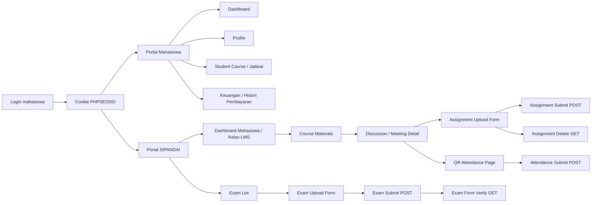
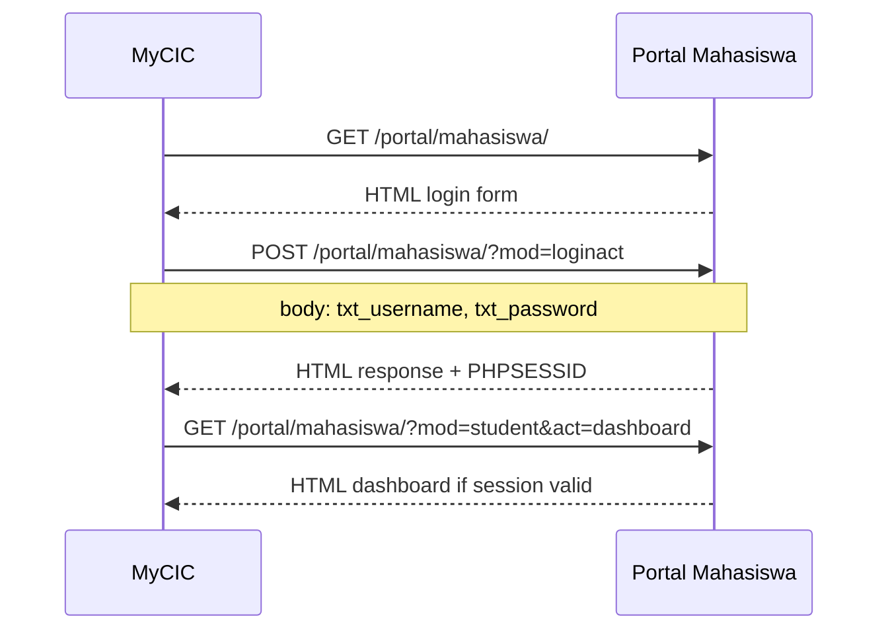
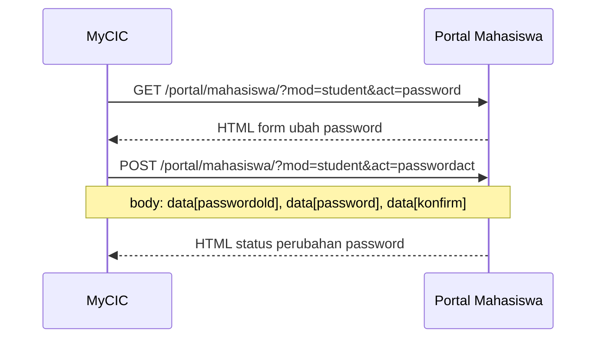
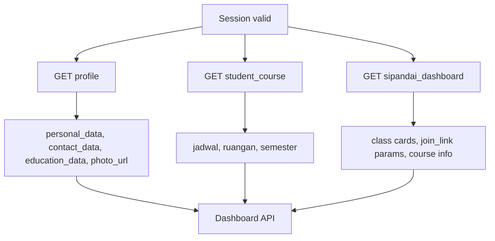
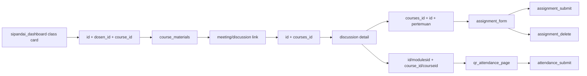
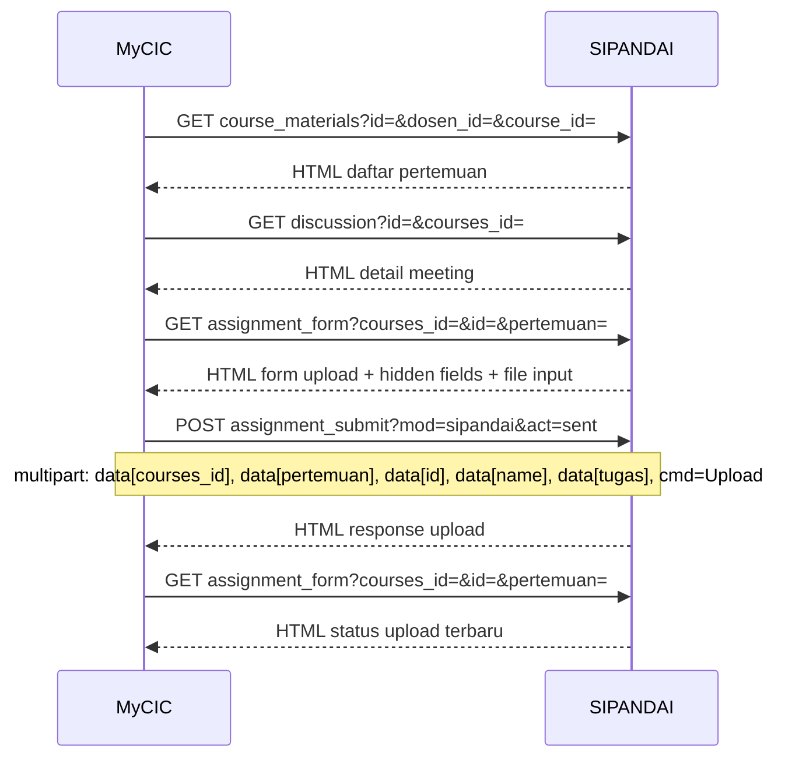
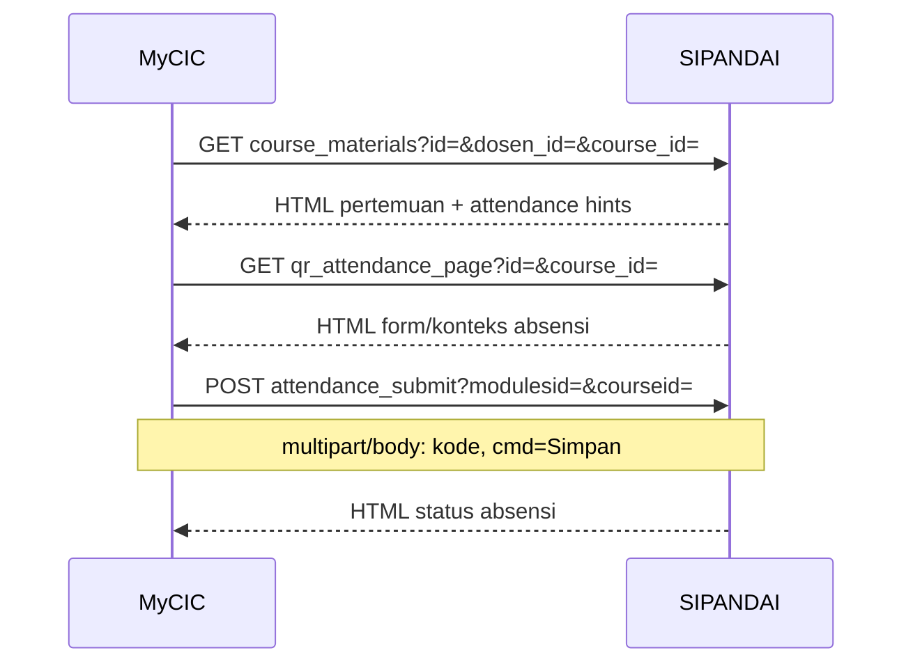
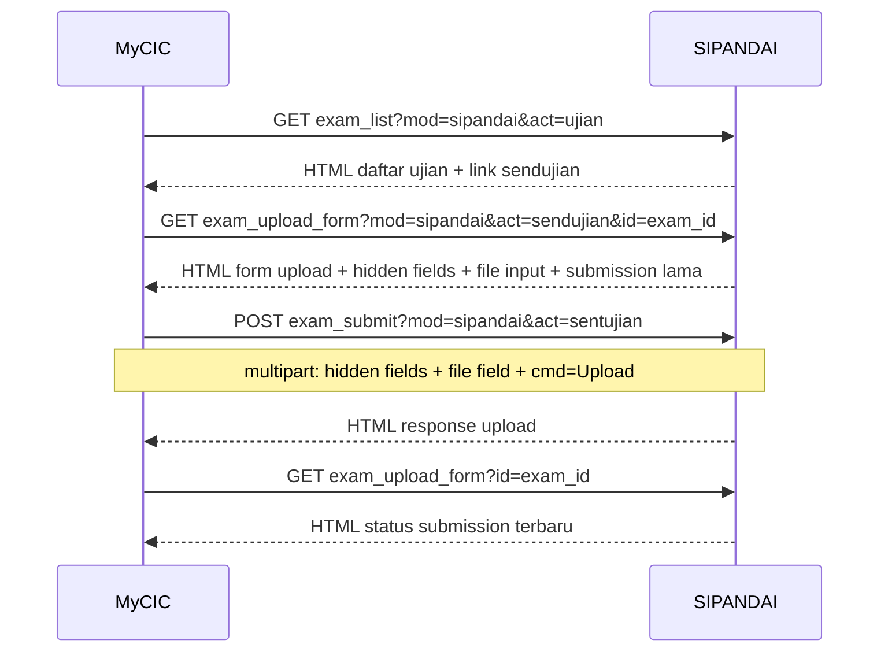

# Pemetaan Alur my.cic.ac.id/portal

Dokumen ini memetakan cara kerja portal resmi `my.cic.ac.id/portal` yang saat ini dibungkus oleh aplikasi MyCIC. Fokus dokumen ini adalah:

- endpoint resmi yang ditembak;
- method, query, dan body yang dibutuhkan;
- asal variabel dari satu halaman ke halaman lain;
- alur GET sebelum POST;
- indikator sukses/gagal dari response HTML.

Dokumen ini bukan rancangan database. Tujuannya adalah membuat kontrak kerja portal resmi rapi dulu, supaya aplikasi bisa meniru workflow web asli dengan lebih aman.

## Prinsip Mapping

1. Gunakan nama parameter upstream apa adanya.
   Contoh: `id`, `dosen_id`, `course_id`, `courses_id`, `pertemuan`, `modulesid`, `courseid`.
2. Setiap aksi POST harus punya halaman GET pendahulu.
   Halaman GET biasanya memberi hidden input, action URL, file field, atau status data terakhir.
3. Jangan hardcode field form jika field bisa dibaca dari HTML.
   Ambil dari form asli, lalu fallback hanya saat portal tidak menampilkan field secara lengkap.
4. Setiap upload harus diverifikasi dengan GET ulang.
   Response POST portal lama kadang ambigu, jadi status final harus dibaca ulang dari halaman detail/form.
5. Response sukses/gagal harus dideteksi dari HTML.
   Kata kunci umum: `berhasil`, `sukses`, `disimpan`, `gagal`, `error`, `tidak berhasil`, `sudah diupload`.

## Peta Besar



## Endpoint Resmi Yang Sudah Dipetakan

Sumber utama ada di `config/portal.php` bagian `endpoints` (`PortalEndpointRegistry`). `php artisan portal:endpoints` menampilkan katalognya (`--key=<nama>` untuk detail satu endpoint), dan `php artisan portal:capture-fixtures` menyimpan salinan halaman yang sudah disanitasi sebagai fixture tes di `tests/Fixtures/portal/real/`.

| Key internal | Method | URL resmi | Query default | Required params | Fungsi |
| --- | --- | --- | --- | --- | --- |
| `login_page` | GET | `/portal/mahasiswa/` | dari config login URL | - | Ambil halaman login dan form login |
| `login` | POST | `/portal/mahasiswa/` | `mod=loginact` | - | Kirim username/password dan ambil cookie session |
| `student_logout` | GET | `/portal/mahasiswa/` | `mod=logout` | - | Logout portal mahasiswa |
| `sipandai_logout` | GET | `/portal/sipandai/controllers/logout.php` | - | - | Logout SIPANDAI |
| `dashboard` | GET | `/portal/mahasiswa/` | `mod=student`, `act=dashboard` | - | Dashboard mahasiswa lama |
| `profile` | GET | `/portal/mahasiswa/` | `mod=student`, `act=profile` | - | Data profil mahasiswa |
| `password_form` | GET | `/portal/mahasiswa/` | `mod=student`, `act=password` | - | Form ubah password |
| `password_submit` | POST | `/portal/mahasiswa/` | `mod=student`, `act=passwordact` | field form dinamis | Submit ubah password |
| `student_course` | GET | `/portal/mahasiswa/` | `mod=student`, `act=course` | - | Jadwal kuliah dan ruangan |
| `student_finance` | GET | `/portal/mahasiswa/` | `mod=student`, `act=keuangan` | - | Histori pembayaran keuangan |
| `sipandai_dashboard` | GET | `/portal/sipandai/` | `mod=sipandai`, `act=dashboardmahasiswa` | - | Daftar kelas LMS/SIPANDAI |
| `course_materials` | GET | `/portal/sipandai/` | `mod=sipandai`, `act=download` | `id`, `dosen_id`, `course_id` | Detail materi per kelas |
| `discussion` | GET | `/portal/sipandai/` | `mod=sipandai`, `act=discuss` | `id`, `courses_id` | Detail meeting/diskusi |
| `assignment_form` | GET | `/portal/sipandai/` | `mod=sipandai`, `act=send` | `courses_id`, `id`, `pertemuan` | Form upload tugas |
| `qr_attendance_page` | GET | `/portal/sipandai/views/validasi/demo.php` | `mod=sipandai`, `act=discuss` | `id`, `course_id` | Halaman validasi absensi QR |
| `assignment_submit` | POST | `/portal/sipandai/` | `mod=sipandai`, `act=sent` | `courses_id`, `id`, `pertemuan` | Submit file tugas |
| `attendance_submit` | POST | `/portal/sipandai/` | `mod=sipandai`, `act=actabsen` | `modulesid`, `courseid` | Submit kode absensi |
| `assignment_delete` | GET | `/portal/sipandai/` | `mod=sipandai`, `act=jobdel` | `id`, `idx`, `pertemuan` | Hapus submit tugas |
| `exam_upload_form` | GET | `/portal/sipandai/` | `mod=sipandai`, `act=sendujian` | `id` | Form upload UTS/UAS |
| `exam_submit` | POST | `/portal/sipandai/` | `mod=sipandai`, `act=sentujian` | dinamis dari form | Submit file UTS/UAS |
| `exam_list` | GET | `/portal/sipandai/` | `mod=sipandai`, `act=ujian` | - | Daftar UTS/UAS |

## Kamus Variabel Penting

| Variabel | Arti | Sumber utama | Dipakai untuk |
| --- | --- | --- | --- |
| `PHPSESSID` | Cookie session portal | Response login | Semua request setelah login |
| `id` pada `course_materials` | ID class/material-root pada URL `act=download` | Link dari SIPANDAI dashboard | GET course materials |
| `dosen_id` | ID dosen | Link dari SIPANDAI dashboard | GET course materials |
| `course_id` | ID course pada LMS | Link dari SIPANDAI dashboard atau student course | GET course materials, QR page |
| `courses_id` | ID course versi endpoint discuss/send | Link discussion atau assignment form | GET discussion, assignment form, assignment submit |
| `meeting_id` | ID meeting/diskusi/module | Link dari course materials | GET discussion, assignment shortcut, attendance shortcut |
| `pertemuan` | Nomor pertemuan | Link assignment form atau hasil parsing meeting | Upload/delete tugas |
| `modulesid` | ID module absensi | URL attendance submit atau hasil resolve QR page | POST attendance |
| `courseid` | ID course untuk attendance submit | URL attendance submit | POST attendance |
| `kode` | Kode QR/unix absensi | Input user atau QR scanner | POST attendance |
| `idx` | ID diskusi/materi saat delete tugas | Delete link dari assignment page | GET assignment delete |
| `submission_id` | ID submit tugas/ujian | Delete link `jobdel` atau `jobdelujian` | Delete/bukti submit |
| `exam_id` | ID ujian | `exam_list` atau URL `sendujian&id=...` | GET exam detail, POST exam |
| `file_field` | Nama input file | `<input type="file">` pada form asli | Multipart upload |
| `hidden fields` | Input tersembunyi form asli | GET form sebelum upload | Multipart upload |
| `data[passwordold]` | Password lama | Form ubah password | POST password submit |
| `data[password]` | Password baru | Form ubah password | POST password submit |
| `data[konfirm]` | Konfirmasi password baru | Form ubah password | POST password submit |

## Validasi Ulang Alias Variabel

Ada banyak nama berbeda yang sebenarnya menunjuk ke data yang sama, tetapi **tidak semua `id` boleh dianggap sama**. Cara paling aman adalah pakai canonical meaning di bawah ini, lalu translate ke nama parameter upstream sesuai endpoint.

### Kelompok Identitas Canonical

| Canonical meaning | Nama upstream/API yang muncul | Aman disamakan? | Catatan validasi |
| --- | --- | --- | --- |
| Class/material-root id | `id`, `class_id` | Hanya pada konteks `act=download` | Ini `id` dari link kelas SIPANDAI. Jangan ditukar dengan `course_id`. |
| Lecturer id | `dosen_id`, `lecturer_id` | Ya | Saat ini upstream utama memakai `dosen_id`. |
| Course id | `course_id`, `courses_id`, `courseid` | Sering sama nilainya, tapi nama harus ikut endpoint | `course_id` untuk `download` dan QR page, `courses_id` untuk `discuss/send`, `courseid` untuk `actabsen`. |
| Meeting/module/discussion id | `meeting_id`, `modulesid`, `id`, `discussion_id` | Sama makna hanya pada konteks meeting/attendance/assignment | `id` pada `discussion` dan `assignment_form` adalah meeting/discussion id, bukan class id. `modulesid` adalah nama submit absensi. |
| Meeting number | `pertemuan`, `meeting_number` | Ya | Nomor pertemuan manusiawi: 1, 2, 3, dst. |
| Assignment submission id | `id`, `submission_id`, `delete_id` | Hanya pada konteks `assignment_delete` | Di delete tugas, `id` bukan class id atau meeting id; ini ID submission yang mau dihapus. |
| Assignment discussion id | `idx`, `discussion_id`, `id` dari upload form | Hanya pada konteks delete/upload tugas | Di delete tugas, `idx` biasanya berisi ID meeting/discussion. |
| Exam id | `id`, `exam_id`, `ujian_id`, `data[id]` | Hanya pada konteks exam | `id` pada `sendujian` dan `data[id]` pada submit ujian adalah exam id. |
| File input name | `data[tugas]`, `file`, dynamic `file_field` | Tidak boleh ditebak jika form tersedia | Assignment biasanya `data[tugas]`; exam fallback saat ini `file`, tapi yang utama tetap baca input file dari form. |

### Alias Yang Saat Ini Diterima Oleh MyCIC

| Input ke MyCIC | Dinormalisasi menjadi | Dipakai untuk | Sumber kode |
| --- | --- | --- | --- |
| route `/api/class/{id}` atau input `id` | `id` | `course_materials.id` | `ClassDetailRequest` |
| `course_id` pada meeting request | `courses_id` | `discussion.courses_id` | `SipandaiMeetingDetailRequest` |
| `courseid` pada flow request | `course_id` dan fallback `courses_id` | build course/material/attendance links | `SipandaiFlowRequest` |
| `discussion_id` pada flow/assignment | `id` | `assignment_form.id`, `discussion.id` | `SipandaiFlowRequest`, `SipandaiAssignmentUploadRequest` |
| `meeting_number` | `pertemuan` | assignment/attendance context | `SipandaiFlowRequest`, `SipandaiAssignmentUploadRequest`, `SipandaiAttendanceRequest`, `SipandaiAssignmentDeleteRequest` |
| `course_id` pada assignment upload | `courses_id` | assignment upload target | `SipandaiAssignmentUploadRequest` |
| `course_id` pada attendance submit | `courseid` | attendance submit target | `SipandaiAttendanceRequest` |
| `id` atau `discussion_id` pada attendance submit | `modulesid` | attendance submit target | `SipandaiAttendanceRequest` |
| `submission_id` pada delete tugas | `id` | assignment delete target | `SipandaiAssignmentDeleteRequest` |
| `delete_id` pada flow request | `submission_id` | build assignment delete URL | `SipandaiFlowRequest` |

### Aturan Normalisasi Yang Harus Diikuti

1. Simpan canonical name di log/internal object, tapi saat menembak portal pakai nama upstream persis.
2. Jangan pernah menukar `id` kelas dengan `course_id`.
   Contoh salah: `?id=8810&course_id=2265`.
3. Untuk class detail, trio yang benar adalah:
   `id` + `dosen_id` + `course_id`.
4. Untuk meeting detail, pasangan yang benar adalah:
   `id` atau `meeting_id` + `courses_id`.
5. Untuk assignment upload, target yang benar adalah:
   `courses_id` + `id` + `pertemuan`.
6. Untuk attendance submit, target yang benar adalah:
   `courseid` + `modulesid`, lalu body berisi `kode` dan `cmd=Simpan`.
7. Untuk assignment delete, `id` berarti submission id, sedangkan `idx` berarti discussion/material id.
8. Untuk exam, `id` berarti exam id, dan pada body submit bisa muncul sebagai `data[id]`.

### Contoh Transformasi Yang Benar

| Dari halaman | Variabel ditemukan | Dipakai sebagai | Endpoint berikutnya |
| --- | --- | --- | --- |
| SIPANDAI dashboard class link | `id=2343&dosen_id=4961&course_id=8987` | tetap `id`, `dosen_id`, `course_id` | `course_materials` |
| Course materials meeting link | `id=30061&courses_id=8987` | `meeting_id=30061`, `courses_id=8987` | `discussion` |
| Discussion/upload link | `courses_id=9000&id=30095&pertemuan=6` | `courses_id`, `id`, `pertemuan` | `assignment_form` |
| Assignment delete link | `id=126663&idx=30095&pertemuan=6` | `submission_id=126663`, `discussion_id=30095`, `pertemuan=6` | `assignment_delete` |
| QR attendance submit URL | `modulesid=30216&courseid=8810` | `module_id=30216`, `course_id=8810` internal; upstream tetap `modulesid`, `courseid` | `attendance_submit` |
| Exam upload link | `act=sendujian&id=8833` | `exam_id=8833` | `exam_upload_form`, lalu `exam_submit` |

### Kesimpulan Validasi

Yang benar bukan “semua beda nama itu sama”, tapi:

- `course_id`, `courses_id`, dan `courseid` biasanya menunjuk **course yang sama**, namun nama endpoint harus dipertahankan.
- `meeting_id`, `modulesid`, dan `id` pada `discussion/send` biasanya menunjuk **meeting/module yang sama**, namun `id` tetap sangat kontekstual.
- `id` adalah parameter paling berbahaya karena bisa berarti class id, meeting id, submission id, atau exam id tergantung endpoint.
- Jadi dokumentasi dan kode harus selalu menyebut konteks: `class_id`, `meeting_id`, `submission_id`, `exam_id`, lalu baru diterjemahkan ke nama upstream.

## Alur Auth Dan Session



### Contract Login

| Bagian | Nilai |
| --- | --- |
| GET awal | `login_page` |
| POST action | `login` |
| Query | `mod=loginact` |
| Body minimal | `txt_username`, `txt_password` |
| Output penting | `PHPSESSID`, user info dari HTML/dashboard |
| Verifikasi | Dashboard dapat diakses tanpa diarahkan ulang ke login |

### Contract Ubah Password



| Bagian | Nilai |
| --- | --- |
| GET awal | `password_form` |
| POST action | `password_submit` |
| Query GET | `mod=student`, `act=password` |
| Query POST | `mod=student`, `act=passwordact` |
| Body minimal | `data[passwordold]`, `data[password]`, `data[konfirm]` |
| MyCIC route GET | `GET /api/auth/password/form` |
| MyCIC route POST | `POST /api/auth/password` |
| Success indicators | `password berhasil`, `berhasil`, `sukses`, `disimpan`, `tersimpan` |
| Failure indicators | `password lama salah`, `konfirmasi`, `tidak sesuai`, `gagal`, `error`, `salah` |

## Alur Data Dasar Mahasiswa



### Contract Profile

| Bagian | Nilai |
| --- | --- |
| Endpoint | `profile` |
| Method | GET |
| Required params | - |
| Data penting | NIM, nama, program studi, angkatan, status, kontak, pendidikan, foto |
| Sumber extractor | `ProfileExtractor::extractProfileData` |

### Contract Jadwal Kuliah

| Bagian | Nilai |
| --- | --- |
| Endpoint | `student_course` |
| Method | GET |
| Required params | - |
| Data penting | mata kuliah, jadwal, jam, ruangan, semester |
| Sumber extractor | `StudentCourseExtractor::extractStudentCourseData` |

### Contract Histori Pembayaran Keuangan

| Bagian | Nilai |
| --- | --- |
| Endpoint | `student_finance` |
| Method | GET |
| URL resmi | `/portal/mahasiswa/?mod=student&act=keuangan` |
| Required params | - |
| Data penting | info mahasiswa, tanggal pembayaran, uraian/jenis pembayaran, nominal, status, channel/bank, nomor referensi bila ada |
| Sumber extractor | `FinancialHistoryExtractor::extractPaymentHistoryData` |
| MyCIC route | `GET /api/finance/payments` |

### Contract Kelas SIPANDAI

| Bagian | Nilai |
| --- | --- |
| Endpoint | `sipandai_dashboard` |
| Method | GET |
| Required params | - |
| Data penting | daftar kelas, kode matkul, nama matkul, link masuk kelas |
| Variabel turunan | `id`, `dosen_id`, `course_id` dari link kelas |
| Sumber extractor | `SipandaiClassesExtractor::extractSipandaiClassesData` |

## Relasi Kelas, Materi, Meeting, Tugas, Absensi



### Contract Course Materials

| Bagian | Nilai |
| --- | --- |
| Endpoint | `course_materials` |
| Method | GET |
| Query wajib | `id`, `dosen_id`, `course_id` |
| Asal params | Link kelas dari `sipandai_dashboard` |
| Data penting | daftar pertemuan, materi, tugas, attendance info, link discussion/send/validasi |
| Output variabel | `meeting_id`, `courses_id`, `pertemuan`, link file, link upload tugas |
| MyCIC route | `GET /api/class/{id}?dosen_id=...&course_id=...` |

### Contract Discussion / Meeting Detail

| Bagian | Nilai |
| --- | --- |
| Endpoint | `discussion` |
| Method | GET |
| Query wajib | `id`, `courses_id` |
| Asal params | Link meeting dari `course_materials` |
| Data penting | pokok bahasan, materi, assignment info, attendance/QR link |
| Output variabel | `assignment_form` params, `qr_attendance_page` params |
| MyCIC route | `GET /api/meeting/{meeting_id}?courses_id=...` |

## Alur Assignment



### Contract Assignment Form

| Bagian | Nilai |
| --- | --- |
| Endpoint | `assignment_form` |
| Method | GET |
| Query wajib | `courses_id`, `id`, `pertemuan` |
| Asal params | Link upload tugas dari discussion/course materials |
| Data penting | form action, method, enctype, hidden fields, file field, status upload sebelumnya |
| Output variabel | `data[courses_id]`, `data[pertemuan]`, `data[id]`, `data[name]`, `data[tugas]`, `cmd` |

### Contract Assignment Submit

| Bagian | Nilai |
| --- | --- |
| Endpoint | `assignment_submit` |
| Method | POST multipart |
| Query default | `mod=sipandai`, `act=sent` |
| Query wajib registry | `courses_id`, `id`, `pertemuan` |
| Body minimal | `data[courses_id]`, `data[pertemuan]`, `data[id]`, `data[name]`, `data[tugas]`, `cmd=Upload` |
| File field umum | `data[tugas]` |
| Before GET | `assignment_form` |
| Verify after | `assignment_form` |
| Success indicators | `berhasil`, `sukses`, `disimpan`, uploaded file link |
| Failure indicators | `gagal`, `error`, `tidak berhasil` |

### Contract Assignment Delete

| Bagian | Nilai |
| --- | --- |
| Endpoint | `assignment_delete` |
| Method | GET |
| Query wajib | `id`, `idx`, `pertemuan` |
| Asal `id` | submission/delete link dari assignment form |
| Asal `idx` | discussion/material id |
| Asal `pertemuan` | nomor pertemuan |
| Verify after | `assignment_form` |

## Alur Attendance



### Contract QR Attendance Page

| Bagian | Nilai |
| --- | --- |
| Endpoint | `qr_attendance_page` |
| Method | GET |
| Path | `/portal/sipandai/views/validasi/demo.php` |
| Query wajib | `id`, `course_id` |
| Asal params | Link QR/validasi dari discussion atau course materials |
| Data penting | jendela waktu absensi, meeting info, form target |
| Output variabel | `modulesid`, `courseid`, `pertemuan` jika tersedia |

### Contract Attendance Submit

| Bagian | Nilai |
| --- | --- |
| Endpoint | `attendance_submit` |
| Method | POST multipart/form |
| Query wajib | `modulesid`, `courseid` |
| Body minimal | `kode`, `cmd=Simpan` |
| Before GET | `qr_attendance_page` jika target belum lengkap |
| Success indicators | `berhasil`, `sukses`, status absen muncul |
| Failure indicators | `gagal`, `error`, kode tidak valid, waktu absen habis |

## Alur Exam UTS/UAS



### Contract Exam List

| Bagian | Nilai |
| --- | --- |
| Endpoint | `exam_list` |
| Method | GET |
| Query default | `mod=sipandai`, `act=ujian` |
| Required params | - |
| Data penting | `exam_id`, kode matkul, nama matkul, jadwal, status, upload URL |
| Fallback | Jika ID tidak muncul, cocokkan dengan kelas dari `sipandai_dashboard` |
| MyCIC route | `GET /api/exam` |

### Contract Exam Upload Form

| Bagian | Nilai |
| --- | --- |
| Endpoint | `exam_upload_form` |
| Method | GET |
| Query wajib | `id` |
| Asal `id` | link `sendujian&id=...` dari `exam_list` atau fallback course id |
| Data penting | form action, method, enctype, hidden fields, file field, status uploaded/not uploaded |
| Output variabel | `data[id]` atau `id`, `file_field`, hidden fields, submission records |
| MyCIC route | `GET /api/exam/{id}` |

### Contract Exam Submit

| Bagian | Nilai |
| --- | --- |
| Endpoint | `exam_submit` |
| Method | POST multipart |
| Query default | `mod=sipandai`, `act=sentujian` |
| Before GET | `exam_upload_form` |
| Body minimal | semua hidden fields dari form, `cmd=Upload`, file attachment |
| Exam id field | utamakan `data[id]`, fallback `id` |
| File field | dari `<input type="file">`, fallback `file` |
| Verify after | `exam_upload_form` dengan `id` yang sama |
| Success indicators | `berhasil`, `sukses`, `disimpan`, `jawaban ujian`, uploaded file link |
| Failure indicators | `gagal`, `error`, `tidak berhasil`, already uploaded jika tidak boleh upload ulang |
| MyCIC route | `POST /api/exam` |

## Mapping MyCIC API Ke Portal Resmi

| MyCIC API | Portal resmi yang ditembak | Catatan |
| --- | --- | --- |
| `POST /api/auth/login` | `login_page`, `login`, `dashboard` | Buat session dan validasi cookie |
| `GET /api/auth/session` | cache/session internal + validasi portal | Pastikan session masih hidup |
| `POST /api/auth/session/refresh` | `dashboard` atau refresh session manager | Menjaga session |
| `POST /api/auth/logout` | `student_logout`, `sipandai_logout` | Bersihkan session |
| `GET /api/auth/password/form` | `password_form` | Metadata form ubah password tanpa membocorkan value |
| `POST /api/auth/password` | `password_form`, `password_submit` | Ubah password dengan field upstream |
| `GET /api/dashboard` | `profile`, `sipandai_dashboard`, `student_course`, optional `dashboard` | Gabungan data |
| `GET /api/profile` | `profile` | Data profil |
| `GET /api/finance/payments` | `student_finance` | Histori pembayaran dari halaman keuangan |
| `GET /api/class` | `sipandai_dashboard` + `student_course` | Merge kelas LMS dan jadwal |
| `GET /api/class/{id}` | `course_materials` | Butuh `dosen_id`, `course_id` |
| `GET /api/meeting/{meeting_id}` | `discussion` | Butuh `courses_id` |
| `GET /api/lms/class` | `sipandai_dashboard` | Daftar kelas LMS |
| `GET /api/schedule/class` | `student_course` | Jadwal dari portal mahasiswa |
| `POST /api/assignment` | `assignment_form`, `assignment_submit`, verify `assignment_form` | Upload tugas |
| `DELETE /api/assignment` | `assignment_delete`, verify `assignment_form` bila params cukup | Hapus tugas |
| `GET /api/assignment/pending` | `sipandai_dashboard`, `course_materials`, `discussion` | Cari tugas belum upload |
| `GET /api/attendance/today` | `sipandai_dashboard`, `course_materials`, `discussion`, optional QR page | Shortcut absensi hari ini |
| `POST /api/attendance` | `qr_attendance_page`, `attendance_submit` | Submit kode QR |
| `GET /api/exam` | `exam_list`, fallback `sipandai_dashboard` | Daftar ujian |
| `GET /api/exam/{id}` | `exam_upload_form` | Detail/form ujian |
| `POST /api/exam` | `exam_upload_form`, `exam_submit`, verify `exam_upload_form` | Upload UTS/UAS |
| `GET /api/support/download` | file URL dari portal | Download file yang host/path-nya valid |

## Template Kontrak Endpoint Yang Perlu Dirapikan Di Kode

Saat ini `PortalEndpointRegistry` sudah menyimpan method, URL, query default, dan required params. Agar mapping workflow lebih kuat, registry berikutnya bisa ditambah field seperti ini:

```php
'exam_submit' => [
    'method' => 'POST',
    'url' => $sipandaiBase,
    'default_query' => [
        'mod' => 'sipandai',
        'act' => 'sentujian',
    ],
    'requires_session' => true,
    'before' => [
        'endpoint' => 'exam_upload_form',
        'required_params' => ['id'],
        'extract' => ['hidden_fields', 'file_field', 'status'],
    ],
    'body' => [
        'type' => 'multipart',
        'fields' => [
            'cmd' => 'Upload',
            'data[id]' => 'exam_id',
            '{file_field}' => 'attachment',
        ],
        'dynamic_fields_from' => 'exam_upload_form',
    ],
    'verify_after' => [
        'endpoint' => 'exam_upload_form',
        'required_params' => ['id'],
    ],
    'indicators' => [
        'success' => ['berhasil', 'sukses', 'disimpan'],
        'failure' => ['gagal', 'error', 'tidak berhasil'],
    ],
]
```

Field yang perlu distandarkan:

- `before`: endpoint GET yang wajib dipanggil sebelum action.
- `body.type`: `form`, `multipart`, atau `none`.
- `body.fields`: field minimal yang harus dikirim.
- `dynamic_fields_from`: endpoint asal hidden fields.
- `verify_after`: endpoint untuk validasi status final.
- `extract`: data apa saja yang harus diparse dari HTML.
- `indicators`: kata kunci sukses/gagal.
- `produces`: variabel yang dihasilkan untuk endpoint berikutnya.

## Urutan Prioritas Pemetaan Lanjutan

1. Lengkapi contract untuk `exam_*` karena alurnya paling kritikal untuk upload file.
2. Lengkapi contract untuk `assignment_*` karena mirip dengan exam dan sudah punya flow GET -> POST -> verify.
3. Lengkapi contract attendance karena params `modulesid/courseid` sering membingungkan.
4. Lengkapi `produces` di endpoint data:
   - `sipandai_dashboard` menghasilkan `id`, `dosen_id`, `course_id`.
   - `course_materials` menghasilkan `meeting_id`, `courses_id`, `pertemuan`, upload/delete/attendance links.
   - `discussion` menghasilkan assignment dan attendance targets.
   - `exam_list` menghasilkan `exam_id` dan `upload_url`.
5. Setelah mapping stabil, baru pertimbangkan DB hanya untuk bukti aksi penting seperti upload exam, upload tugas, dan attendance.

## Catatan Keamanan

- Jangan simpan credential asli di dokumentasi, log, atau script publik.
- Response HTML portal bisa mengandung data pribadi mahasiswa. Jangan commit response mentah yang berisi NIM, nama, file, atau cookie.
- Cookie `PHPSESSID` harus diperlakukan sebagai secret.
- Endpoint file/download harus tetap divalidasi agar tidak menjadi proxy ke host eksternal sembarang.
