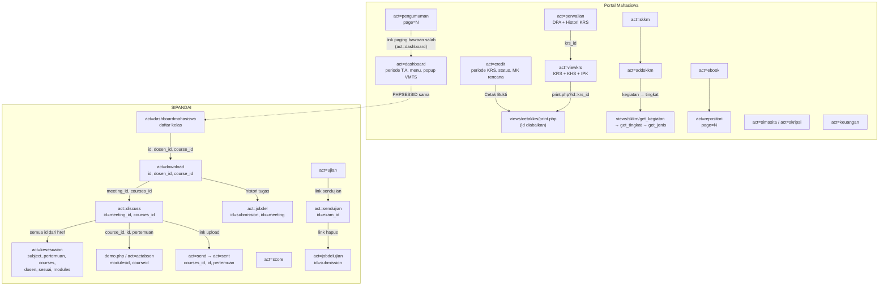
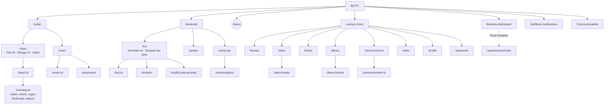

# Peta Fitur Portal Mahasiswa untuk MyCIC

Dokumen ini memetakan semua fitur Portal Mahasiswa resmi (`https://my.cic.ac.id/portal/mahasiswa/`) dan SIPANDAI (`/portal/sipandai/`) yang bisa dijangkau darinya, lalu membandingkannya dengan yang sudah ada di MyCIC. Tujuannya satu: semua fitur portal bisa dipakai lewat MyCIC dengan pengalaman yang lebih cepat, jelas, dan ramah HP. Untuk setiap fitur ada URL dan parameternya, data yang tersedia, aksi, bukti cakupan di kode, rancangan UX, dan resep implementasi.

- **Sumber**: crawl read-only pada **2026-10-20** dengan sesi satu mahasiswa aktif. Semua halaman dibuka lewat `GET`. Tidak ada form yang di-submit, dan tidak ada data yang diubah atau dihapus. Satu-satunya `POST` adalah endpoint AJAX katalog SKKM, yang hanya membaca data.
- **Batasan**: state yang bergantung pada waktu atau kondisi akun belum teramati, misalnya periode pengisian KRS, kuesioner yang sudah diisi, SKKM yang sudah berisi, skripsi aktif, tagihan berjalan, dan ujian yang sedang dibuka. Daftar lengkap dan cara menangkapnya dengan aman ada di [§8](#8-state-yang-belum-teramati--cara-menangkapnya-dengan-aman).
- **Privasi**: semua nilai di dokumen ini adalah placeholder (`<nim>`, `<nama_dosen>`, `<krs_id>`, `<kode_mk>`, `<nilai_huruf>`, ...). Dokumen ini tidak memuat data pribadi.
- **Dokumen terkait**: [portal-flow-map.md](portal-flow-map.md) (alur backend yang sudah ada), [portal-workflow-mapping.md](portal-workflow-mapping.md), [design.md](design.md).

Daftar isi:

- [Ringkasan](#ringkasan)
1. [Peta menu portal](#1-peta-menu-portal)
2. [Matriks cakupan](#2-matriks-cakupan)
3. [Detail per fitur](#3-detail-per-fitur)
   - [3.0 Keputusan lintas fitur](#30-keputusan-lintas-fitur-berlaku-untuk-semua-resep)
   - [3.1 Beranda & Info](#31-beranda--info)
   - [3.2 Akademik](#32-akademik)
   - [3.3 Perkuliahan & LMS](#33-perkuliahan--lms)
   - [3.4 Keuangan](#34-keuangan)
   - [3.5 Kemahasiswaan (SKKM)](#35-kemahasiswaan-skkm)
   - [3.6 Skripsi & Pustaka](#36-skripsi--pustaka)
4. [Arsitektur informasi MyCIC yang diusulkan](#4-arsitektur-informasi-mycic-yang-diusulkan)
5. [Prinsip UX lintas fitur](#5-prinsip-ux-lintas-fitur)
6. [Roadmap bertahap](#6-roadmap-bertahap)
7. [Quirk & bug portal resmi](#7-quirk--bug-portal-resmi)
8. [State yang belum teramati & cara menangkapnya dengan aman](#8-state-yang-belum-teramati--cara-menangkapnya-dengan-aman)
- [Lampiran A: katalog endpoint & dataset baru](#lampiran-a-katalog-endpoint--dataset-baru)
- [Lampiran B: taksonomi SKKM](#lampiran-b-taksonomi-skkm)

---

## Ringkasan

**48 fitur** dipetakan. Asal datanya:

- **30 teramati langsung** di HTML crawl (halaman fitur itu di-GET dan strukturnya dicek). F02 dan F24 hanya sebagian: popup VMTS dan status absen teramati, tetapi alur kirimnya belum diikuti atau berasal dari kode.
- **7 hanya dari link** di halaman crawl; targetnya tidak dipetakan dari crawl: F07, F08, F17, F23, F31, F40, F48.
- **2 dari fixture test dan kode MyCIC**, tidak terlihat saat crawl: F26 (`act=send`/`sent`/`jobdel`) dan F30 (`act=jobdelujian`).
- **2 diduga, belum teramati**: F11 (form pengisian KRS) dan F41 (aksi entri SKKM).
- **3 turunan** dari data fitur lain: F04, F36, F44.
- **3 alur yang hanya dijelaskan lewat pengumuman**: F10 (Her-registrasi/PIN KRS), F18 (EDOM), F19 (Semester Pendek).
- **1 fitur portal yang mati**: F33 (Arsip Kelas).

| Area | Fitur | ✅ ada | 🟡 sebagian | ❌ belum | ➖ tidak berlaku |
|---|---:|---:|---:|---:|---:|
| Beranda & Info | 8 | 2 | 2 | 4 | – |
| Akademik | 11 | – | 1 | 10 | – |
| Perkuliahan & LMS | 14 | 5 | 6 | 2 | 1 |
| Keuangan | 3 | – | 1 | 2 | – |
| Kemahasiswaan (SKKM) | 5 | – | 1 | 4 | – |
| Skripsi & Pustaka | 7 | – | 1 | 6 | – |
| **Total** | **48** | **7** | **12** | **28** | **1** |

Menurut prioritas: **8 P0**, **22 P1**, **17 P2**, dan 1 tanpa prioritas (Arsip Kelas).

Temuan terpenting:

1. **Nilai dan IPK resmi sebenarnya tersedia.** `act=viewkrs` memuat KHS semua semester ditambah ringkasan kumulatif (IPK, SKS terkumpul, sisa SKS, jumlah nilai A–E). SIPANDAI `act=score` menambahkan komponen ABSEN dan TUGAS. Sementara itu dashboard MyCIC selalu menampilkan IPK `–` dengan tooltip menyesatkan "Belum ada nilai yang keluar", karena selector-nya tidak pernah cocok (`DashboardExtractor.php:113`, `:118-150`; `dashboard.blade.php:82-84`, `:95`). Dengan 2–3 GET, MyCIC bisa membangun KHS, transkrip, IPK, progres SKS, dan kesiapan skripsi.
2. **Semua area administratif belum ada di MyCIC**: Pengumuman, Reg & KRS (yang diambil cuma angka SKS), Perwalian/DPA, SIREKA (SKKM), SiMASITA, Repositori skripsi, dan e-Book. Padahal Pengumuman adalah satu-satunya sumber jadwal dan syarat KRS, her-registrasi, Semester Pendek, dan format surat.
3. **Syarat KRS berbentuk rantai yang tersebar di empat tempat**: UKT tahap 1 lunas → isi EDOM → PIN KRS terbit → her-registrasi → isi KRS → validasi DPA → baru nilai semester itu bisa dilihat. Rantai ini bisa disatukan menjadi satu checklist di MyCIC.
4. **Ada bug kritis di MyCIC**:
   - **Proxy unduhan bisa memicu aksi tulis portal.** `GET /api/support/download` menerima URL absolut apa pun di host portal (`SipandaiSubmissionService.php:1575-1599`, `PortalUrlGuard.php:35-50`). Satu link ke proxy ini dengan `path` berisi URL `act=jobdel`, `act=jobdelujian`, `act=kesesuaian`, atau `?mod=logout` membuat server menjalankan GET bertulis itu dengan sesi kampus user (Fase 0.1, K13).
   - Ganti password tidak pernah berhasil dari UI (`auth/password.blade.php:94-101`).
   - Tanggal materi tidak pernah terbaca karena regex case-sensitive (`ClassesExtractor.php:1244`), sehingga target absen di dashboard tidak pernah reliable.
   - Ujian selalu tampak "dibuka" dan bisa di-upload ke id hasil tebakan (`exams/show.blade.php:273`).
   - Email dosen selalu kosong karena obfuscation Cloudflare (`SipandaiClassesExtractor.php:258`).
   - Empat extractor memanggil `Log::` tanpa import.
5. **Tagihan aktif dibuang diam-diam.** Tabel tagihan di `act=keuangan` sebenarnya ikut diambil, tetapi dibuang oleh `FinancialHistoryExtractor::hasPaymentSignal` (`:283-296`). Akibatnya payload `GET /api/dashboard` membawa nilai default `Rp 0` yang palsu (UI belum menampilkan Tagihan).
6. **Konfirmasi kesesuaian materi dan hapus jawaban ujian sudah di-parse, tetapi belum bisa dijalankan.** Href GET kesesuaian, yang punya efek tulis, bahkan sudah ikut terkirim mentah di payload `GET /api/meeting/{meeting_id}`.
7. **SKKM bisa dibuat ramah HP.** Form tambah SKKM berupa multipart dengan katalog bertingkat (5 kegiatan, 13 tingkat). Seluruh katalog bisa dibaca read-only dengan 19 POST AJAX, jadi cocok dijadikan wizard yang bisa dicari.
8. **Portal punya beberapa jebakan**:
   - Link paging pengumuman salah mengarah ke `act=dashboard`.
   - `print.php` mengabaikan `id`.
   - `act` yang tidak dikenal mengembalikan shell kosong ~12 KB dengan status 200.
   - Form SSO menaruh nilai mirip hash kredensial di HTML setiap halaman.
   - Beberapa aksi tulis dijalankan lewat link GET (`kesesuaian`, `jobdel`, `jobdelujian`).

Legenda yang dipakai di seluruh dokumen:

| Simbol | Arti |
|---|---|
| ✅ / 🟡 / ❌ / ➖ | Sudah ada / sebagian / belum ada / tidak berlaku (fitur portal mati) |
| P0 / P1 / P2 | P0 = mendesak atau bug yang memblokir, P1 = nilai tinggi, P2 = pelengkap |
| S / M / L | Kompleksitas: S ≤ 1 hari, M 2–4 hari, L ≥ 1 minggu atau masih menunggu state yang belum teramati |
| B / T | Baca / Tulis (aksi yang mengubah data di portal) |
| `M` / `S` di kolom endpoint | `M` = `/portal/mahasiswa/?mod=student&…`, `S` = `/portal/sipandai/?mod=sipandai&…` |

---

## 1. Peta menu portal

### 1.1 Pohon menu resmi

```
Portal Mahasiswa  /portal/mahasiswa/
├─ Navbar atas
│  ├─ Panduan MyCIC ▾ ─ Panduan Her-registrasi Online   ../files/Panduan_Her-registrasi-KRS_dan_Perwalian.pdf
│  ├─ Setting ▾ ─ Ganti Passowrd (typo)                 ?mod=student&act=password → POST act=passwordact
│  └─ Log out                                           ?mod=logout
├─ Sidebar
│  ├─ Dashboard              act=dashboard     (popup Kuesioner VMTS → POST act=kuesionerform)
│  ├─ Pengumuman             act=pengumuman    (&page=N; link paging bawaan salah ke act=dashboard)
│  ├─ Profil Mahasiswa       act=profile
│  ├─ Jadwal Kuliah          act=course
│  ├─ Reg & KRS Online       act=credit        → views/cetakkrs/print.php (Cetak Bukti KRS)
│  ├─ Perwalian              act=perwalian     → act=viewkrs&id=<krs_id> (KRS + KHS + ringkasan IPK)
│  ├─ [SiPANDAI]             form POST ../sipandai/?mod=login&act=loginact.php (SSO, hidden id/p/who/ak)
│  ├─ SIREKA (SKKM)          act=skkm          → act=addskkm (+ AJAX views/skkm/get_*.php), Pedoman PDF
│  ├─ SiMASITA               act=simasita      (SOP PDF)        [tersembunyi: act=skripsi]
│  ├─ Keuangan               act=keuangan      (tagihan + histori pembayaran)
│  └─ e-Book                 act=ebook         → 5 perpustakaan eksternal + act=repositori&page=N
└─ Halaman tanpa menu: act tak dikenal = shell kosong (khs, transkrip, nilai, krs, edom, cuti, ...; daftar lengkap di §1.3)

SIPANDAI  /portal/sipandai/   (PHPSESSID yang sama, tanpa perlu SSO)
├─ Beranda                   ?mod=sipandai&act=            (kosong; beranda asli act=dashboardmahasiswa)
│  └─ Join Kelas             act=download&id&dosen_id&course_id   (RPS, presensi P.1–P.14, histori tugas, materi)
│     └─ Join Pertemuan N    act=discuss&id&courses_id
│        ├─ Absensi          views/validasi/demo.php → redirect QR / act=actabsen
│        ├─ Upload Tugas     act=send → act=sent ; hapus act=jobdel
│        ├─ Kesesuaian RPS   act=kesesuaian&...&sesuai=ya/tidak   (GET bertulis)
│        └─ Diskusi Kelas    #myForm (popup, field belum diketahui)
├─ Kartu Hasil Studi         act=score  → views/transcripts/print.php
├─ Ujian (UTS/UAS/SP)        act=ujian  → act=sendujian&id → act=sentujian ; hapus act=jobdelujian ; views/ujian/kartuujian.php
├─ Arsip Kelas               href="" (mati)
└─ Logout                    controllers/logout.php

File statis  /portal/files/…   sap/ (RPS), modul/, latihan/, soal/ (soal ujian), tugasmhs/, fotostudent/, skkm/, skripsi/kolokium/, SOP_*.pdf, Panduan_*.pdf
```

### 1.2 Navigasi & rantai id

Halaman detail selalu butuh id yang diambil dari link di halaman sebelumnya. Server tidak boleh membangun id ini dari input klien.



Ringkasan nama parameter. Nama berbeda per endpoint untuk id yang sama:

| Id | dashboardmahasiswa / download | discuss | `validasi/demo.php` (QR) | kesesuaian | actabsen | send / sent | jobdel |
|---|---|---|---|---|---|---|---|
| Kelas/subject | `id` | – | – | `subject` | – | – | – |
| Course | `course_id` | `courses_id` | `course_id` | `courses` | `courseid` | `courses_id` | – |
| Dosen | `dosen_id` | – | – | `dosen` | – | – | – |
| Pertemuan (modul) | – | `id` | `id` | `modules` | `modulesid` | `id` | `idx` |
| Nomor pertemuan | – | – | `pertemuan` (opsional) | `pertemuan` | `pertemuan` (body) | `pertemuan` | `pertemuan` |
| Submission | – | – | – | – | – | – | `id` |

`jobdel` hanya memakai `id`, `idx`, dan `pertemuan` (`config/portal.php:459-471`); `send`/`sent` memakai `courses_id`, `id`, `pertemuan` (`:407-419`, `:433-445`); `demo.php` memakai `id` + `course_id` (`:420-432`).

### 1.3 Act yang di-probe tapi kosong & alternatif MyCIC

Act berikut mengembalikan shell kosong ~12 KB dengan status 200 (Quirk #5). Supaya tujuan "semua fitur" tetap terpenuhi, kebutuhan di baliknya dipenuhi dari sumber lain:

| Act yang di-probe | Kebutuhan mahasiswa | Alternatif di MyCIC |
|---|---|---|
| `khs`, `nilai`, `ipk` | Nilai dan IPK | F15/F16 dari S `act=score` + M `act=viewkrs` |
| `transkrip` | Transkrip | F16 (versi MyCIC) + F17 (`transcripts/print.php`) |
| `krs` | Isi KRS | F09 `act=credit` + detektor F11 |
| `kurikulum` | Peta kurikulum | Turunan kolom `SEMESTER` (semester kurikulum MK) di F09/F14, berlabel "sebagian, dari KRS" |
| `kalender` | Kalender akademik | Agregasi tenggat pengumuman (F03, K3), periode KRS/her-registrasi (F09/F10), jadwal kuliah (F20), ujian (F29), dan tenggat tahap UKT (F36), dengan ekspor `.ics` |
| `jadwalujian` | Jadwal ujian | Kolom "Nama Dosen / Jadwal Ujian" di S `act=ujian` (`schedule_text`, F29) |
| `presensi` | Rekap kehadiran | `AttendanceStrip` F22 + kartu rekap lintas MK (F24) |
| `tagihan`, `pembayaran` | Tagihan dan pembayaran | F34/F35 dari `act=keuangan` |
| `surat` | Surat keterangan/pengantar | F04 (email BAAK dari pengumuman) |
| `edom` | EDOM | F18 (checklist manual + link dari config) |
| `cuti` | Cuti akademik | Pilihan aktif/cuti di her-registrasi (F10); jangan diotomatisasi |
| `kuesioner` | Kuesioner | F02 (popup VMTS di dashboard) |
| `biodata`, `editprofile` | Ubah data diri | F05 read-only + link perbaikan data PDM dari pengumuman |
| `viewskkm`, `editskkm` | Detail/ubah SKKM | F41 (menunggu link aksi teramati) |
| `wisuda`, `yudisium` | Wisuda dan yudisium | Belum ada sumber; kategori pengumuman (F03) + checklist F44 |
| `beasiswa` | Beasiswa | Kategori pengumuman (F03) |
| `pkl`, `magang` | PKL/magang | Surat pengantar magang (F04) + kategori pengumuman |

---

## 2. Matriks cakupan

| Fitur | Menu portal | Endpoint portal | B/T | Status di MyCIC | Prioritas | Kompleksitas |
|---|---|---|---|---|---|---|
| [F01 Dashboard & konteks periode](#f01--dashboard-portal--konteks-periode-akademik) | Dashboard | M `act=dashboard` | B | 🟡 sebagian | P1 | S |
| [F02 Kuesioner VMTS](#f02--kuesioner-pemahaman-vmts) | Dashboard (popup) | M `act=dashboard` → POST `act=kuesionerform` | B/T | ❌ belum | P1 | M |
| [F03 Pengumuman](#f03--pengumuman) | Pengumuman | M `act=pengumuman&page=N` | B | ❌ belum | P0 | M |
| [F04 Permohonan surat BAAK](#f04--permohonan-surat-baak-via-email) | Pengumuman (item format surat) | turunan F03 + `mailto:` | B | ❌ belum | P2 | M |
| [F05 Profil mahasiswa](#f05--profil-mahasiswa) | Profil Mahasiswa | M `act=profile`, `files/fotostudent/*` | B | ✅ ada | P1 | S |
| [F06 Ganti password](#f06--ganti-password-portal) | Setting > Ganti Passowrd | M `act=password` → POST `act=passwordact` | T | 🟡 sebagian (rusak dari UI) | P0 | S |
| [F07 Panduan MyCIC](#f07--panduan-mycic-pdf) | Navbar > Panduan MyCIC | `/portal/files/Panduan_Her-registrasi-KRS_dan_Perwalian.pdf` | B | ❌ belum | P2 | S |
| [F08 Logout](#f08--logout) | Navbar > Log out | M `mod=logout`, S `controllers/logout.php` | T | ✅ ada | P2 | S |
| [F09 Reg & KRS Online: status](#f09--reg--krs-online-periode-status-validasi-mk-rencana) | Reg & KRS Online | M `act=credit` | B | 🟡 sebagian | P0 | M |
| [F10 Her-registrasi & PIN KRS](#f10--her-registrasi-online--pin-krs) | menu PIN her-registrasi (musiman) | belum teramati | B/T | ❌ belum | P1 | M |
| [F11 Pengisian/perbaikan KRS](#f11--pengisian--perbaikan-krs) | Reg & KRS Online (saat periode) | belum teramati | T | ❌ belum | P2 (detektor P0) | L |
| [F12 Cetak bukti KRS](#f12--cetak-bukti-krs) | Reg & KRS > Cetak Bukti | M `views/cetakkrs/print.php` | B | ❌ belum | P1 | S |
| [F13 Perwalian & histori KRS](#f13--perwalian-info-dpa--histori-krs) | Perwalian | M `act=perwalian` | B | ❌ belum | P0 | S |
| [F14 Detail KRS per semester](#f14--detail-krs-per-semester) | Perwalian > Lihat KRS | M `act=viewkrs&id=<krs_id>` | B | ❌ belum | P1 | S |
| [F15 KHS](#f15--kartu-hasil-studi-khs) | SiPANDAI > Kartu Hasil Studi | S `act=score` (+ M `act=viewkrs`) | B | ❌ belum | P0 | M |
| [F16 Transkrip & progres studi](#f16--transkrip--progres-studi) | Perwalian > Lihat KRS (kartu ringkasan) | M `act=viewkrs` + S `act=score` | B | ❌ belum | P0 | M |
| [F17 Cetak transkrip resmi](#f17--cetak-transkrip-resmi) | KHS > Cetak Transkrip | S `views/transcripts/print.php` | B | ❌ belum | P2 | S |
| [F18 EDOM](#f18--edom-evaluasi-dosen-oleh-mahasiswa) | di luar portal (syarat PIN KRS) | belum diketahui | T (manual) | ❌ belum | P2 | S |
| [F19 Semester Pendek](#f19--semester-pendek-sp) | Pengumuman + "Ujian (UTS/UAS/SP)" | turunan F03 + F15 | B | ❌ belum | P2 | M |
| [F20 Jadwal kuliah](#f20--jadwal-kuliah-mingguan) | Jadwal Kuliah | M `act=course` | B | ✅ ada | P2 | S |
| [F21 Daftar kelas & kontak dosen](#f21--sipandai-beranda-daftar-kelas--kontak-dosen) | SiPANDAI > Beranda | S `act=dashboardmahasiswa` | B | 🟡 sebagian | P1 | S |
| [F22 Halaman kelas](#f22--halaman-kelas-join-kelas) | Beranda > Join Kelas | S `act=download&id&dosen_id&course_id` | B | 🟡 sebagian | P0 | M |
| [F23 RPS](#f23--rps-rencana-pembelajaran-semester) | Join Kelas > Open RPS | `/portal/files/sap/<kode_mk>-rps<n>.pdf` | B | 🟡 sebagian | P1 | S |
| [F24 Presensi](#f24--presensi-per-pertemuan) | Join Pertemuan > Absensi | S `views/validasi/demo.php`, `act=actabsen` | T | ✅ ada | P1 | S |
| [F25 Halaman pertemuan](#f25--halaman-pertemuan-join-pertemuan-n) | Join Pertemuan N | S `act=discuss&id&courses_id` | B | ✅ ada | P1 | M |
| [F26 Upload & hapus tugas](#f26--upload--hapus-tugas) | Join Pertemuan > Upload Tugas | S `act=send`, `act=sent`, `act=jobdel` | T | ✅ ada | P2 | S |
| [F27 Konfirmasi kesesuaian materi](#f27--konfirmasi-kesesuaian-materi-dengan-rps) | Join Pertemuan > Kesesuaian | S `act=kesesuaian&…&sesuai=ya/tidak` (GET bertulis) | T | 🟡 sebagian | P1 | M |
| [F28 Diskusi kelas](#f28--diskusi-kelas) | Join Pertemuan > Diskusi Kelas | S `act=discuss` (+ POST belum diketahui) | B/T | ❌ belum | P2 | L |
| [F29 Ujian: daftar & upload](#f29--ujian-utsuassp-daftar-aturan-upload) | SiPANDAI > Ujian (UTS/UAS/SP) | S `act=ujian`, `act=sendujian`, `act=sentujian` | B/T | 🟡 sebagian | P1 | M |
| [F30 Hapus/ganti jawaban ujian](#f30--hapus--ganti-jawaban-ujian) | Ujian > form sendujian | S `act=jobdelujian&id` (GET bertulis) | T | 🟡 sebagian | P1 | M |
| [F31 Kartu ujian](#f31--kartu-ujian) | Ujian > Cetak Kartu Ujian | S `views/ujian/kartuujian.php` | B | ❌ belum | P2 | S |
| [F32 SSO SiPANDAI](#f32--tombol-sso-sipandai) | Sidebar > tombol SiPANDAI | POST S `?mod=login&act=loginact.php` | – | ✅ ada (tidak diperlukan) | P2 | S |
| [F33 Arsip Kelas](#f33--arsip-kelas-fitur-portal-mati) | SiPANDAI > Arsip Kelas | `href=""` (mati) | – | ➖ tidak berlaku | – | – |
| [F34 Tagihan aktif](#f34--informasi-tagihan-keuangan) | Keuangan | M `act=keuangan` (tabel ke-2) | B | ❌ belum | P0 | M |
| [F35 Histori pembayaran](#f35--histori-pembayaran-ukt) | Keuangan | M `act=keuangan` (tabel ke-3) | B | 🟡 sebagian | P1 | M |
| [F36 Status & tenggat keuangan](#f36--status-keuangan-tenggat--syarat-krs) | Pengumuman + Keuangan + KRS | turunan | B | ❌ belum | P1 | M |
| [F37 SKKM: statistik & daftar](#f37--sireka-statistik-poin--daftar-skkm) | SIREKA (SKKM) | M `act=skkm` | B | ❌ belum | P1 | M |
| [F38 Tambah SKKM](#f38--tambah-skkm) | SIREKA > Tambah SKKM | M `act=addskkm` (GET + POST multipart) | T | ❌ belum | P1 | L |
| [F39 Katalog kegiatan SKKM](#f39--katalog-kegiatan-skkm) | Tambah SKKM (dropdown) | M POST `views/skkm/get_*.php` | B | ❌ belum | P1 | M |
| [F40 Pedoman SKKM](#f40--pedoman-skkm) | SIREKA > Pedoman SKKM | `/portal/files/skkm/<file>.pdf` | B | 🟡 sebagian | P2 | S |
| [F41 Aksi entri SKKM](#f41--aksi-per-entri-skkm) | Daftar SKKM > Lampiran/Aksi | belum teramati | B/T | ❌ belum | P2 | M |
| [F42 SiMASITA: syarat & SOP](#f42--simasita-syarat--sop-tugas-akhir) | SiMASITA | M `act=simasita` | B | ❌ belum | P2 | S |
| [F43 Status skripsi](#f43--status-skripsi-actskripsi) | (tersembunyi) | M `act=skripsi` | B | ❌ belum | P2 | S |
| [F44 Kesiapan skripsi](#f44--checklist-kesiapan-skripsi) | (turunan) | `act=simasita` + `act=viewkrs` + `act=keuangan` | B | ❌ belum | P1 | M |
| [F45 e-Book & perpustakaan](#f45--e-book--perpustakaan-digital) | e-Book | M `act=ebook` | B | ❌ belum | P2 | S |
| [F46 Repositori skripsi](#f46--repositori-skripsi) | e-Book > SiMASITA Repositori | M `act=repositori&page=N` | B | ❌ belum | P1 | M |
| [F47 Pencarian repositori](#f47--pencarian--filter-repositori) | Repositori (form kosong) | M POST `act=repositori` (tidak berfungsi) | B | ❌ belum | P1 | M |
| [F48 PDF skripsi & dokumen via proxy](#f48--pdf-skripsi--dokumen-kampus-via-proxy) | Repositori > File Full | `/portal/files/skripsi/kolokium/*.pdf` | B | 🟡 sebagian | P1 | S |

---

## 3. Detail per fitur

Format setiap fitur: **URL & parameter**, **Data**, **Aksi**, **Cakupan MyCIC** (bukti `path:line`, lalu gap), **UX**, **Resep**, dan **Quirk**. Semua path relatif ke root repo.

### 3.0 Keputusan lintas fitur (berlaku untuk semua resep)

Beberapa fitur memakai data atau komponen yang sama. Keputusan di bawah ini menjadi sumber kebenaran dan sudah diterapkan di semua resep pada §3.1–3.6.

| # | Topik | Keputusan |
|---|---|---|
| K1 | **Periode akademik** (T.A + Ganjil/Genap) | Sumber kanonik: `portal_context.academic_period` dari `act=dashboard` `.navbar-header a.navbar-brand`. Fallback berurutan: `act=credit` h4.title → `act=course` card 1 h4.title → SIPANDAI `a.navbar-brand` / judul card "JADWAL KULIAH T.A <ta> SEMESTER <GANJIL\|GENAP>" → `act=ujian` (Th Akademik + Semester). Fitur lain membaca dari `portal_context`, tidak mem-parse sendiri. Boleh cross-check, dan selisihnya cukup dicatat di log. |
| K2 | **Semester ke-N** | Ambil dari portal, jangan dihitung. Urutan sumber: (1) `act=course` card 2 "Semester : <n>", yang sudah diekstrak di `StudentCourseExtractor::extractStudentCourseSemesterInfo` (`StudentCourseExtractor.php:312-328`); (2) SIPANDAI "Daftar Kelas Yang Diikuti Semester : <n>"; (3) `act=ujian` `<b>Semester : <n></b>`; (4) baris "Semester" di `cetakkrs/print.php`; (5) semester numerik tertinggi di Histori KRS (bukan baris bertanggal terbaru, dan bukan `T`; lihat F13). Hitungan dari angkatan hanya jadi fallback dan wajib diberi label "perkiraan", karena hasilnya salah untuk mahasiswa transfer, cuti, atau yang punya KRS semester "T". Diekspos sebagai `portal_context.semester_number` + `semester_source`. |
| K3 | **Tanggal Indonesia** | Satu helper `parseIndonesianDate()` di `PortalScrapingService`, yang menggantikan `AttendanceShortcutService::parsePortalDate` (`:697`). Mendukung `<Hari>, <dd> <Bulan> <yyyy>`, `dd Bulan yyyy`, `dd-mm-yyyy`, `dd/mm/yyyy`, dan rentang `sd` / `s.d.` / `s/d` / `-`. Rentang parsial yang ada di pengumuman juga wajib didukung: `<dd>&nbsp;s/d <dd> <Bulan> <yyyy>` dan `<dd> <Bulan>&nbsp; - <dd> <Bulan> <yyyy>`. Tanggal awal mewarisi bulan dan/atau tahun dari tanggal akhir. Bila hasilnya jatuh setelah tanggal akhir: untuk rentang yang hanya memberi hari awal (`<dd> s/d <dd> <Bulan> <yyyy>`), mundurkan bulan awal satu bulan (dan tahun ikut mundur satu hanya bila bulan melewati Januari); untuk rentang yang memberi bulan awal tanpa tahun, kurangi tahun awal satu. Sertakan kedua kasus (lintas bulan dan lintas tahun) di test K3. Ganti `&nbsp;` (U+00A0) dengan spasi biasa sebelum regex. Regex wajib Unicode dan case-insensitive (`/u`, `/i`). Rentang ini sumber tenggat F03, F10, dan F19. |
| K4 | **Email Cloudflare** (`[data-cfemail]` generik, ditambah fragmen href `/cdn-cgi/l/email-protection#<hex>`) | Jangan bergantung pada tag: di profil, SIPANDAI, `act=credit`, dan `act=perwalian` class `__cf_email__` ada di `<a>`, sedangkan di `act=pengumuman` ada di `<span>` di dalam `a[href^='/cdn-cgi/l/email-protection#']`. Decode dari atribut `data-cfemail`; bila tidak ada, decode dari fragmen href. Pindahkan `ProfileExtractor::decodeCloudflareEmail` (`ProfileExtractor.php:481-495`) menjadi method `protected` di `PortalScrapingService`, ditambah helper `extractCloudflareEmail(Crawler $node): ?string`. Jangan membuat trait di `app/Services/Concerns/`, karena folder itu belum ada dan aturan repo melarang base folder baru tanpa persetujuan. |
| K5 | **Teks berjalan (marquee) portal** | Satu parser `extractPortalNotice(Crawler $scope, string $kind)` di `PortalScrapingService` yang mengembalikan `{text, dates[], is_future, kind}`. Setiap halaman punya marquee berbeda, jadi notice disimpan **per sumber**: <br>• `portal_context.notice` (`kind: payment\|attendance\|general`): marquee yang identik di `act=pengumuman` dan SIPANDAI. Tampil hanya bila ada tanggal `is_future`; untuk `payment`, juga disembunyikan bila tahap terkait sudah lunas (F35). Teks tanpa tanggal ("Pastikan Status Absensi…") cukup jadi hint di kartu absen. <br>• `krs.notice` (`kind: krs_period`): `act=credit` `td[colspan=3] > marquee > font[color=red]`. Dipakai untuk `krs.periods[]` (F09) dan deteksi menu "KRS Online" (F10/F11), bukan banner. <br>• `exams.notice` (`kind: exam`): `act=ujian` `marquee h1 font[color=red]`. Jadi hint statis di `/exam` ("jangan upload di akhir sesi; jam server bisa selisih ±15 menit"). <br>• `skkm.notice` (`kind: skkm`): `act=skkm`/`act=addskkm` `.box-header marquee …`. Jadi alert statis yang bisa ditutup di `/skkm`. <br>• Marquee sambutan SiMASITA (`kind: welcome`): diabaikan. <br>Tidak ada marquee yang dirender sebagai marquee. |
| K6 | **Kontak dosen & DPA** | Satu renderer JS `renderContactSheet()` di `PortalApp` (`resources/js/app.js`, lihat K15), berupa bottom sheet `LecturerContactSheet`, dengan tombol WhatsApp (`wa.me/62…`, angka 0 di depan dinormalisasi), `tel:`, `mailto:`, dan Salin. Dipakai untuk dosen pengampu (F21, F22) dan DPA (F09, F13). Sumber kanonik DPA adalah `act=perwalian` (dataset `advising`); `act=credit` hanya untuk cross-check. |
| K7 | **Proxy file** | Satu route `GET /api/support/download?path=&name=&disposition=inline\|attachment` (default `attachment`). Dipakai untuk panduan, RPS, modul, SOP, pedoman SKKM, PDF skripsi, dan foto profil (`Cache-Control: private`). Halaman HTML cetak (`cetakkrs/print.php`, `transcripts/print.php`, `ujian/kartuujian.php`) memakai satu service baru `PortalPrintPageService`. Service ini mengambil HTML, membuang `<script>`/`onclick`, dan meng-inline aset kop sebagai data URI lewat `PortalUrlGuard`. Proxy file biasa tidak bisa dipakai karena `downloadCampusFile` menolak `text/html` (`SipandaiSubmissionService.php:312-316`). |
| K8 | **Perhitungan akademik** | Satu kelas `app/Services/AcademicProgressCalculator.php` untuk IPS, IPK, proyeksi, simulasi target, dan hitung D/E (dengan dedupe MK yang diulang). `SkripsiReadinessEvaluator` memakai `grades.summary.official` dan kalkulator ini, tidak menghitung sendiri. |
| K9 | **Notifikasi** | Satu mekanisme diff snapshot generik (§4.4). Setiap fitur cukup mendeklarasikan aturan `notify` di dataset-nya. Tidak ada lagi cabang ad-hoc per fitur di `ScanPortalNotificationsJob`. |
| K10 | **Penamaan** | Route web berbahasa Inggris mengikuti `/class`, `/meeting`, `/exam`, `/finance`, `/profile`, `/password`. Akronim yang dikenal mahasiswa (KRS, SKKM) dipertahankan. API akademik dikelompokkan di bawah `/api/academic/*`. Endpoint key memakai snake_case dengan prefix `student_*` untuk mahasiswa; untuk SIPANDAI, prefix `sipandai_*` atau nama domain mengikuti `exam_list`/`assignment_form`. Dataset key memakai nama domain berbahasa Inggris. Tabel lengkap ada di bawah. |
| K11 | **Dashboard** | Satu **Pusat tindakan** untuk semua kewajiban (§4.2), bukan kartu ringkasan terpisah per fitur. Metric 2×2: **IPK** · **SKS lulus** (`sks_terkumpul` dari `grades`) · **SKS semester ini** (total KRS dari `krs`, dengan sub-label "<n> MK") · **Tagihan**. Label "SKS lulus" dan "SKS semester ini" wajib dibedakan. |
| K12 | **Panduan PDF** | Satu sumber: `portal_context.guide_links`, dibaca dari dropdown navbar dashboard. Dipakai oleh menu akun, F09, F10, dan F11. |
| K13 | **Payload aksi** | Href yang punya efek tulis (`kesesuaian`, `jobdel`, `jobdelujian`, hapus SKKM) tidak pernah dikirim ke browser. Server menyimpan payload-nya, dan klien hanya mengirim id + opsi. Scraper dan prefetch tidak boleh mengikuti link ini. Proxy file juga tidak boleh menjadi jalan memutar: `GET /api/support/download` hanya melayani file statis di `/portal/files/` dan menolak URL atau query yang mengarah ke endpoint PHP portal (`mod=`/`act=`), lihat Fase 0.1 dan F48. |
| K14 | **Fixture & privasi** | Semua fixture baru disanitasi: placeholder untuk nama, NIM, dosen, dan MK; `data-cfemail` sintetis; hidden SSO dikosongkan. Fixture yang sekarang masih berisi data asli dibersihkan di Fase 0 (§6). |
| K15 | **Lokasi komponen UI** | Repo tidak punya `resources/views/components` dan tidak memakai `@include`/`<x-…>`. UI dibangun dari dua lapis: (1) render helper JS di class `PortalApp` (`resources/js/app.js`, diekspos sebagai `window.portalApp`, `:2407`), misalnya `renderBadge` (`:2009`), `renderPageHeader` (`:2013`), `renderStatCards` (`:2036`), `renderErrorState` (`:2080`), `mountErrorState` (`:2094`), `renderEmptyState` (`:2121`), `renderKeyValueList` (`:2390`); (2) Blade view per halaman (`resources/views/<domain>/<page>.blade.php`, atau langsung di `resources/views/` seperti `dashboard.blade.php` dan `profile.blade.php`) dengan markup dan script khusus halaman itu. Ikuti pola ini: komponen lintas halaman (`ConfirmBottomSheet`, `LecturerContactSheet`/`renderContactSheet`, `AttendanceStrip`, `NowNextCard`, `ClassCard`, `RpsButton`, `UploadPanel`, `ActionStatusStrip`, `AgendaItem`) menjadi method `render*`/`mount*` baru di `PortalApp`; markup yang hanya dipakai satu halaman tetap di view halaman itu, atau sebagai partial di folder view yang sama bila terlalu panjang. Membuat folder baru seperti `resources/views/components` butuh persetujuan pemilik, sama seperti alasan K4. |
| K16 | **Semester `T`** | `T` adalah KRS **konversi** mahasiswa lanjutan (misalnya D3 → S1): KRS `T` (`act=viewkrs&id=<krs_id_T>`) memuat MK yang diakui, sering dengan kolom Semester kosong, tetapi kartu KHS `Semester : T` di `act=score` dan `act=viewkrs` selalu tanpa baris, dan portal tidak memasukkannya ke SKS Terkumpul maupun Sisa SKS. Aturan: `PortalGradesResolver` membaca KRS `T` dari Histori KRS; SKS MK-nya ditambahkan ke SKS lulus dan dikurangkan dari Sisa SKS (`AcademicProgressCalculator::conversionCredits`, MK yang sudah dinilai di KHS tidak dihitung dua kali). MK konversi tidak punya nilai, jadi tetap di luar IPK, IPS, rata-rata SKS per semester, dan sumber K2. KRS `T` bukan beban studi semester berjalan dan diberi label "Konversi". |

Konvensi nama untuk fitur baru:

| Fitur | Endpoint key | Dataset | API | Web route |
|---|---|---|---|---|
| Konteks portal | `dashboard` (sudah ada) | `portal_context` | `data.portal_context` di `GET /api/dashboard` | `/dashboard` |
| Pusat tindakan | – | – (baca snapshot) | `GET /api/action-items` | `/dashboard` |
| Pengumuman | `student_announcement` | `announcements`, `announcement_page` | `/api/announcement`, `/api/announcement/{id}` | `/announcement`, `/announcement/{id}` |
| Surat BAAK | – | (turunan `announcements`) | `/api/letter/templates` | `/letter` |
| Kuesioner VMTS | `student_questionnaire_form` | – (selalu live) | `/api/questionnaire/vmts` | `/questionnaire/vmts` |
| KRS aktif | `student_credit` | `krs` | `/api/academic/krs` | `/krs` |
| Perwalian/DPA | `student_advising` | `advising` | `/api/academic/advising` | `/krs?tab=riwayat` |
| Detail KRS | `student_krs_detail` | `krs_detail` | `/api/academic/krs/{id}` | `/krs/{id}` |
| Cetak KRS | `student_krs_print` | – | `/api/academic/krs/print/official` | `/krs/print`, `/krs/{id}/print` |
| KHS | `sipandai_score` (+ `student_krs_detail`) | `grades` | `/api/academic/grades` | `/grades` |
| Transkrip | (dari `grades`) | `grades` | `/api/academic/transcript` | `/transcript`, `/transcript/print` |
| Transkrip resmi | `sipandai_transcript_print` | – | `/api/academic/transcript/print/official` | `/transcript/print?source=official` |
| Kartu ujian | `exam_card` | `exam_card` | `/api/exam/card` | `/exam/card` |
| Kesesuaian | `meeting_conformity` | (invalidate `meeting_detail`) | `POST /api/meeting/{meeting_id}/conformity` | `/meeting/{id}#konfirmasi` |
| Hapus jawaban ujian | `exam_submission_delete` | (invalidate `exams`) | `DELETE /api/exam` | `/exam/{id}` |
| Ringkasan keuangan | `student_finance` (sudah ada) | `payments` | `/api/finance/summary` | `/finance` |
| SKKM | `student_skkm`, `student_skkm_*` | `skkm`, `skkm_catalog` | `/api/skkm`, `/api/skkm/options` | `/skkm`, `/skkm/create` |
| Skripsi | `student_simasita`, `student_skripsi` | `thesis` | `/api/thesis`, `/api/thesis/readiness` | `/thesis` |
| Perpustakaan | `student_ebook` | `library` | `/api/library` | `/library` |
| Repositori | `student_repository` | `thesis_repository` | `/api/library/theses` | `/library/theses` |
| Notifikasi | – | – (tabel) | `/api/notifications` | `/notifications` |
| Hub "Lainnya" | – | – | – | `/more` |

> Route `GET /api/academic/krs/{id}` ditulis setelah route `.../krs/print/official` dan diberi `->whereNumber('id')`.
>
> Setiap halaman baru: `@section('page_id', '<sync-key>')`, `cachePolicies` di `resources/js/app.js:48-60`, entri `refreshDomainsForCurrentPage` di `resources/js/app.js:843-857`, dan prefix di `PROTECTED_PAGE_PREFIXES` di `public/sw.js:5`.

---

### 3.1 Beranda & Info

#### F01 · Dashboard portal & konteks periode akademik

🟡 sebagian · P1 · S · Baca

- **URL & parameter**: `GET M act=dashboard`. Parameter `page=N` diabaikan.
- **Data**:
  - `server_date`: `.sidebar .logo a.simple-text`, format `<Hari>, <dd> <Bulan> <yyyy>`.
  - `academic_period`: `.navbar-header a.navbar-brand`, berisi `PORTAL MyCIC T.A <yyyy/yyyy> SEMESTER <GANJIL|GENAP>`. Regex `/T\.A\s+(\d{4}\/\d{4})/` dan `/SEMESTER\s+(GANJIL|GENAP)/i`.
  - `sidebar_menu[]`: `.sidebar .nav > li > a[href]`. Label ada di `<p>`, `act` diambil dari query. Item SiPANDAI berupa `<form>`, bukan `<a>`.
  - `guide_links[]`: `.navbar .dropdown-menu a[href$='.pdf']` (lihat F07).
  - `kuesioner`: lihat F02.
  - **Nama mahasiswa tidak ada di dashboard.** NIM hanya muncul di `input[type=hidden][name=id]` milik form SSO (`form[action*='act=loginact.php']`, bersama `p`, `who`, `ak`). Field-field ini **tidak boleh dibaca, disimpan, atau diekspos**. Identitas resmi diambil dari `act=profile` (F05).
- **Aksi**: buka Panduan PDF (unduh); Setting > Ganti Passowrd (navigasi); Log out (`?mod=logout`); tombol SiPANDAI berupa POST SSO, yang tidak diperlukan karena PHPSESSID yang sama sudah berlaku di SIPANDAI.
- **Cakupan MyCIC**:
  - Bukti:
    - `config/portal.php:11` dan endpoint `dashboard`.
    - `PortalAuthService.php:229-242`: login meng-GET dashboard lalu memanggil `extractUserInfo()`.
    - `PortalAuthService.php:417-433`: `isSessionAlive()` hanya mengembalikan bool. Dipakai oleh `PortalSessionManager.php:187`; `RefreshPortalSessionJob.php:60` memanggil `keepAlive()`.
    - `PortalAuthService.php:456-467`: marker login.
  - Gap:
    - `extractUserInfo()` (`PortalAuthService.php:472+`) mencari `.student-name`, `h1`, `.table tr`, yang semuanya tidak ada, sehingga `campus_user_info` kosong saat login.
    - Periode, tanggal server, panduan, kuesioner, dan daftar menu tidak diekstrak.
    - Belum ada pusat tindakan.
- **UX**:
  - Chip `T.A <yyyy/yyyy> · Ganjil · Semester <n>` di hero `/dashboard` (semester sesuai K2).
  - Kartu **Pusat tindakan** (§4.2).
  - Chip disembunyikan bila data gagal dimuat, karena ini data sekunder.
  - Insight:
    - Deteksi menu sidebar baru (fitur baru di portal, lihat F10/F18).
    - Peringatan "jam perangkat salah" bila tanggal server berbeda dengan tanggal perangkat (penting untuk absen).
    - Notifikasi sekali saat T.A atau semester berganti.
- **Resep**:
  - Dataset `portal_context` `{academic_period, semester_number, semester_source, server_date, guide_links, kuesioner, sidebar_menu, notice}`, `fresh_for 21600`, `cache_keys ['/api/dashboard']`, `sync_keys ['dashboard-overview']`; resource TTL `portal_context` 3600.
  - Extractor `app/Services/Extractors/PortalHomeExtractor.php::extractPortalContextData()`, digabung dengan `classes.semester_info` (K2) oleh `PortalContextResolver`.
  - **"Tanpa request tambahan" baru benar setelah refactor.** `login()` dan `isSessionAlive()` harus menyerahkan HTML dashboard ke `PortalHomeExtractor` atau langsung menulis snapshot `portal_context`. Tanpa refactor itu, setiap sync butuh satu `GET dashboard`.
  - Hapus selector mati di `extractUserInfo`, lalu isi `user_info` dari profil.
  - API: tambahkan `data.portal_context` di `GET /api/dashboard`.
  - Test: fixture `tests/Fixtures/portal/student_dashboard.html` yang sudah disanitasi (hidden SSO dikosongkan), plus `tests/Unit/Extractors/PortalHomeExtractorTest.php`. Kasus yang diuji: T.A/semester, tanggal Indonesia, `guide_links`, popup ada/tidak, menu sidebar, dan halaman login.
- **Quirk**:
  - Label menu typo "Ganti Passowrd".
  - Isi utama dashboard hanya popup VMTS.
  - Toast "welcome notify" kemungkinan berasal dari template; isinya belum diketahui (§8).

#### F02 · Kuesioner Pemahaman VMTS

❌ belum · P1 · M · Baca/Tulis

- **URL & parameter**:
  - Deteksi di `GET M act=dashboard`.
  - Form dibuka lewat `POST M act=kuesionerform` dengan body `vmts=<value tombol>`. Tidak diikuti saat crawl.
- **Data**:
  - Penanda: `div.popup-wrapper#popup > .popup-container > form.popup-form[method=post][action='?mod=student&act=kuesionerform']`.
  - Judul: `form.popup-form > h4 > center`. T.A diambil dengan `/Tahun Akademik\s+(\d{4}\/\d{4})/`.
  - Deskripsi: `h5[align=justify] + p[align=justify]`.
  - Tombol: `input[type=submit][name=vmts]` dengan value `Klik Kuesioner VMTS Tahun Akademik <ta>`.
- **Aksi**:
  - Buka form (POST). Efeknya belum diketahui: bisa hanya merender pertanyaan, bisa juga menandai "mulai mengisi".
  - Kirim jawaban. Action dan nama field belum diketahui.
- **Cakupan MyCIC**:
  - Bukti: tidak ada referensi `kuesioner`/`vmts` di `app/`, `resources/`, `routes/`, maupun `config/`. Tombol "Portal Kampus" (`layouts/app.blade.php:197`) membuka portal tanpa sesi.
  - Gap: mahasiswa yang hanya memakai MyCIC tidak pernah tahu ada kuesioner wajib di awal T.A.
- **UX**:
  - Tahap 1:
    - Item di Pusat tindakan: "Isi Kuesioner VMTS T.A <ta>" dengan badge `Wajib · awal T.A`.
    - CTA membuka sheet "Buka di Portal Kampus (perlu login ulang)".
  - Tahap 2: halaman `/questionnaire/vmts`.
    - Satu pertanyaan per layar, progress bar, dan opsi skala berupa tombol 44px.
    - CTA sticky yang tidak tertutup bottom nav.
    - Ringkasan sebelum kirim.
    - Setelah kirim, verifikasi bahwa popup sudah hilang.
- **Resep**:
  - Tahap 1 menumpang `portal_context.kuesioner`.
  - Tahap 2:
    - Endpoint `student_questionnaire_form` (POST, `required_params ['vmts']`) dan `student_questionnaire_submit` (menunggu capture).
    - Service `app/Services/PortalQuestionnaireService.php` dengan pola `PortalPasswordService`: ambil form, `extractFormMetadata`, submit, lalu GET dashboard untuk verifikasi.
    - Tidak di-cache.
    - Route `GET` dan `POST /api/questionnaire/vmts` (`throttle:portal-action`).
    - Halaman: `Route::view('/questionnaire/vmts', 'questionnaire.vmts')`.
  - Test: deteksi popup ada/tidak, parse T.A, dan (setelah capture) payload dengan nama field asli.
- **Quirk**:
  - Dibuka lewat POST, jadi tidak bisa di-deep-link.
  - Tidak ada indikator selesai/belum.

#### F03 · Pengumuman

❌ belum · **P0** · M · Baca

- **URL & parameter**: `GET M act=pengumuman[&page=N]`. Satu halaman berisi 3 item, page dimulai dari 1. Link paging bawaan portal salah: mengarah ke `act=dashboard&page=N`.
- **Data**:
  - `ticker_text`: `.card .header marquee h4 font b`. Teksnya peringatan pembayaran lama yang tetap tampil, ditangani lewat K5.
  - `items[]`: **hanya baris langsung** `div.table-full-width > table.table > tbody > tr > td[align=justify]`. Isi pengumuman bisa memuat `<table>` bersarang, jadi jangan pakai selector `table tr`.
  - `title`: `h5` pertama di dalam td. Nesting `<b><h5>` tidak valid, sehingga parser bisa memindahkan h5 keluar dari b.
  - `meta_raw`: `'<Hari>, <dd> <Bulan> <yyyy>, Dipublish oleh : <nama_publisher> (<unit>)'`. Turunannya: `published_date` (K3), `publisher_name` (`/Dipublish oleh\s*:\s*(.+?)\s*\(/`), dan `publisher_unit` (isi kurung terakhir, mis. BAAK).
  - `body_html`: sibling setelah `<hr>` pertama, disanitasi dengan allowlist. Simpan juga `body_text`.
  - `links[]`: `a[href]` + URL polos di teks. Link Google Form ditulis sebagai teks, jadi perlu di-linkify.
  - `emails[]`: Cloudflare, diproses lewat K4.
  - `id`: dibuat MyCIC dengan `sha1(title|published_date|publisher_unit|body_text)`, karena portal tidak punya id.
  - `pagination`: `div.paging` berisi teks polos `[ <from>-<to> of <total> ]`. Yang berupa `<a>` hanya `<< Previous` (di halaman >1) dan `Next >>`, keduanya ber-href `?mod=student&act=dashboard&page=N`. Di halaman 1, `<< Previous` hanya teks biasa.
    - `<total>` adalah **jumlah item**, bukan jumlah halaman. `from` = `(page − 1) × 3 + 1` (halaman 1 → 1, halaman 2 → 4), dan `to` selalu sama dengan `from` (bug portal).
    - Rumus: `last_page = ceil(total / 3)`. Rumus ini dipakai untuk mendeteksi halaman terakhir (§8) dan sebagai batas sinkron inkremental.
- **Aksi**: paging (GET); buka tautan eksternal di isi (Google Form SP, perbaikan data PDM, dll.); `mailto:` ke unit.
- **Cakupan MyCIC**:
  - Bukti: tidak ada endpoint, extractor, maupun view. `DashboardExtractor.php:166-167` mencari `.announcement-item` yang tidak pernah cocok, sehingga `recent_activity` selalu `[]`. `ScanPortalNotificationsJob` tidak memindai pengumuman.
  - Gap: jadwal dan syarat KRS, pembayaran, SP, perbaikan data, serta format surat hanya bisa dibaca di portal.
- **UX**: feed `/announcement` dan detail `/announcement/{id}`, kartu "Pengumuman terbaru" (2 item) di Beranda, serta lonceng di header.
  - Bagian atas: search (debounce 250 ms) dan chip kategori yang bisa digeser: Semua, Akademik/KRS, Keuangan, Surat, Kegiatan.
  - Kartu: judul dibatasi 2 baris, meta "tanggal relatif · unit", cuplikan 2 baris, badge `Baru` / `Tenggat <n> hari`. Seluruh kartu bisa diklik (bukan affordance palsu).
  - Ticker tampil sebagai `mycic-alert-warning` yang bisa ditutup, dengan aturan K5 (bukan marquee).
  - Paging: infinite scroll dengan tombol "Muat lagi" sebagai fallback.
  - Detail: heading `h1` di isi diturunkan ke `h3`. Tombol aksi hasil ekstraksi (Buka formulir, Kirim email, Tambah ke kalender) ditaruh di `mycic-sticky-action`. Di md+, tampilan master-detail 5/7.
  - Insight:
    - Kategori otomatis dari kata kunci.
    - Ekstraksi tenggat (`s/d`, `paling lambat`, dd/mm/yyyy) menjadi countdown dan file `.ics`.
    - Langkah bernomor diubah jadi checklist (mis. 8 tahap her-registrasi untuk F10).
    - Penanda duplikat (judul sama, penerbit beda).
  - States: skeleton 3 kartu; cache-first lewat `primeCachedView`; `mountErrorState` + "Coba lagi"; kosong "Belum ada pengumuman"; offline menampilkan halaman yang tersimpan.
- **Resep**:
  - Endpoint `student_announcement`.
  - Extractor `app/Services/Extractors/AnnouncementExtractor.php::extractAnnouncementData(string $sessionToken, int $page = 1)`: sanitasi allowlist, linkify, Cloudflare (K4), parse `div.paging`, dan **tulis ulang href `act=dashboard` → `act=pengumuman`**.
  - Dataset:
    - `announcements` (halaman 1): `fresh_for 1800`, `cache_keys ['/api/announcement']`, `sync_keys ['announcement-index']`.
    - `announcement_page`: `parameterized`, `fresh_for 86400`.
    - Resource TTL 900.
  - Sinkron inkremental: baca dari halaman 1 sampai bertemu id yang sudah dikenal, dengan batas `last_page = ceil(total / 3)`. Bila `total` sama dengan snapshot dan id pertama tidak berubah, berhenti di halaman 1.
  - Status baca disimpan per pemilik lewat notification center (§4.4) atau tabel `announcement_reads (owner_hash, announcement_id, read_at)`.
  - API: `GET /api/announcement?page=N`, `GET /api/announcement/{id}` (di-resolve dari snapshot), `POST /api/announcement/read {ids[]}`.
  - Web: `Route::view('/announcement', 'announcements.index')`, `/announcement/{id}`.
  - Test: fixture `pengumuman.html` dan `pengumuman_p2.html` yang disanitasi (penerbit, email, dan link form diganti placeholder; tabel bersarang dan `span.__cf_email__` tetap ada). Kasus:
    - 3 item per halaman (tabel bersarang tidak menambah item).
    - Tanggal, unit, decode email, linkify.
    - Paging dan rewrite href.
    - Halaman terakhir, daftar kosong, halaman login.
- **Quirk**:
  - Link paging salah.
  - Teks paging salah hitung (`from` = `to`); hanya `from` dan `total` yang bisa dipakai.
  - Tidak ada id maupun halaman detail.
  - Email di-obfuscate Cloudflare; URL ditulis polos.
  - Isi memuat tabel bersarang dan `h1`.
  - Ada pengumuman duplikat.
  - Marquee kedaluwarsa tetap tampil di setiap halaman.

#### F04 · Permohonan surat BAAK via email

❌ belum · P2 · M · Baca (+ `mailto:`)

- **Sumber**: item pengumuman "Surat Pengantar Observasi atau Magang" dan "Format Surat Keterangan Masih Kuliah". Saat crawl, item ini ada di halaman 2; posisinya bisa bergeser.
- **Data**:
  - `letter_type`: `pengantar_observasi_magang` | `keterangan_kuliah`.
  - `recipient_email`: email Cloudflare di isi (jangan di-hardcode).
  - Field pengantar: NIM, NAMA, JURUSAN/PRODI, SEMESTER, MATA KULIAH, NAMA dan ALAMAT TUJUAN SURAT.
  - Field keterangan kuliah:
    - Data mahasiswa: NIM, NAMA, JURUSAN/PRODI, SEMESTER, STATUS MAHASISWA (Reguler/KIP/Karyawan).
    - Data wali: NAMA, NIP, GOLONGAN, JABATAN, INSTANSI.
  - Instruksi pengambilan dokumen asli di BAAK setelah email dibalas.
- **Aksi**: mahasiswa mengirim email sendiri, BAAK membalas, lalu dokumen diambil di BAAK.
- **Cakupan MyCIC**: belum ada. Data prasyarat sudah tersedia di profil (`ProfileExtractor.php:55-108`).
- **UX**: wizard `/letter`.
  1. Pilih jenis surat lewat dua tile besar.
  2. Form: field profil terisi otomatis dan terkunci (semester sesuai K2); field status mahasiswa memakai segmented control; data wali **hanya diproses di klien**.
  3. Pratinjau email, tombol "Buka aplikasi email" (`mailto:` dengan subject dan body terisi), dan tombol "Salin teks".
  - Riwayat lokal: Terkirim → Dibalas → Diambil.
  - Bila email penerima tidak ditemukan, tampilkan "Salin" saja.
- **Resep**:
  - `app/Services/PortalLetterTemplateResolver.php`: cari item pengumuman lewat kata kunci, ambil email (sudah di-decode) dan daftar field. Bila tidak ketemu, pakai fallback `config('portal.letters')` dan tampilkan peringatan "format mungkin berubah".
  - API `GET /api/letter/templates`; web `Route::view('/letter', 'letters.index')`.
  - Tanpa endpoint baru.
- **Quirk**:
  - Format surat bisa diganti lewat pengumuman "Perubahan Format …".
  - Email penerima hanya tersedia dalam bentuk ter-encode.

#### F05 · Profil mahasiswa

✅ ada · P1 · S · Baca

- **URL & parameter**: `GET M act=profile`. Foto dari `../files/fotostudent/<file>`; `nopic.gif` berarti tidak ada foto.
- **Data**: tiga tabel `label | : | value`. Label duplikat dibedakan lewat indeks tabel.
  - "Data Profil Mahasiswa": Program Studi, Angkatan, NIM, Nama, Status, Tempat Lahir, Tanggal Lahir, Jenis Kelamin.
  - "Data Kontak Mahasiswa": Alamat Rumah, Kota, Propinsi, Kodepos, Telp, HP, `Alamat Email ` (ada spasi di akhir; nilainya `a.__cf_email__`).
  - "Data Pendidikan Mahasiswa": NISN, Tingkat Pendidikan, Asal Sekolah, Alamat, Kota, Propinsi, Negara, Telp.
- **Aksi**: read-only. Profil di portal tidak bisa diedit (probe `act=editprofile`/`biodata` mengembalikan shell kosong). Perbaikan data diajukan lewat Google Form dari pengumuman PDM.
- **Cakupan MyCIC**:
  - Bukti:
    - Config: `config/portal.php:12`, dataset `profile` `fresh_for 3600`.
    - Extractor: `ProfileExtractor.php:18-50`, `:55-108`, `:113-172` (decode Cloudflare di `:481-495`), `:177-232`, `:500-523`.
    - API: `PortalDataController.php:84-94`.
    - UI: `resources/views/profile.blade.php`.
    - Test: `tests/Unit/Extractors/ProfileExtractorTest.php`, `ProfileExtractorEmailTest.php`.
  - Gap:
    - `Log::warning` dipanggil tanpa import (`:104`, `:168`, `:228`, `:531`).
    - `user_info` selalu `[]` (`PortalDataController.php:90`).
    - Foto dimuat langsung dari domain kampus (`profile.blade.php:221`).
    - Negara dan telp sekolah tidak ditampilkan (`:210-217`).
    - Status default `Aktif` (`profile.blade.php:187`).
    - Error hanya muncul sebagai toast (`:261-263`).
    - Belum ada jalur perbaikan data.
- **UX**:
  - Pertahankan hero dan 3 kartu.
  - Tambahkan meter "Kelengkapan data <x>%" dan chip semester (K2).
  - Tombol salin NIM **sudah ada** (`#copy-nim-btn` + `copyToClipboard`, `profile.blade.php:139-160`); tambahkan salin email dan HP.
  - Badge status tanpa nilai default palsu.
  - Foto lewat proxy (K7), fallback ke inisial.
  - Footer "Data salah? Ajukan perbaikan" yang membuka pengumuman PDM.
  - Ganti toast error dengan `mountErrorState`.
- **Resep**:
  - Tanpa endpoint baru. Foto lewat `/api/support/download?path=<photo_path>&disposition=inline`, dengan `photo_path` dari payload server. `downloadCampusFile` sudah menerima `files/` (`SipandaiSubmissionService.php:296-323`).
  - Tambahkan import `Log` dan isi `user_info`.
  - Test: jalur exception tidak melempar Error; nopic menghasilkan `null`; label duplikat terpetakan per blok.
- **Quirk**:
  - Label `Alamat Email ` punya spasi di akhir.
  - Label yang benar-benar ganda hanya Kota, Propinsi, dan Telp (blok Kontak dan blok Pendidikan).
  - Label `Alamat Rumah` (Kontak), `Alamat Email ` (Kontak), dan `Alamat` (Pendidikan) berbeda, tetapi akan saling bertabrakan bila dicocokkan dengan `str_contains('alamat')`. Cocokkan label eksak per blok, seperti `switch` di `ProfileExtractor.php:142`, `:160`, `:208`.

#### F06 · Ganti password portal

🟡 sebagian (**rusak dari UI**) · **P0** · S · Tulis

- **URL & parameter**:
  - Form: `GET M act=password`.
  - Submit: `POST M act=passwordact` dengan `data[passwordold]`, `data[password]`, `data[konfirm]` (urlencoded). Tombol "Ubah" tidak punya `name`.
- **Data**:
  - Header `.card .header h4.title` berisi peringatan "masih menggunakan Password menggunakan NIM". **Header ini statis**: header tetap tampil terlepas dari password yang dipakai, jadi tidak bisa dipakai sebagai sinyal.
  - Instruksi di `th[colspan=3]`.
  - Field: `input[type=password][maxlength=30]` × 3.
  - `<form>` ditaruh di dalam `<table>`, sehingga di DOM HTML5 form-nya kosong dan input berada di luar form.
- **Aksi**: mengganti password portal (juga berlaku di SiPANDAI). Kredensial relogin yang tersimpan di MyCIC menjadi usang.
- **Cakupan MyCIC**:
  - Bukti:
    - Config: `config/portal.php:13-14` dan endpoint `password_form`/`password_submit`.
    - Service: `PortalPasswordService.php:43-75`, `:77-97` (memilih form `passwordact` dan melewati form SSO), `:143-185` (fallback nama field).
    - Request: `PortalPasswordChangeRequest.php:17-33`.
    - Controller: `PortalAuthController.php:229-296`; `:276` menghapus kredensial tersimpan.
    - Route: `routes/web.php:53`.
  - Gap:
    - **Kritis**: `auth/password.blade.php:94-101` mengirim opsi `body`, padahal `app.request` hanya mengirim `options.json`/`options.formData` (`resources/js/app.js:522-529`). Akibatnya selalu 422 "Password lama wajib diisi."
    - Pada struktur asli, `extractFormMetadata` (`PortalPasswordService.php:102-132`) mendapat 0 field. Submit hanya selamat berkat fallback; fixture test memakai form yang "rapi".
    - Penentuan hasil memakai heuristik kata kunci (`:244-306`).
    - Validasi `max:255`, padahal portal `maxlength=30`.
    - Setelah sukses, kredensial dihapus (bukan diperbarui), sehingga auto-relogin diam-diam berhenti.
    - Status strip tetap memicu refresh `dashboard` (`app.js:843-857`).
- **UX**:
  - Kartu `max-w-lg` dengan alert keamanan yang memakai **deteksi MyCIC sendiri**. Saat login, server membandingkan password dengan username dan **hanya menyimpan flag boolean** `session('campus_password_is_nim')`. Nilai password tidak pernah disimpan maupun dicatat di log.
  - Field dengan `autocomplete` (`current-password`/`new-password`), `maxlength=30`, toggle tampil, strength meter, dan checklist (beda dari NIM, beda dari password lama).
  - Error inline di bawah field (`aria-describedby`).
  - CTA sticky; layar sukses "Password portal & SiPANDAI sudah diganti".
  - `@section('hide_status_strip','1')`.
  - Bila flag NIM aktif, tambahkan item "Ganti password default" di Pusat tindakan.
- **Resep**:
  - Ganti `body` menjadi `json: {current_password, new_password, new_password_confirmation}`.
  - Di `PortalPasswordService`:
    - Deteksi `alert('…')` dengan regex sebelum heuristik, dan abaikan isi `<script>` lain.
    - Baca `maxlength` dari form.
    - Verifikasi dengan login uji stateless (CookieJar terpisah) memakai password baru. Bila sukses, **perbarui** kredensial terenkripsi.
  - `PortalPasswordChangeRequest`: `max:30`.
  - Test:
    - Fixture struktur asli (`<table><form></form><tr>…input…`) tetap mengirim ketiga field.
    - `alert('…berhasil…')` dianggap sukses.
    - `postJson` sukses; input >30 karakter menghasilkan 422.
    - `php artisan test --filter=Password`.
- **Quirk**:
  - Menu bertuliskan "Passowrd".
  - Form diletakkan di dalam tabel.
  - Header NIM statis.
  - Tidak ada aturan kekuatan password yang terlihat.

#### F07 · Panduan MyCIC (PDF)

❌ belum · P2 · S · Baca

- **URL & parameter**: `GET /portal/files/Panduan_Her-registrasi-KRS_dan_Perwalian.pdf` (href relatif `../files/…`).
- **Data**: `li.dropdown (Panduan MyCIC) > ul.dropdown-menu > li > a[href$='.pdf']`, didahului `li.divider` kosong.
- **Cakupan MyCIC**:
  - Bukti: menu akun hanya berisi Profil, Ubah Password, Portal Kampus, dan Keluar (`layouts/app.blade.php:190-200`). Proxy `GET /api/support/download` (`routes/api.php:73`, `PortalSupportController.php:162-188`) sudah menerima `files/` (`SipandaiSubmissionService.php:1587-1596`).
  - Gap: `Content-Disposition` selalu `attachment` (`PortalSupportController.php:179`), jadi PDF tidak bisa dibaca inline di HP.
- **UX**:
  - Item "Bantuan & Panduan" di `/more` dan menu akun: ikon dokumen, judul, tombol "Buka" (inline) dan "Unduh".
  - Kartu kontekstual "Bingung isi KRS? Baca panduan" di `/krs` selama periode KRS.
  - Badge "Baru" bila dropdown portal menambah PDF.
- **Resep**: `portal_context.guide_links` (K12), ditambah parameter `disposition=inline` di `PortalFileDownloadRequest` dan controller (K7). Test: `Content-Disposition: inline` bila diminta, `attachment` sebagai default, 422 untuk nilai lain.

#### F08 · Logout

✅ ada · P2 · S · Tulis

- **URL & parameter**: `GET M mod=logout` dan `GET S controllers/logout.php`.
- **Cakupan MyCIC**:
  - Bukti:
    - Config: `config/portal.php:10` dan endpoint `student_logout`/`sipandai_logout`.
    - Service: `PortalAuthService.php:438-454` (best-effort ke kedua endpoint).
    - Route: `routes/api.php:28`.
    - UI: tombol `[data-logout]` di `layouts/app.blade.php:199`; handler di `app.js:699-729`; `clearOfflineData` di `app.js:1230-1234`.
  - Gap:
    - Hanya bisa diakses dari dropdown avatar.
    - Tidak ada konfirmasi bila masih ada upload berjalan (`sessionStorage 'mycic-active-operations'`).
    - Cache halaman `mycic-v3` tidak ikut dibersihkan untuk halaman yang tidak terdaftar di `sw.js:5`.
- **UX**:
  - Bottom sheet "Akun" di mobile berisi identitas, Profil, Ubah Password, Panduan, Portal Kampus, dan tombol destruktif "Keluar" di paling bawah.
  - Dialog "Upload sedang berjalan, tetap keluar?" bila ada operasi aktif.
- **Resep**: tanpa backend baru. Tambahkan `BladePagesTest` untuk memastikan `[data-logout]` bisa dijangkau di layout mobile.
- **Quirk**: logout portal mahasiswa dan SIPANDAI terpisah walaupun berbagi PHPSESSID.

---

### 3.2 Akademik

> **Aturan lintas fitur dari pengumuman her-registrasi:** "Jika belum divalidasi DPA maka mahasiswa tidak dapat melihat nilai di semester tersebut." Status validasi KRS (F09) harus menjelaskan kenapa KHS semester berjalan kosong (F15), dan F15 harus menautkan balik ke F09.

#### F09 · Reg & KRS Online: periode, status validasi, MK rencana

🟡 sebagian · **P0** · M · Baca

- **URL & parameter**: `GET M act=credit`. Tanpa id; selalu menampilkan KRS untuk T.A aktif.
- **Data**:
  - `term`: h4.title pertama, `Layanan Pengisian Kartu Rencana Studi (KRS Online) T.A <yyyy/yyyy> Semester <GANJIL|GENAP>`.
  - `period.start/end`:
    - Sumber utama: baris `Periode KRS dan Perwalian Online | : | b`, berisi `'<Hari>, <dd> <Bulan> <yyyy> sd <Hari>, <dd> <Bulan> <yyyy>'`. Split pada ` sd `, lalu parse dengan K3.
    - Duplikat di `center h4.title` (`s.d.`) dan di marquee.
  - `periods[]`: ada **dua periode berbeda** yang tidak boleh disamakan.
    - `perwalian_perbaikan`: periode "Perwalian … dan Perbaikan KRS" di `act=credit` (baris tabel di atas dan marquee `td[colspan=3] > marquee > font[color=red]`). Rentangnya panjang.
    - `her_registrasi`: jendela "Pengisian Her-Registrasi dan KRS" dari pengumuman (F03), biasanya berformat `dd s/d dd Bulan yyyy` (rentang parsial K3). Rentangnya jauh lebih pendek.
    - Bentuk: `krs.periods[] {kind: her_registrasi|perwalian_perbaikan, start, end, source: credit|announcement, source_ref}`. `period.start/end` lama dipertahankan sebagai alias `perwalian_perbaikan` supaya kompatibel.
  - Identitas `label | : | value` (Fakultas, Program Studi, Th Akademik, `N I M` dengan huruf berspasi, Nama). Normalisasi label dengan menghapus spasi dan mengubah ke lowercase.
  - DPA: `Nama Dosen DPA`, `No Tlp/WA DPA`, `Email DPA` (cfemail). Hanya untuk cross-check; sumber kanonik ada di F13 (K6).
  - `krs_status`:
    - Lokasi: baris `Status KRS Online`. td2 berisi `a[href='views/cetakkrs/print.php']` lalu `span.blink`. Span itu memuat **dua** `b > i > font`: yang pertama teks status, yang kedua `<nama_dosen>` DPA ("Segera hubungi Dosen Pembimbing Akademik <nama_dosen> …").
    - `raw_text` = teks node `b > i > font` **pertama** saja. Jangan simpan seluruh teks span, karena memuat nama DPA.
    - `code`: `pending_dpa` hanya bila teks cocok dengan `/belum\s+(di)?validasi|segera\s+menghubungi\s+dosen\s+dpa/i`; `validated` bila cocok `/sudah\s+divalidasi/i`; teks "belum" lainnya (misalnya belum mengisi/mengajukan KRS) menjadi `not_submitted`; sisanya `unknown`. Jangan memakai kata "belum" saja (jebakan yang sama dengan SKKM "Belum Memenuhi"). Teks aslinya tetap ditampilkan bila `unknown`.
  - `planned_courses[]`:
    - Lokasi: card `DAFTAR MATA KULIAH YANG DIRENCANAKAN (KRS)`. Header `tr[bgcolor='#c8c1bd'] td>b`: `NO. | KODE | NAMA MATA KULIAH | SKS | SEMESTER`.
    - Format SKS: `<n> . SKS`.
    - Kolom `SEMESTER` (`Semester. <n>`) adalah **semester kurikulum MK**, bukan semester mahasiswa.
  - `totals`: `Total Mata Kuliah Yang Diambil` (`<n> Matakuliah`) dan `Total SKS` (`<n> SKS`).
  - `notice_text`: `td[colspan=3] > center > b`.
  - `notice` (K5, `kind: krs_period`): marquee `td[colspan=3] > marquee > font[color=red]`. Teksnya menyuruh mahasiswa "click menu KRS Online", jadi kemungkinan ada menu "KRS Online" terpisah yang muncul saat jendela pengisian (detektor F10/F11).
- **Aksi**: cetak bukti (F12; ada `confirm()` di browser); unduh panduan (F07); email DPA.
- **Cakupan MyCIC**:
  - Bukti:
    - Hanya ada URL flat `student_credit_url` di `config/portal.php:16` dan `:55`. URL ini tidak ada di `endpoints`, jadi tidak muncul di `/api/metadata/endpoints`.
    - `DashboardExtractor::resolveTotalCredits` (`:329-354`) dipanggil di `:67`. Method itu memanggil `resolveTotalCreditsFromCreditPage` (`:356-374`) di `:353`, **hanya sebagai fallback terakhir** ketika SKS dari kelas SIPANDAI dan overview sama-sama 0. URL diambil dari `config('portal.student_credit_url')` di `:360`.
    - `extractCreditPageTotal` (`:396-460`) menebak angka dengan heuristik.
    - Belum ada route, nav, maupun dataset.
  - Gap:
    - Periode, status, DPA, dan MK rencana tidak diekstrak.
    - Metric "SKS" di dashboard ambigu.
- **UX**: `/krs`, tab **Semester ini**.
  - Header "KRS <T.A> <Ganjil/Genap>" dengan chip status.
  - Tracker (vertikal di 320px, horizontal di md+): Periode dibuka → KRS diajukan → Menunggu validasi DPA → Tervalidasi → Kelas tersedia di SIPANDAI.
  - Kartu countdown "Sisa <n> hari · tutup <hari, tgl>", memakai periode yang relevan dengan langkah yang belum selesai: `her_registrasi` sebelum KRS diajukan, `perwalian_perbaikan` untuk validasi DPA dan perbaikan. Bila periode `her_registrasi` tidak ditemukan di pengumuman, tampilkan hanya `perwalian_perbaikan` dengan label sumbernya.
  - Kartu DPA (K6).
  - Daftar MK (`mycic-list-row`): kode kecil, nama, badge SKS, dan badge "MK smt <n>" bila semester kurikulumnya berbeda.
  - Ringkasan sticky "<n> MK · <n> SKS" dengan tombol "Cetak bukti" (tidak tertutup bottom nav). Di lg, grid 8/4.
  - States:
    - Di luar periode: "Periode KRS sudah ditutup <tgl>".
    - Belum ada MK: empty state dengan link panduan.
    - Status `unknown`: tampilkan teks portal apa adanya.
- **Insight**:
  - Sisa hari periode.
  - "Kelas sudah tersedia di SIPANDAI", dengan mencocokkan kode MK dengan dataset `classes`.
  - Komposisi SKS per semester kurikulum.
- **Notifikasi**:
  - Pengingat H-7/H-3/H-1 sebelum `end` dari periode yang relevan (aturan yang sama dengan countdown): `her_registrasi` selama KRS belum diajukan, `perwalian_perbaikan` selama belum `validated`.
  - Diff `raw_text` status, misalnya "KRS sudah divalidasi DPA".
  - Item di Pusat tindakan: "KRS belum divalidasi · <n> hari lagi", dengan tombol WA DPA.
- **Resep**:
  - Endpoint `student_credit`. Ganti `config('portal.student_credit_url')` di `DashboardExtractor.php:360` dengan `PortalEndpointRegistry::url('student_credit')`.
  - Extractor `app/Services/Extractors/KrsExtractor.php::extractCurrentKrsData()`, dengan **detektor form F11 ikut dirilis**.
  - Resolver `app/Services/PortalKrsResolver.php` menggabungkan `credit` + `advising` (krs_id aktif) + `classes` menjadi `status_tracker`, dan menyusun `periods[]` dari `credit` + `announcements` (item berjudul `/her.?registrasi/i`).
  - Dataset `krs`: `fresh_for 900` (21600 di luar periode), `cache_keys ['/api/academic/krs', '/api/dashboard']`, `sync_keys ['krs-index', 'dashboard-overview']`. Resource `krs_current` 900.
  - `DashboardExtractor` membaca "SKS semester ini" dari dataset ini, bukan lagi dari heuristik.
  - API: `GET /api/academic/krs`. Web: `Route::view('/krs', 'academic.krs')->name('academic.krs')`.
  - Nav "Akademik" (§4.1).
  - Test: fixture `student_credit.html` yang disanitasi; `KrsExtractorTest` mencakup:
    - Periode dalam format ISO, label `N I M`, decode cfemail.
    - `<n> . SKS` menjadi `<n>`, `Semester. <n>` menjadi `<n>`.
    - Total; status `pending_dpa` dan `validated` dari varian teks sintetis.
    - `raw_text` hanya node status pertama (nama DPA di node kedua tidak ikut).
    - `periods[]`: dua kind terpisah; rentang parsial dari pengumuman (K3).
    - Shell kosong menghasilkan `found=false`; halaman login melempar exception.
- **Quirk**:
  - Status hanya berupa teks bebas di `span.blink`.
  - Email DPA di-obfuscate Cloudflare; nomor WA berupa teks polos.
  - Tombol cetak tetap tampil walaupun KRS belum divalidasi.
  - Periode ditulis tiga kali dengan format berbeda.
  - Satu KRS bisa berisi MK lintas semester kurikulum.
  - Peringatan "KRS tidak akan masuk e-learning bila tidak divalidasi" tidak selalu sesuai data: kelas SIPANDAI bisa sudah muncul sebelum KRS divalidasi.

#### F10 · Her-registrasi online & PIN KRS

❌ belum · P1 · M · Baca/Tulis · *fitur dari pengumuman, belum teramati langsung*

- **Sumber**: pengumuman "Pengisian Her-Registrasi dan KRS" berisi langkah:
  1. Lunasi UKT tahap 1 tahun berjalan dan dapatkan kwitansi dari Keuangan.
  2. Isi EDOM.
  3. PIN KRS dibuat oleh Keuangan berdasarkan langkah 1 dan 2.
  4. PIN muncul di "menu PIN her registrasi".
  5. Her-registrasi: perbaikan data diri, lalu memilih status aktif/cuti.
  6. Konsultasi MK tawar dengan DPA.
  7. Isi KRS dan minta validasi DPA.
  8. Bila belum divalidasi, nilai semester itu tidak bisa dilihat.

  `act=credit` juga menyebut "Periode Her-registrasi".
- **Data**: belum ada. Menu PIN tidak terlihat di sidebar saat crawl karena di luar jendela her-registrasi. Probe `act=cuti` mengembalikan shell kosong.
- **Aksi**: memilih status aktif/cuti adalah **aksi tulis**, jadi jangan pernah diotomatisasi sebelum alurnya teramati.
- **Cakupan MyCIC**: belum ada.
- **UX**: checklist **"Siap KRS"** di `/krs` dan di Pusat tindakan. Setiap langkah diberi label sumber (otomatis/manual):
  - UKT tahap 1 lunas (otomatis, F35).
  - EDOM sudah diisi (manual, F18).
  - PIN terbit (otomatis: menu terdeteksi).
  - Her-registrasi selesai.
  - KRS diajukan (F09).
  - Tervalidasi DPA (F09).
- **Resep**:
  - Detektor GET-only: setiap sync `portal_context`, bandingkan `sidebar_menu[]` dengan baseline (kunci = `act` + label yang dinormalisasi). Item **baru** yang labelnya cocok `/PIN|her.?regis|KRS\s*Online/i` disimpan strukturnya (label, act), lalu halamannya di-GET sekali dalam **mode capture struktur** (§8). Jangan submit apa pun.
    - `KRS\s*Online` ditambahkan karena marquee `act=credit` menyuruh "click menu KRS Online" (F09). Item lama "Reg & KRS Online" sudah ada di baseline, jadi hanya item yang benar-benar baru yang dicocokkan.
  - Endpoint `student_her_registration` didaftarkan setelah capture.
  - Resolver checklist: `app/Services/PortalKrsReadinessResolver.php`.
- **State belum teramati**: menu dan halaman PIN, halaman her-registrasi, serta pilihan aktif/cuti.

#### F11 · Pengisian / perbaikan KRS

❌ belum · P2 (detektor tahap 1: **P0**, ikut F09) · L · Tulis

- **URL & parameter**: diduga form di `act=credit` saat periode dibuka dan KRS belum diajukan. Probe `act=krs` mengembalikan shell kosong. Nama action dan field belum diketahui.
- **Data**: `offered_courses[]` dan `max_sks` diduga ada tetapi belum teramati. Di `act=viewkrs` ada input hidden per MK, `txt_id` (`<krs_detail_id>`) dan `txt_creditid` (`<krs_id>`); kemungkinan dipakai untuk ubah/hapus MK.
- **Aksi**: tambah MK, hapus MK, simpan/ajukan KRS. Semua berisiko secara akademik.
- **Cakupan MyCIC**:
  - Belum ada.
  - Pola yang bisa dipakai ulang: `SipandaiSubmissionService::extractFormMetadata` (`:1674`), alur write + verify + operation tracker (`ProcessPortalAssignmentUploadJob`).
- **UX**: wizard `/krs/fill` (`academic.krs.fill`).
  1. Pilih MK: filter semester kurikulum, peringatan bentrok jadwal, counter sticky "x / max SKS".
  2. Tinjau.
  3. Ajukan lewat modal konfirmasi eksplisit, lalu operation tracker, lalu verifikasi GET ulang `act=credit` + `act=perwalian`.

  Setelah sukses, arahkan ke tracker "Menunggu validasi DPA" dengan tombol WA DPA. Rekomendasikan MK ulang (nilai ≤ C dari F15).
- **Resep**:
  - **Tahap 1 (sekarang, GET-only)**: di `KrsExtractor`, cari `<form>`, checkbox/radio, select, atau tombol submit **hanya di dalam `.main-panel .content`**, dan kecualikan form SSO `form[action*="loginact.php"]` beserta isinya. Bila ada, set `registration_open=true` dan simpan metadata form (action, method, nama field, jumlah opsi) dengan nilai di-redact. Tidak ada submit.
    - Alasannya: halaman live **selalu** memuat form SSO di sidebar (`form[action*="loginact.php"]` dengan hidden `id/p/who/ak` dan `input[type=submit][value=SiPANDAI]`). Detektor yang memindai seluruh dokumen akan selalu bernilai `true` (false positive permanen). HTML crawl sudah membuang sidebar, jadi fixture dari crawl saja tidak cukup untuk menangkap bug ini.
    - Sinyal tambahan: munculnya menu sidebar baru "KRS Online" (detektor F10).
  - **Tahap 2 (setelah capture)**: service write dengan pola `SipandaiSubmissionService` (fetch form → hidden → submit → verify-after) dan `POST /api/academic/krs` (async, `operation_id`). Invalidate `krs`, `advising`, `classes`, `dashboard`.
  - Test tahap 1:
    - Fixture sintetis berisi form di `.main-panel .content` menghasilkan `registration_open=true` dengan nilai ter-redact.
    - Fixture `act=credit` saat ini **ditambah sidebar lengkap dengan form SSO** (nilai hidden dikosongkan) menghasilkan `false`.
    - Form SSO saja, tanpa form lain, menghasilkan `false`.
- **Quirk**: banner menyebut "Perbaikan KRS Online", tetapi setelah KRS diajukan tidak ada form maupun tombol ubah.

#### F12 · Cetak bukti KRS

❌ belum · P1 · S · Baca

- **URL & parameter**: `GET /portal/mahasiswa/views/cetakkrs/print.php`. Parameter `?id=<krs_id>` **diabaikan**: yang dikembalikan selalu KRS terkini.
- **Aset**:
  - Kop: `/portal/img/kop_krs.png`, `/portal/img/kop_trans1.jpg`.
  - Watermark tabel MK: `../../../img/watermark_krs.gif`, yaitu `/portal/img/watermark_krs.gif`.
  - Watermark tabel total dan blok tanda tangan: `../../../../img/watermark_krs.gif`, yaitu `/img/watermark_krs.gif`.
- **Data**:
  - Identitas `label | : | value`: `K R S #` (`<krs_id>`), tahun akademik, tanggal KRS (`dd-mm-yyyy`), fakultas, prodi, NIM, nama, `Semester` (semester mahasiswa, salah satu sumber K2).
  - Tabel MK: `th No. | Kode | Nama Mata Kuliah | SKS`.
  - Total MK dan SKS.
  - Blok "Disetujui oleh :" (Ketua Program Studi, kolom kosong, Mahasiswa). Tanggalnya adalah **tanggal cetak**, bukan tanggal KRS.
- **Aksi**: Print lewat `<a href="" onclick="window.print()">`, yang me-reload halaman sesudahnya.
- **Cakupan MyCIC**: belum ada. `downloadCampusFile` menolak `text/html` (`SipandaiSubmissionService.php:312-316`), `resolveCampusFileUrl` hanya menerima path relatif berawalan `files/` (`:1575-1599`; URL absolut justru lolos tanpa cek path, celah Fase 0.1), dan browser tidak punya sesi kampus.
- **UX**:
  - `/krs/print` dan `/krs/{id}/print` versi MyCIC:
    - Pratinjau A4 responsif dengan toolbar sticky (Simpan PDF/Cetak, Bagikan lewat Web Share, Kembali).
    - Watermark status validasi yang jujur ("BELUM DIVALIDASI DPA" / "TERVALIDASI").
    - Footer "dibuat dari data portal per <timestamp> · bukan dokumen resmi".
    - `@media print` menyembunyikan chrome aplikasi.
  - Tombol sekunder "Versi resmi portal", hanya untuk KRS terkini.
- **Resep**:
  - Endpoint `student_krs_print`.
  - Proxy resmi `GET /api/academic/krs/print/official` lewat `PortalPrintPageService` (K7); resource `krs_print` TTL 300.
  - `KrsExtractor::extractKrsPrintData()` untuk cross-check `K R S #` dengan krs_id terbaru.
  - Test: parse `K R S #`, tanggal `dd-mm-yyyy`, total; sanitasi membuang `onclick`/`script`.
- **Quirk**:
  - `id` diabaikan.
  - Print me-reload halaman.
  - Path watermark tidak konsisten (salah satunya mungkin 404).
  - Lebar tabel tetap 800px.
  - Tidak ada kolom tanda tangan DPA maupun status validasi.

#### F13 · Perwalian: info DPA & histori KRS

❌ belum · **P0** · S · Baca

- **URL & parameter**: `GET M act=perwalian`.
- **Data**:
  - Foto: `img[src^='../files/fotostudent/']`; `nopic.gif` → `null`.
  - Identitas: redundan dengan profil. Ambil hanya `status_mahasiswa`; jangan menyimpan ulang TTL.
  - **DPA (sumber kanonik, K6)**: tabel setelah `h4.title 'Informasi Dosen Pembimbing Akademik (DPA) <nama>'`, berisi `Nama Dosen DPA`, `No Tlp/WA DPA`, `Email DPA` (cfemail).
  - `krs_history[]`:
    - Lokasi: tabel setelah `h4.title 'Histori KRS Mahasiswa <nama>'`. Header berupa `td>b` (bukan `th`): `T.A | Tanggal | Semester | Aksi`.
    - `a[href*='act=viewkrs']`: `krs_id` diambil lewat `parse_str(parse_url(href, PHP_URL_QUERY))`.
    - **Urutan tidak mengikuti kolom Tanggal.** Baris diurutkan menurut T.A/semester menurun, dan baris semester `T` bisa berada paling bawah walaupun tanggal KRS-nya tidak paling lama. Semester bisa bernilai `T` (K16).
    - `krs_id` terbaru = baris dengan **semester numerik tertinggi** (pada data saat ini, baris pertama). Abaikan baris `T`, dan jangan memakai tanggal maksimum.
  - `div.linkadd` kosong (kemungkinan slot tombol tambah saat periode).
- **Aksi**: Lihat KRS (F14); email DPA.
- **Cakupan MyCIC**: belum ada. `perwalian` hanya muncul sebagai link sidebar di fixture. Data DPA tidak ada di mana pun.
- **UX**: tab **Riwayat & DPA** di `/krs`.
  - Kartu DPA (K6).
  - Timeline semester ("Semester <n> · T.A", tanggal KRS, chip MK/SKS yang dimuat lazy dari `krs_detail`, chip IPS dari `grades`). Seluruh baris bisa diklik (`role=link`) menuju `/krs/{krs_id}`.
  - Semester `T` diberi label "non-reguler (makna belum diketahui)" dan tidak diberi chip MK/SKS sebagai beban studi (K16).
  - Template WA dibuat di klien: salam + nama + NIM + permohonan validasi KRS.
- **Resep**:
  - Endpoint `student_advising`.
  - Extractor `app/Services/Extractors/AdvisingExtractor.php::extractAdvisingData()`.
  - Dataset `advising`: `fresh_for 3600`, `cache_keys ['/api/academic/advising']`, `sync_keys ['advising-index']`.
  - API: `GET /api/academic/advising`.
  - `krs_id` terbaru (semester numerik tertinggi, bukan tanggal maksimum) dipakai oleh `PortalKrsResolver` dan `PortalGradesResolver`. Semester numerik tertinggi menjadi sumber K2 nomor 5.
  - Test: fixture yang disanitasi; parse `krs_id`, semester `T`, cfemail, DPA `-` menjadi `null`. Kasus urutan: fixture sintetis dengan baris `T` bertanggal lebih baru di posisi terakhir tetap menghasilkan `krs_id` terbaru dari semester numerik tertinggi.
- **Quirk**:
  - Header tabel berupa `td>b`.
  - Judul h4 memuat nama mahasiswa.
  - T.A dan tanggal KRS bisa tidak sejalan, terutama pada baris semester `T`.

#### F14 · Detail KRS per semester

❌ belum · P1 · S · Baca

- **URL & parameter**: `GET M act=viewkrs&id=<krs_id>`. Id wajib; panjangnya sudah 5 digit.
- **Data**:
  - Header `label | : | value`: tahun akademik, `krs_semester` (angka atau `T`), tanggal KRS dalam format panjang, NIM, nama, teks status ("Segera menghubungi Dosen DPA …").
  - Tabel MK: `th No. | Kode | Mata Kuliah | SKS | Semester | Status MK`.
    - Sel Kode memuat `input[type=hidden][name=txt_id]` (`<krs_detail_id>`) dan `input[name=txt_creditid]` (`<krs_id>`) sebelum teks kode, jadi teks kode perlu di-trim.
    - Kolom Semester bisa kosong.
    - Status MK mis. `Baru`.
  - Totals: `Total Mata Kuliah`, `Total SKS`, dan link `Cetak KRS Semester N` (`print.php?id=`).
  - Halaman yang sama memuat **KHS semua semester + ringkasan kumulatif** (F15/F16). Isinya identik untuk id mana pun.
- **Cakupan MyCIC**: belum ada. Jangan meniru batas 4 digit di `ClassDetailRequest.php:22`.
- **UX**: `/krs/{id}`.
  - Header semester dengan chip status.
  - Segmen **Rencana (KRS)** | **Hasil (KHS)**.
  - Badge nilai di samping MK bila sudah keluar (join kode MK dengan `grades`).
  - Badge Baru/Ulang dan semester kurikulum.
  - Prev/next semester. Di md+, tampil sebagai tabel dengan header sticky.
  - KRS semester `T` tampil dengan label "non-reguler (makna belum diketahui)"; totalnya tidak dihitung sebagai beban studi (K16).
  - Bila id tidak ada di histori milik user, tampilkan 404 "KRS tidak ditemukan".
- **Resep**:
  - Endpoint `student_krs_detail` (`required_params ['id']`).
  - `KrsExtractor::extractKrsDetail()`. HTML yang sama (memo `$this->get()`) dipakai ulang oleh `KhsExtractor`.
  - Request `app/Http/Requests/PortalKrsDetailRequest.php`: id numerik tanpa batas digit, **dan wajib ada di `advising.krs_history` milik user**. Pengecekan ini anti-IDOR dan tidak perlu memanggil portal.
  - Dataset `krs_detail`: `parameterized`, `fresh_for 21600`, `sync_keys ['krs-show']`.
  - Test: input hidden tidak mencemari kode; Semester kosong menjadi `null`; shell kosong menghasilkan `found=false`; id asing 404; id non-numerik 422.
- **Quirk**:
  - Teks status yang sama juga muncul pada KRS lama, sehingga belum tentu mencerminkan validasi.
  - Input hidden berada di luar `<form>`.
  - `<b>` tidak tertutup.

#### F15 · Kartu Hasil Studi (KHS)

❌ belum · **P0** · M · Baca

- **URL & parameter**:
  - Kanonik untuk baris nilai: `GET S act=score` (dengan trailing slash `/portal/sipandai/?…`). Sumber ini menambahkan ABSEN dan TUGAS.
  - Verifikasi dan fallback: `GET M act=viewkrs&id=<krs_id terbaru>`. Sumber ini menambahkan ringkasan kumulatif resmi.
- **Data**:
  - `semesters[].label`: `h4.title 'KHS Semester : N'` (score) atau `'Kartu Hasil Studi (KHS) Semester : N'` (viewkrs). Regex `/Semester\s*:\s*([0-9]+|[A-Z])/`. Urutan menurun, dengan `T` di akhir.
  - `courses[]`:
    - Header `tr[bgcolor='#c8c1bd'] td>b`.
      - score (10 kolom): `KODE | NAMA MATA KULIAH | SKS | ABSEN | TUGAS | UTS | UAS | NILAI | BOBOT | MUTU`.
      - viewkrs (8 kolom): tanpa ABSEN dan TUGAS.
    - Nilai diakhiri `&nbsp;`, jadi trim `\x{00A0}`.
    - `mutu = sks × bobot` (sudah dicek di semua baris).
  - Footer:
    - `Total SKS`.
    - `Jumlah Mutu`: `td[colspan=6]` (score) / `td[colspan=4]` (viewkrs).
    - `Indeks Prestasi Semester :`: biasanya `td[colspan=9]` (score) / `td[colspan=7]` (viewkrs). **Pilih sel berdasarkan teks** (`/Indeks Prestasi Semester\s*:/`), bukan colspan saja, karena di viewkrs `td[colspan=7]` juga dipakai kartu ringkasan kumulatif ("Total Nilai Mutu … I.P. Kumulatif", F16). Nilai **`0` dengan 0 MK berarti `null`, bukan 0**.
  - `transcript_print_url`: `a[href='views/transcripts/print.php']`.
- **Cakupan MyCIC**:
  - Bukti: belum ada endpoint `sipandai_score`. `DashboardExtractor.php:113` memberi default `gpa '0.00'` dan selector `:118-150` tidak pernah cocok, sehingga `dashboard.blade.php:82-84` selalu menampilkan IPK `–`.
  - Gap: tidak ada nilai per MK, IPS, maupun notifikasi nilai keluar.
- **UX**: `/grades`.
  - Kartu ringkas: IPK (angka tabular besar), IPS semester terakhir yang sudah dinilai dengan delta, dan SKS lulus.
  - Chip semester yang bisa digeser. Defaultnya semester terbaru yang sudah ada nilainya.
  - Semester tanpa nilai tampil "Nilai semester ini belum keluar". **Bila status KRS (F09) belum tervalidasi, jelaskan bahwa nilai tidak tampil sampai DPA memvalidasi**, dengan link ke `/krs`.
  - Kartu MK: badge huruf (token semantik), SKS, mutu, dan expand mini-bar ABSEN/TUGAS/UTS/UAS. Di md+, tabel bisa diurutkan dengan filter "nilai C ke bawah".
  - **Jangan menampilkan prediksi huruf** sebagai fakta, karena rumusnya tidak bisa diturunkan dari data.
  - Bila `act=score` gagal, pakai fallback viewkrs dengan badge "data sebagian".
- **Notifikasi**: diff record `kode_mk + semester`, contohnya "Nilai <nama_mk> sudah keluar: <nilai_huruf>"; "IPS semester <n>: <ips>" ketika semua MK di semester itu terisi.
- **Resep**:
  - Endpoint `sipandai_score` dan `student_krs_detail`.
  - Extractor `app/Services/Extractors/KhsExtractor.php`, parser generik untuk kedua sumber:
    - Pilih tabel dengan XPath `//table[.//tr[1][contains(normalize-space(.),'BOBOT')]]`.
    - Label diambil dari `preceding::h4[1]`.
    - Kolom dipetakan berdasarkan teks header (pola `FinancialHistoryExtractor::paymentKey`, `:262`).
    - Jangan bergantung pada nesting `.card > .content`, karena `<b>` yang tidak tertutup merusaknya.
  - Resolver `app/Services/PortalGradesResolver.php`: score sebagai sumber kanonik baris nilai, viewkrs untuk summary resmi dan cross-check per kode MK. Mismatch dicatat di log.
  - Dataset `grades`:
    - `fresh_for 3600` (1800 di masa UTS/UAS).
    - `cache_keys ['/api/academic/grades', '/api/academic/transcript', '/api/thesis/readiness', '/api/dashboard']`.
    - `sync_keys ['grades-index', 'transcript-index', 'thesis-index', 'dashboard-overview']`.
    - Resource `grades` 3600.
  - `DashboardExtractor` mengisi IPK dari `grades.summary.official.ipk`.
  - API `GET /api/academic/grades`; web `Route::view('/grades', 'academic.grades')`.
  - Test:
    - Fixture `sipandai_score.html` dan `student_viewkrs.html` yang disanitasi dengan nilai sintetis.
    - Kasus parser: 10 vs 8 kolom, trim `&nbsp;`, IPS 0 + 0 MK menjadi `null`, semester `T`, `mutu = sks×bobot`, HTML `<b>` tak tertutup, dan kartu ringkasan kumulatif ber-`colspan=7` tidak terbaca sebagai IPS.
    - Kasus resolver: fallback dan mismatch.
- **Quirk**:
  - Isi kedua sumber identik untuk kolom yang sama.
  - KHS di viewkrs bukan KHS untuk semester KRS itu, melainkan semua semester.
  - Semester berjalan dan semester `T` tampil sebagai kartu kosong dengan IPS `0`. Kartu `T` selalu kosong walaupun KRS `T` bisa memuat MK (K16).
  - Dropdown notifikasi SIPANDAI berisi lorem ipsum; abaikan.

#### F16 · Transkrip & progres studi

❌ belum · **P0** · M · Baca

- **URL & parameter**: `act=viewkrs&id=<krs_id terbaru>` untuk ringkasan resmi dan `act=score` untuk baris nilai.
- **Data**:
  - `official_summary`: kartu terakhir di viewkrs (tanpa judul), berupa `td[colspan=7] > b` dengan baris `Label : nilai` dipisah `<br>`:
    - `Total Nilai Mutu`, `SKS Terkumpul`, `Sisa SKS yang harus ditempuh`, `I.P. Kumulatif`.
    - `Nilai A` … `Nilai E` (jumlah MK, bukan SKS).
    - Regex `/^(.+?)\s*:\s*([\d.,]+)$/`. Cari td yang memuat "I.P. Kumulatif".
  - `target_sks = sks_terkumpul + sisa_sks`, ditulis `<target_sks>`. Jangan di-hardcode.
  - `computed`: IPK dan seri IPS dari `grades` (K8), dicocokkan dengan nilai resmi.
  - `transcript_rows[]` dari semua semester. `current_load_sks` diambil dari `krs`.
- **Cakupan MyCIC**: belum ada. IPK di dashboard rusak (lihat F15); prompt UI awal (Juni 2026, sudah dihapus) meminta IPK dan SKS tanpa sumber nyata.
- **UX**: `/transcript`.
  - Hero IPK dengan progress bar SKS bersegmen: lulus (solid), sedang ditempuh (striped), dan sisa. Label "x dari `<target_sks>` SKS".
  - Sparkline IPS (chart penuh di md+), dengan titik semester tanpa nilai dihilangkan.
  - Stacked bar A–E.
  - Kartu **Simulasi target IPK**: masukkan target dan SKS semester depan, keluar IPS yang dibutuhkan. Bila hasilnya >4.00, tampilkan "tidak tercapai semester ini".
  - Accordion transkrip per semester atau mode "Semua MK" dengan pencarian.
  - Cetak versi MyCIC (F17). Bila ringkasan resmi gagal, tampilkan angka hitungan dengan label "dihitung MyCIC".
- **Insight**:
  - Persentase progres.
  - Proyeksi sisa semester: `ceil(sisa_sks / rata-rata SKS lulus per semester)`, dengan semester `T` dikeluarkan dari rata-rata (K16).
  - Tren IPS.
  - Daftar MK ≤ C.
  - Perkiraan predikat diberi label "perkiraan".
- **Resep**:
  - Bagian dari dataset `grades` (`summary.official` + `summary.computed`), dengan satu snapshot.
  - `KhsExtractor::extractCumulativeSummary(Crawler)` menormalisasi label ke snake_case.
  - Logika hitung ada di `app/Services/AcademicProgressCalculator.php` (K8).
  - API `GET /api/academic/transcript` (proyeksi tanpa scrape tambahan). Metric "SKS lulus" di dashboard.
  - Test `AcademicProgressCalculatorTest`: pembulatan 2 desimal, semester tanpa nilai diabaikan, semester `T` tidak masuk IPK/proyeksi, pembagian nol, target tidak tercapai; plus parse label berspasi/bertitik.
- **Quirk**:
  - Kartu ringkasan tidak berjudul.
  - Target SKS hanya tersirat dari "Sisa SKS".
  - Semester `T` tidak masuk SKS terkumpul.

#### F17 · Cetak transkrip resmi

❌ belum · P2 · S · Baca

- **URL & parameter**: `GET /portal/sipandai/views/transcripts/print.php`, relatif dari SIPANDAI. **Belum di-crawl**.
- **Data**: diduga mirip `cetakkrs/print.php` (kop, `label | : | value`, `window.print`). Perlu satu GET read-only untuk memastikan.
- **Cakupan MyCIC**: belum ada. Proxy file tidak bisa dipakai untuk HTML (K7).
- **UX**: `/transcript/print`.
  - Default versi MyCIC dari `grades`, berlabel "Transkrip sementara · bukan dokumen resmi".
  - Tombol "Versi resmi SIPANDAI" disembunyikan di balik feature flag sampai fixture tersedia.
- **Resep**: endpoint `sipandai_transcript_print`; `GET /api/academic/transcript/print/official` lewat `PortalPrintPageService`; resource TTL 300.
- **Quirk**: link berupa `<a>` yang membungkus `<button>`.

#### F18 · EDOM (evaluasi dosen oleh mahasiswa)

❌ belum · P2 · S · Tulis (manual)

- **Sumber**: langkah 2 pengumuman her-registrasi (EDOM menjadi syarat PIN KRS). Probe `act=edom` mengembalikan shell kosong, jadi EDOM kemungkinan ada di sistem lain yang URL-nya belum diketahui.
- **UX**:
  - Item checklist manual "Sudah mengisi EDOM?" di F10, disimpan per pemilik.
  - Tombol "Buka EDOM" hanya tampil bila `config('portal.links.edom')` terisi (default kosong).
- **Resep**: tanpa scraping. Pantau `portal_context.sidebar_menu` (F01) bila menu EDOM muncul, lalu petakan ulang.
- **Pertanyaan terbuka**: apakah EDOM juga syarat untuk melihat nilai?

#### F19 · Semester Pendek (SP)

❌ belum · P2 · M · Baca

- **Sumber**: pengumuman "Pendaftaran Semester Pendek". Isinya:
  - Tujuan: memperbaiki nilai C/D/E atau memenuhi syarat lulus.
  - Pendaftaran lewat Google Form, lalu KRS dan pembayaran SP pada tanggal tertentu.
  - Total 8 pertemuan (termasuk ujian), maksimal 9 SKS.

  Label menu SIPANDAI "Ujian (UTS/UAS/SP)" dan judul `act=ujian` "Periode Ujian <UTS|UAS|SP>" juga menyebut SP.
- **UX**: kartu musiman "Semester Pendek" di `/grades` dan di Pusat tindakan. Kartu ini tampil bila ada pengumuman berkategori SP dengan tenggat `is_future`. Isinya:
  - Kandidat MK bernilai ≤ C dari `grades`.
  - Counter SKS terhadap batas 9 SKS (dibaca dari teks pengumuman, fallback ke config).
  - Countdown.
  - Tombol "Buka formulir pendaftaran" (link dari pengumuman).
- **Resep**: `app/Services/PortalShortSemesterResolver.php`, turunan dari `announcements` + `grades`. Tanpa endpoint baru.

---

### 3.3 Perkuliahan & LMS

#### F20 · Jadwal kuliah mingguan

✅ ada · P2 · S · Baca

- **URL & parameter**: `GET M act=course`. Tanpa id.
- **Data**:
  - Card 1: `.card .header h4.title` berisi `Jadwal Kuliah T.A <yyyy/yyyy> SEMESTER <GANJIL|GENAP>`, lalu tabel `label | : | value` (Program Studi, Tahun Akademik, `N I M`, Nama Mahasiswa).
  - Card 2: `h4.title 'Semester : <n>'` (sumber K2 nomor 1).
  - Tabel jadwal. Baris header-nya memakai `<td>`, bukan `<th>`: `No. | Hari & Waktu | Kelas & Ruangan | Mata Kuliah | Dosen Pengampuh`.
    - `td[1]`: `<b> <Hari>&nbsp;<br> HH:MM:SS-HH:MM:SS&nbsp;</b>`.
    - `td[2]`: `<nama_kelas><br><b><ruang></b>`. Ini satu-satunya sumber ruangan.
    - `td[3]`: `<kode_mk><br> <nama_mk>`.
    - `td[4]`: `<b><nama_dosen></b>`.
- **Cakupan MyCIC**:
  - Bukti:
    - `config/portal.php:345-356` (`student_course`); dataset `classes` dan `schedule` (`fresh_for 1800`).
    - `StudentCourseExtractor.php:96-134`, `:312-328`.
    - `PortalDatasetBuilder.php:90-123` (merge dengan SIPANDAI).
    - `routes/api.php:41` (`/api/class`) dan `:48-50` (`/api/schedule/class`, tidak dipakai UI).
    - Route: `routes/web.php:54` `Route::view('/class', 'classes.index')`.
  - Gap:
    - T.A dan Ganjil/Genap tidak diekstrak (`StudentCourseExtractor.php:318-321` hanya mengambil "Semester : n").
    - Merge hanya mengiterasi kelas SIPANDAI (`PortalDatasetBuilder.php:101-111`), sehingga kelas tanpa pasangan hilang.
    - Hari Minggu tidak ada di `DAYS_LIST` (`classes/index.blade.php:180`).
    - Garis "sekarang" dan `TODAY_DAY` hanya dihitung sekali (`:182`, `:605-611`).
    - Belum ada `.ics` maupun pengingat.
    - `Log` tidak di-import.
- **UX**: segmen **Hari ini** | **Minggu ini** di `/class`, dengan default "Hari ini" di mobile.
  - `NowNextCard`: countdown per menit, ruang, tombol "Buka ruang kelas" dan "Absen".
  - Chip Sen–Min dengan jumlah kelas per hari.
  - `AgendaItem`: jam, `<nama_mk>`, `<ruang>`, `<nama_kelas>`, dosen, dan badge status absen.
  - Badge "Bentrok" dan blok "Jeda <x> menit".
  - "Tambah ke kalender" (`.ics` satu semester).
  - Pengingat 15 menit sebelum kelas (opt-in).
  - Ringkasan pagi: "Hari ini <n> kelas, pertama <HH:MM> di <ruang>".
  - Bila `act=course` kosong (KRS belum divalidasi), arahkan ke `/krs`.
- **Resep**:
  - Regex `/T\.A\s*(\d{4}\/\d{4})\s*SEMESTER\s*(GANJIL|GENAP)/i` dimasukkan ke `portal_context` (K1).
  - Kelas `act=course` yang tidak punya pasangan SIPANDAI tetap dimasukkan dengan `lms_available=false`.
  - Tambahkan Minggu dan `setInterval` 60 detik.
  - Opsional: `GET /api/class/calendar.ics`.
  - Test: header `<td>` dilewati; kelas tanpa pasangan tetap muncul.
- **Quirk**:
  - Header tabel memakai `<td>`.
  - Waktu diakhiri `&nbsp;`.
  - Typo "Pengampuh".
  - Judul card 1 juga memuat kata "SEMESTER", jadi selector teks "semester" ikut cocok dengan dua card.

#### F21 · SIPANDAI Beranda: daftar kelas & kontak dosen

🟡 sebagian · P1 · S · Baca

- **URL & parameter**: `GET S act=dashboardmahasiswa`. Menu "Beranda" (`?mod=sipandai&act=`) mengembalikan shell kosong.
- **Data**:
  - `a.navbar-brand`: `SISTEM MYCIC TAHUN AKADEMIK <yyyy/yyyy> SEMESTER <…>`.
  - `.app-branding`: tanggal server.
  - Judul card pertama: `JADWAL KULIAH T.A <ta> SEMESTER <GANJIL|GENAP>` (fallback K1).
  - `student_info`: Program Studi, `N I M`, Nama.
  - Marquee `td[colspan=3] b marquee font[color=red]` (K5).
  - `h4.title 'Daftar Kelas Yang Diikuti Semester : <n>'` (sumber K2 nomor 2).
  - Tabel `th No. | Hari & Waktu | Mata Kuliah | Dosen | Join`:
    - Sel Dosen: `<b><nama_dosen><br> Kontak Dosen : <telp|-><br> Email Dosen : <a class="__cf_email__" data-cfemail="<hex>">…</a></b>`.
    - `a.btn[href*='act=download']` berisi `id`, `dosen_id`, `course_id`.
- **Aksi**: Join Kelas (GET); hubungi dosen lewat aplikasi eksternal.
- **Cakupan MyCIC**:
  - Bukti:
    - `config/portal.php:369-380`.
    - `SipandaiClassesExtractor.php:93-133` (dibatasi 20 kelas di `:132`; batas yang sama ada di `StudentCourseExtractor.php:134` dan `ClassesExtractor.php:266`) dan `:227-264`.
    - Resource `lms_classes` di `ClassesExtractor.php:17-50`. `class_catalog` dibangun di `app/Services/PortalClassCatalog.php` (resource `class_catalog`, `config/portal.php:111`).
    - UI: `classes/index.blade.php:362-363`, `:1084-1094`.
  - Gap:
    - **Email dosen selalu kosong** di data live. Regex `/Email Dosen\s*:\s*([^\s<]+)/` (`SipandaiClassesExtractor.php:258`) tidak cocok dengan obfuscation Cloudflare, dan fixture `sipandai_dashboard.html` masih memakai email plaintext.
    - Kontak berupa teks dengan emoji (`:1087-1090`).
    - Marquee, periode, dan tanggal tidak diekstrak.
    - `Log` tidak di-import.
    - Batas 20 kelas.
- **UX**:
  - `ClassCard` yang seluruhnya bisa diklik: `<kode_mk>`, hari-jam, `<nama_mk>`, dosen dengan avatar inisial, serta chip "Hadir x/y", "Tugas belum: n", "Konfirmasi: n".
  - Tombol kecil "Kontak" membuka sheet (K6). Kontak `-` tampil sebagai "Kontak tidak tersedia". Email yang gagal di-decode disembunyikan, jangan tampilkan `[email protected]`.
  - Ganti emoji dengan ikon SVG.
- **Resep**:
  - Decode `[data-cfemail]` (K4) di `SipandaiClassesExtractor::extractSipandaiLecturerInfo` dan di `ClassesExtractor::extractLecturerInfo`/`extractLecturerInfoFromCell`.
  - Tambahkan `academic_period` dan notice (K1, K5).
  - Hapus batas 20 kelas atau jadikan konfigurasi, di ketiga extractor sekaligus (Fase 0.30).
  - Test: fixture dengan `data-cfemail` sintetis; `-` menjadi `null`; hex tidak valid menjadi `null`.
- **Quirk**:
  - Menu Beranda kosong.
  - "Arsip Kelas" mati (F33).
  - Dropdown notifikasi berisi lorem ipsum statis.
  - SIPANDAI memakai `<th>`, berbeda dengan `act=course`.

#### F22 · Halaman kelas (Join Kelas)

🟡 sebagian · **P0** · M · Baca

- **URL & parameter**: `GET S act=download&id=<class_id>&dosen_id=<dosen_id>&course_id=<course_id>`. Semua id diambil dari `join_link` F21.
- **Data**:
  - Breadcrumb `.card .header h4.title` (`Beranda > Join Kelas > <nama_mk>`).
  - `course_info` `label | : | value`:
    - `Nama Dosen`.
    - `Nomor Kontak Dosen`: `<telp> / <a.__cf_email__>`.
    - `Nama Kelas`.
    - `Nama Mata Kuliah`: `<kode_mk> - <nama_mk> - <n> SKS`.
    - `RPS …`: `a.btn-success`.
  - Presensi: `h6.title 'Presensi Kehadiran …'` dengan kolom `th P.1 … P.14`. Isi sel berupa `button[title='<Hari>, <dd> <Bulan> <yyyy>, Jam <HH:MM:SS> '] > a 'H'` atau `img[src='../images/bolos.jpg']`.
    - `title` tombol adalah **waktu absen yang benar-benar tercatat** (`attended_at`, parse dengan K3; ada spasi di akhir). Nilainya bisa beberapa jam setelah jam mulai di materi, jadi jangan disamakan dengan jadwal.
  - Histori tugas:
    - Header: `th No. | Tanggal | Pertemuan | File Tugas | Nilai Tugas`.
    - File: `a[href*='files/tugasmhs/']`.
    - Baris rata-rata hanya punya 2 sel: `td[colspan=4] h6 'RATA-RATA NILAI TUGAS'` + `td h5`.
  - Materi (terbaru di atas):
    - Judul: `h6 'Materi Pertemuan <n> Pokok Bahasan : <judul>'`.
    - Waktu: `'<Hari>, <dd> <Bulan> <yyyy>, Jam : <HH:MM>'`.
    - Uraian berupa `ol`/`p`.
    - Link: `a[href*='act=discuss']` (`Join Pertemuan <n>`).
- **Aksi**: Join Pertemuan; Open File tugas; Open RPS.
- **Cakupan MyCIC**:
  - Bukti:
    - Config: `config/portal.php:381-393`, dataset `class_detail`.
    - Extractor: `ClassesExtractor.php:53-107`, `:659-720`, `:902-1145`, `:1147-1213`, `:1215-1285`, `:1644-1690`.
    - Route: `routes/api.php:42`; web `routes/web.php:55-61` (`/class/{id}`).
    - UI: `classes/show.blade.php:76-150`, `:205-211`.
  - Gap (BUG):
    1. **Tanggal materi tidak pernah terbaca.** Regex `/([A-Z]+, \d+ [A-Z]+ \d+)/` (`ClassesExtractor.php:1244`) case-sensitive. Akibatnya `AttendanceShortcutService::findTodayMaterial` (`:650-662`) tidak pernah menemukan materi hari ini, dan `attendance_target_reliable` selalu `false`.
    2. `findTodayMaterial` mengisi `meeting_number = index + 1` (`AttendanceShortcutService.php:657`), padahal portal mengurutkan materi terbaru dulu. Ini akan salah begitu regex diperbaiki.
    3. `average_score` tidak pernah terisi karena baris rata-rata hanya 2 sel, sementara extractor mensyaratkan ≥ 5 (`:1193-1201`).
    4. Kontak dan email kosong, karena regex di `:762` tidak cocok dengan Cloudflare.
    5. `detectContentType` (`:829-830`) selalu menghasilkan `students_list`.
    6. Metric "Presensi" di UI menampilkan total pertemuan (`classes/show.blade.php:82-83`).
- **UX**: hero berisi `<nama_mk>`, `<kode_mk> · <n> SKS · <nama_kelas>`, dosen dengan tombol Kontak, dan tombol RPS (F23).
  - `AttendanceStrip` 14 titik: hijau = hadir, merah = absen, abu = belum berlangsung. Status "belum berlangsung" ditentukan dari tanggal pertemuan atau jadwal, karena portal memakai gambar yang sama untuk absen dan belum berlangsung. Titik hadir diberi label/tooltip "Hadir `<HH:MM>`" dari `attended_at`.
  - Teks "`<x>`/14 berlangsung · `<p>`% hadir".
  - Segmen **Ringkasan** | **Pertemuan** (timeline dengan chip Absen / Tugas / Konfirmasi) | **Tugas** (nilai + rata-rata).
  - Breadcrumb "Kelas > `<nama_mk>`".
  - Peringatan bila persentase hadir mendekati batas minimal.
- **Resep**:
  - Regex tanggal: `/(\p{L}+),\s+(\d{1,2})\s+(\p{L}+)\s+(\d{4})/u` (K3).
  - Baris rata-rata: deteksi `h6` yang memuat "RATA-RATA NILAI TUGAS", lalu ambil `td:last-child`.
  - Presensi: simpan `attendance[] {meeting_number, status: present|absent_or_upcoming, attended_at?}` dari `button[title]` **di dalam tabel Presensi (P.1–P.14) saja**, dan hanya bila title cocok `/Jam \d{2}:\d{2}/`. Tombol "Join Kelas Pertemuan <n>" di `act=download` juga punya `title`, jadi jangan diparse sebagai presensi.
  - Kontak: decode cfemail (K4).
  - Hapus heuristik `mahasiswa` di `detectContentType`.
  - `findTodayMaterial`: pakai `$material['meeting_number']`.
  - Notifikasi lewat diff: "Materi P-n diunggah", "Nilai tugas P-n keluar".
  - Test: fixture `sipandai_class_live.html` yang disanitasi (format tanggal asli, urutan terbaru dulu, rata-rata `colspan=4`, cfemail sintetis). Kasus: tanggal terisi; `meeting_number` benar dan `target_reliable=true`; `average_score` terisi.
- **Quirk**:
  - Absen dan belum berlangsung sama-sama memakai `bolos.jpg`.
  - Semua tombol "H" berlatar merah, jadi warna tidak punya arti.
  - Kolom presensi selalu P.1–P.14.
  - `<th>` ditaruh di dalam `<tbody>`.

#### F23 · RPS (Rencana Pembelajaran Semester)

🟡 sebagian · P1 · S · Baca

- **URL & parameter**: `GET /portal/files/sap/<kode_mk>-rps<n>.pdf`. Di HTML ditulis `../files/sap/…` dengan spasi di akhir, `target=_blank`.
- **Data**:
  - Di halaman kelas: baris `RPS (Rencana Pembelajaran Semester)` dengan `a.btn.btn-success.btn-sm 'Open RPS'`.
  - Di halaman pertemuan: baris yang sama dengan label dalam `<b>`.
- **Cakupan MyCIC**:
  - Bukti:
    - Ekstraksi: `ClassesExtractor.php:706-712` (`course_info.rps_link`) dan `:1381-1408` (`rps_info`).
    - Trim **sudah ada** di proxy (`resolveCampusFileUrl`, `SipandaiSubmissionService.php:1577`) dan di JS (`absoluteCampusUrl`, `resources/js/app.js:2219`).
  - Gap:
    - Nilai di payload belum di-trim: `course_info.rps_link` (`ClassesExtractor.php:710`) dan `rps_info.file_link` (`:1397`).
    - RPS tidak dirender di UI mana pun (grep `rps` di views kosong).
- **UX**:
  - `RpsButton` di hero kelas, Ruang Pertemuan, dan kartu konfirmasi kesesuaian (F27).
  - Viewer lewat proxy inline (K7) dengan aksi "Unduh" dan toggle "Simpan offline" (cache service worker).
  - Tanpa RPS: tombol disembunyikan. Bila respons proxy berupa HTML, tampilkan "Sesi kampus berakhir, masuk ulang".
- **Resep**: `trim()` di kedua href dan tambahkan `rps_info.file_name`. Test: href dengan spasi menjadi bersih; path di luar `files/` ditolak.
- **Quirk**: RPS yang sama tampil di setiap halaman pertemuan.

#### F24 · Presensi per pertemuan

✅ ada · P1 · S · Tulis

- **URL & parameter**:
  - Status: baris `Absensi Kehadiran` di halaman pertemuan, `'<b> Hadir Absen Jam : HH:MM:SS </b>'`.
  - Halaman QR: `GET S views/validasi/demo.php?mod=sipandai&act=discuss&course_id=<course_id>&id=<meeting_id>[&pertemuan=<n>]`.
  - Fallback: `POST S act=actabsen&modulesid=<meeting_id>&courseid=<course_id>`.
- **Aksi**:
  - **Mode QR**: halaman `demo.php` memuat `var redirect`. MyCIC POST ke URL redirect itu dengan `qrcode=<kode>`, `cmd=Simpan`, `pertemuan=<n>`.
  - **Fallback**: POST ke `act=actabsen` dengan payload form (`cmd=Simpan`, `pertemuan`).
  - Input API MyCIC tetap bernama `kode` (`SipandaiAttendanceRequest.php:45`).
  - Bukti: `SipandaiSubmissionService.php:125-135`, `:151-154`, `:2494-2513`.
  - Efek: kehadiran tercatat di portal dan tidak bisa dibatalkan.
- **Cakupan MyCIC**:
  - Bukti:
    - Config: `config/portal.php:420-432`, `:446-458`.
    - Service: `SipandaiSubmissionService.php:99`.
    - Controller: `PortalActionController.php:251-330`, `:332`.
    - Route: `routes/api.php:64-65`.
    - UI: `meetings/show.blade.php:399-447`, `:593-640`.
    - Target absen dashboard: `AttendanceShortcutService.php:269-327`.
  - Gap:
    - Target absen di dashboard tidak reliable (bug F22).
    - Belum ada rekap atau batas minimal kehadiran.
    - Jendela waktu absen resmi belum diketahui. Perkiraannya bisa diturunkan dari `attended_at` (F22, `button[title]` di tabel Presensi `act=download`, title cocok `/Jam \d{2}:\d{2}/`) dibandingkan jam mulai di materi: selisih terbesar yang pernah tercatat berarti jendela absen setidaknya sepanjang itu. Tampilkan dengan label "perkiraan".
    - FAB di dashboard mengisi kode tanpa submit (`app.js:196-199`).
    - Di halaman lain, FAB tidak punya target.
- **UX**:
  - FAB "Absen" membuka scanner untuk kelas yang **sedang berlangsung**, dipilih dari jadwal.
  - Setelah QR terbaca, tampil review 2 detik (`<nama_mk>`, P-n) dengan tombol batal, lalu otomatis kirim.
  - Hasilnya badge "Hadir `<HH:MM>`" (jam dari `Hadir Absen Jam : HH:MM:SS` di halaman pertemuan atau `attended_at` F22), diikuti CTA ke konfirmasi kesesuaian (F27).
  - Kode salah tampil sebagai error inline, bukan hanya toast.
- **Resep**:
  - **Sumber target FAB**: snapshot dataset `dashboard` (`config/portal.php:159-163`), yang sudah memuat shortcut absen di `classes_summary.today_classes` (`DashboardExtractor.php:53`, `:88`) dan sudah meng-invalidate `/api/attendance/today`. Di klien, target dibaca lewat cache `/api/attendance/today` (`freshFor` 15 menit, `resources/js/app.js:50`).
    - Halaman selain Beranda hanya membaca cache klien itu dan **tidak pernah** memanggil endpoint dengan `fresh=1`.
    - Alasannya: `GET /api/attendance/today` (`PortalActionController.php:332-345` → `AttendanceShortcutService::collectTodayShortcuts`, `:74`) tidak lewat `PortalDatasetRepository`. Saat cache resource kosong, ia meng-crawl daftar kelas, detail kelas, dan halaman pertemuan untuk setiap kelas hari ini.
    - Ubah endpoint itu agar membaca snapshot `dashboard` lewat `PortalDatasetRepository` (pola `ensureFresh`), sehingga FAB global tidak menambah request ke portal.
  - Tambahkan kartu rekap kehadiran lintas MK di dashboard.
  - Test: `AttendanceShortcutServiceTest` dengan format tanggal asli; kode kosong 422.
- **Quirk**:
  - Tidak ada status "terlambat".
  - Marquee "Pastikan Status Absensi…" tampil di setiap halaman kelas (K5: jadikan hint, bukan banner).

#### F25 · Halaman pertemuan (Join Pertemuan N)

✅ ada · P1 · M · Baca

- **URL & parameter**: `GET S act=discuss&id=<meeting_id>&courses_id=<course_id>`.
  - PDF materi: `../files/modul/<hash32>-<n>-mod-<x>.pdf` (iframe 500px).
  - Soal tugas: `../files/latihan/…`.
- **Data**:
  - Breadcrumb `Beranda > <a act=download&id&dosen_id&course_id>Kelas <nama_mk></a> > Pertemuan <n>`. Dari link ini didapat `class_ref`.
  - Baris info `<b>label</b> | : | value`: Nama Dosen, Tanggal Pertemuan, `Mulai Kelas Jam` (`<HH:MM> Wib`), RPS, Absensi Kehadiran, `Upload Tugas `.
  - Status tugas: `<b>Tidak ada tugas perkuliahan untuk pertemuan tersebut</b>` atau link `act=send`.
  - Card materi: Pokok Bahasan, Uraian, `iframe[src*='files/modul/']`.
  - Blok tugas: `h4 'Instruksi Tugas Perkuliahan Pertemuan <n> :'`, `h4 'Due Date Tugas <Hari>, <dd> <Bulan> <yyyy> '`, dan iframe latihan.
  - Di halaman ini juga ada konfirmasi kesesuaian (F27) dan diskusi (F28).
- **Cakupan MyCIC**:
  - Bukti:
    - Config: `config/portal.php:394-406`, dataset `meeting_detail`.
    - Extractor: `ClassesExtractor.php:113-170`, `:1534-1590`, `:1448-1480`.
    - Resolver: `PortalMeetingDetailResolver.php:40-60`.
    - Route: `routes/api.php:43`; web `routes/web.php:63-68`.
    - UI: `meetings/show.blade.php:275-363`.
  - Gap:
    - `deadline` diambil dari sel `:` (`ClassesExtractor.php:1461-1465`), dan `deriveAssignmentParams` (`meetings/show.blade.php:129-135`) menganggap `:` sebagai konten. Akibatnya form upload palsu bisa muncul.
    - State "tidak ada tugas" tidak dimodelkan.
    - Tombol "Kembali" selalu ke `/class` (`:253`, `:747`).
    - Iframe memuat langsung dari domain kampus (`:299-318`).
    - Tanpa `courses_id`, skeleton tampil selamanya (`:89-93`).
- **UX**:
  - Breadcrumb "Kelas `<nama_mk>` > P-n".
  - **ActionStatusStrip** dengan 3 status: Absen (✓ jam), Tugas (Tidak ada / Belum / Terkirim / Dinilai), Konfirmasi.
  - Kartu Materi: uraian sebagai list, viewer PDF lewat proxy (tinggi responsif, ada `title`), tombol unduh.
  - Kartu Tugas hanya tampil bila memang ada tugas.
  - Navigasi P-(n-1) / P-(n+1) di footer.
  - Countdown deadline.
- **Resep**:
  - Deadline dibaca dari blok "Due Date Tugas" (K3).
  - Set `assignment_info.state='none'` bila teks memuat "Tidak ada tugas".
  - Parse `class_ref` dari breadcrumb dan tambahkan `sibling_meetings` ke payload.
  - Test: fixture `sipandai_discuss_no_assignment.html` → `state='none'`, `deadline=''`, `class_ref` terisi.
- **Quirk**:
  - Kolom `:` berupa sel tersendiri.
  - Iframe dipatok 500px.

#### F26 · Upload & hapus tugas

✅ ada · P2 · S · Tulis

- **URL & parameter**:
  - Form: `GET S act=send&courses_id&id&pertemuan`.
  - Upload: `POST S act=sent` multipart (hidden, `data[tugas]`, `cmd=Upload`).
  - Hapus: `GET S act=jobdel&id=<submission_id>&idx=<meeting_id>&pertemuan=<n>`. Hapus dijalankan lewat GET.
- **Cakupan MyCIC**:
  - Bukti:
    - Config: `config/portal.php:407-419`, `:433-445`, `:459-471`.
    - Service: `SipandaiSubmissionService.php:29`, `:207`, `:241`.
    - Controller: `PortalActionController.php:95`, `:180`.
    - Route: `routes/api.php:56-60`.
    - UI: `meetings/show.blade.php:503-535`, `:714`.
  - Gap:
    - Dropzone palsu, tanpa handler drag/drop (`:513-523`; style `app.css:749` tidak terpakai).
    - Tidak ada validasi tipe/ukuran di klien.
    - Hapus memakai `window.confirm` tanpa nama file (`:714`).
    - Deadline belum terstruktur.
- **UX**:
  - Komponen upload bersama (dipakai juga di F29 dan F38): drag/drop sungguhan, input `sr-only` yang tetap bisa dijangkau keyboard, validasi PDF ≤ 10 MB sebelum kirim, progress bar.
  - Setelah upload: nama file, tanggal, nilai, dan tombol "Ganti file" (sheet konfirmasi: hapus lalu upload).
  - Push H-1 dan H-3 jam sebelum deadline.
- **Resep**: `deadline_date` ISO dari "Due Date Tugas". Test yang ada tetap hijau (`tests/Unit/SipandaiSubmissionServiceTest.php`).

#### F27 · Konfirmasi kesesuaian materi dengan RPS

🟡 sebagian · P1 · M · Tulis

- **URL & parameter**: `GET S act=kesesuaian&subject=<class_id>&pertemuan=<n>&courses=<course_id>&dosen=<dosen_id>&sesuai=ya|tidak&modules=<meeting_id>`.
  - Ini **GET yang punya efek tulis**, didahului JS `confirm('Yakin Anda Akan Menyatakan Perkuliahan Pertemuan <n> Ada, Materi Sesuai Rencana')` (atau varian "Tidak Sesuai Rencana").
- **Data**:
  - `td[colspan=3] > b`: `Kesesuaian Materi Pertemuan <n> dengan Rencana Pembelajaran Semester (RPS)`.
  - Instruksi di `p[align=justify]` (syarat: sudah absen dan menghadiri kuliah).
  - Opsi "ya": `a[href*='act=kesesuaian'][href*='sesuai=ya'][onclick^='return confirm'] > button`, teks "Perkuliahan Ada, Materi Sesuai Rencana".
  - Opsi "tidak": `td[bgcolor=yellow] a[href*='sesuai=tidak']`, teks "Perkuliahan Ada, Materi Tidak Sesuai Rencana".
- **Cakupan MyCIC**:
  - Yang sudah ada:
    - `extractConformityInfo` (`ClassesExtractor.php:1485-1530`) dipanggil di `extractMeetingDetail` (`:139`).
    - Hasilnya (`description`, `yes_button.href`, `no_button.href` mentah) **ikut terkirim apa adanya** di `GET /api/meeting/{meeting_id}` (`routes/api.php:43`; `PortalMeetingDetailResolver.php:137`).
    - Artinya data untuk membaca sudah ada di API, dan href GET bertulis sudah terekspos ke browser.
  - Yang belum ada: aksi, endpoint registry, dan UI.
  - Bug: parsing berbasis posisi sel (`:1503-1520`). Bila baris kesesuaian tidak ada, `no_button` bisa berisi link RPS atau link upload.
- **UX**:
  - Kartu **Konfirmasi perkuliahan** muncul setelah absen tercatat: "Materi P-n sesuai RPS?" dengan tombol besar "Sesuai" (primary) dan "Tidak sesuai" (secondary), plus link "Cek RPS".
  - Tap membuka `ConfirmBottomSheet` (pengganti `window.confirm`; fokus terkunci, bisa ditutup dengan Esc) yang berisi ringkasan dan konsekuensinya.
  - Setelah kirim: badge "Dikonfirmasi: Sesuai".
  - Antrean "Perlu konfirmasi" ditampilkan di Pusat tindakan, hanya untuk pertemuan dengan `submitted=false`. Pertemuan `'unknown'` tampil sebagai "Status konfirmasi belum diketahui", bukan sebagai tugas tertunda. **Antrean ini dan pengingat di bawah tetap nonaktif** sampai §8 menangkap HTML setelah konfirmasi, sehingga `false` bisa dideteksi dengan pasti.
  - Pengingat di `end_time + 10 menit` bila sudah absen dan `submitted=false` (nonaktif selama `submitted` masih `'unknown'`).
  - Belum absen: kartu nonaktif dengan alasan yang ditampilkan.
- **Resep**:
  - Endpoint `meeting_conformity` (`required_params [subject, pertemuan, courses, dosen, sesuai, modules]`, category `action`).
  - `extractConformityInfo`: ganti dengan `filter('a[href*="act=kesesuaian"]')` + `parse_str`, lalu hasilkan opsi per nilai `sesuai`. **Payload hanya disimpan di server**; API cukup mengembalikan `{available, submitted, options[{value, label}]}` (K13).
    - `submitted` bernilai `true | false | 'unknown'`, dengan **default `'unknown'`**. Saat crawl, tombol kesesuaian tetap tampil setelah absen tercatat, dan HTML setelah konfirmasi belum teramati (§8). Jadi keberadaan tombol tidak boleh dibaca sebagai "belum konfirmasi".
    - `submitted=false` baru boleh diisi setelah penanda "belum konfirmasi" vs "sudah konfirmasi" ter-capture (§8). Sebelum itu, nilai yang dipakai hanya `true` atau `'unknown'`.
    - `submitted=true` hanya diisi dari bukti nyata: respons/alert sukses `submitConformity` yang tercatat di ledger `conformity:<meeting_id>`, atau penanda di HTML yang sudah ter-capture.
  - `SipandaiSubmissionService::submitConformity(sessionToken, meetingId, coursesId, sesuai)`:
    1. Ambil meeting detail yang fresh.
    2. Bangun URL dengan `PortalEndpointRegistry::url('meeting_conformity', payload)`.
    3. GET, lalu `extractAlertMessages`.
    4. Re-fetch halaman discuss untuk verifikasi. Status: `confirmed` | `already_confirmed` | `not_available` | `failed` | `unknown`.
  - Route: `POST /api/meeting/{meeting_id}/conformity {courses_id, sesuai: ya|tidak}` (`throttle:portal-action`), dengan Form Request `SipandaiConformityRequest`. Ledger `conformity:<meeting_id>`.
  - Test unit: dua opsi terbaca; tanpa baris kesesuaian menghasilkan `available=false` dan link RPS tidak ikut tertangkap.
  - Test feature: `sesuai` tidak valid 422; tidak tersedia 409; sukses dengan service di-mock.
- **Quirk**:
  - Aksi tulis memakai link GET. Prefetcher atau crawler yang mengikutinya akan ikut memicu aksi.
  - Nama parameter berbeda lagi (`subject`, `courses`, `dosen`, `modules`).
  - Tidak ada opsi "perkuliahan tidak ada".

#### F28 · Diskusi kelas

❌ belum · P2 · L · Baca/Tulis

- **URL & parameter**: card di `act=discuss`. Field dan action untuk POST belum diketahui.
- **Data**:
  - `.card .header h4.title 'Diskusi Kelas'`.
  - `table.table.table-hover.table-striped` (kosong saat crawl).
  - `button.open-button[onclick='openForm()']` "Posting Diskusi Kelas".
  - `div.chat-popup#myForm` kosong di HTML yang tersimpan.
- **Cakupan MyCIC**: belum ada (grep `chat-popup|myForm` kosong).
- **UX**:
  - Tab "Diskusi" di Ruang Pertemuan dengan thread bergaya chat.
  - Composer sticky di atas bottom nav (safe-area).
  - Saat pertama kali posting, tampilkan konfirmasi "Pesan terlihat oleh dosen dan teman sekelas".
  - Bila kirim gagal, simpan draf secara lokal.
- **Resep**:
  - Read-only dulu: `ClassesExtractor::extractDiscussion` (card "Diskusi Kelas"; form `#myForm` diambil lewat `extractFormMetadata`).
  - Endpoint `discussion_post` didaftarkan setelah capture.
- **Quirk**: belum jelas apakah fitur ini aktif atau mati seperti Arsip Kelas.

#### F29 · Ujian UTS/UAS/SP: daftar, aturan, upload

🟡 sebagian · P1 · M · Baca/Tulis

- **URL & parameter**:
  - Daftar: `GET S act=ujian`.
  - Form: `GET S act=sendujian&id=<exam_id>`, hanya dari link di baris ujian.
  - Upload: `POST S act=sentujian` multipart (`data[id]`, `cmd=Upload`, file).
- **Data**:
  - `h4.title 'Sistem Ujian (UTS/UAS) Periode Ujian <UTS|UAS|SP>'`.
  - Marquee `h1 font[color=red]`: jangan upload di akhir sesi; waktu server bisa selisih ±15 menit.
  - `student_info`: Program Studi, Th Akademik, Semester (GANJIL/GENAP), `N I M`, Nama.
  - Aturan: `PERHATIAN :` diikuti `h6` (Teori 4 jam, Praktikum 8 jam). Setelahnya ada `<b>Semester : <n></b>` (sumber K2 nomor 3).
  - Tabel `th No. | Nama Mata Kuliah | Nama Dosen / Jadwal Ujian | Ujian Reguler | Ujian Susulan`. Setiap baris berisi **7 td**, termasuk 4 td kosong yang diduga slot aksi.
    - Sel ke-3 "Nama Dosen / Jadwal Ujian" = `td > b` (`<nama_dosen>`) + `<br>` + teks jadwal. Ambil teks setelah `<br>` sebagai `schedule_text` (kosong saat crawl), lalu parse dengan K3 bila berisi tanggal.
    - Kolom ini **satu-satunya sumber jadwal ujian**, karena probe `act=jadwalujian` mengembalikan shell kosong (§1.3).
  - Link `center b a[target=_blank][href='views/ujian/kartuujian.php']` (F31).
- **Cakupan MyCIC**:
  - Bukti:
    - Config: `config/portal.php:472-509`.
    - Service: `SipandaiSubmissionService.php:573-625`, `:656-694`, `:855-895`, `:435`, `:332`.
    - Resolver: `PortalExamListResolver.php:26-50`, `:107-140`, `:171-201`.
    - Controller: `PortalActionController.php:404-560`; route `routes/api.php:67-71`.
    - UI: `exams/index.blade.php:47-78`, `exams/show.blade.php:216-222`, `:273`.
  - Gap:
    - Periode, aturan, dan peringatan waktu tidak diekstrak.
    - Kolom Reguler dan Susulan tidak dibedakan (header 5 kolom, baris 7 td).
    - **Fallback resolver mengisi `id=course_id` dan `upload_url` tebakan** (`:107-140`, `:171-201`).
    - **`isUploadReady` selalu true** (`exams/show.blade.php:273`).
    - Endpoint tanpa trailing slash (`config/portal.php:474`, `:487`, `:499`).
    - Input file tanpa `accept` (`:218`).
    - CTA tertutup bottom nav (`:221`).
- **UX**:
  - Header chip "Periode `<UTS|UAS|SP>` · Ganjil `<yyyy/yyyy>`" dan jam server. **Label periode hanya tampil bila minimal satu baris punya link `sendujian`.** Saat crawl (pertengahan semester, belum ada ujian dibuka) `h4.title` sudah bertuliskan UAS, jadi label tanpa link itu menyesatkan. Tanpa link, tampilkan "Belum ada ujian yang dibuka" dan T.A saja.
  - Jadwal per MK dari `schedule_text` bila terisi.
  - Kartu aturan yang bisa dilipat.
  - Daftar dikelompokkan: Sedang dibuka (countdown) / Terjadwal / Belum dibuka.
  - Kartu ujian punya dua slot, Reguler dan Susulan. **Upload hanya aktif bila portal memberi link `sendujian`.**
  - Batas aman upload = deadline − 15 menit.
  - `UploadPanel` (`accept` pdf/zip/rar, ≤ 20 MB) diletakkan sticky di atas bottom nav.
  - Push "Ujian `<nama_mk>` dibuka" saat link muncul.
- **Resep**:
  - `extractExamList`: tambahkan `period` (`/Periode Ujian\s+(UTS|UAS|SP)/i`), `period_active` (= ada link `sendujian`), `rules`, notice (K5 `kind: exam`), `schedule_text` per baris, dan link per td (reguler/susulan).
  - Resolver: fallback dari kelas hanya untuk menampilkan daftar (`can_upload=false`), tanpa `upload_url`.
  - `isUploadReady = form.available === true`.
  - Samakan URL menjadi `/sipandai/?` setelah diverifikasi.
  - Dataset `exams`: `fresh_for 1800`, turun ke 300 saat periode aktif.
  - Test: fixture `sipandai_ujian_closed.html` → `period='UAS'`, `period_active=false`, aturan terbaca, `schedule_text` kosong, `can_upload=false` di semua baris, tanpa `upload_url` tebakan.
- **Quirk**:
  - Label periode di `h4.title` tidak mencerminkan ujian yang sedang dibuka (sudah "UAS" di pertengahan semester).
  - Jumlah kolom header berbeda dengan jumlah td.
  - Link kartu ujian tanpa parameter (berbasis sesi).

#### F30 · Hapus / ganti jawaban ujian

🟡 sebagian · P1 · M · Tulis

- **URL & parameter**: `GET S act=jobdelujian&id=<submission_id>`. Diketahui dari fixture test; tidak teramati saat crawl. Ini GET yang punya efek tulis.
- **Data**: di halaman `sendujian`:
  - `a.btn.btn-danger[href*='act=jobdelujian']`: `submission_id` diambil dari query.
  - File: `a[href*='files/tugasmhs']` atau "Open Jawaban Ujian".
- **Cakupan MyCIC**:
  - Yang sudah ada:
    - Parse `delete_url` dan `submission_id` (`SipandaiSubmissionService.php:1132-1215`).
    - Persistensi ke `ExamSubmissionRecord` (`:1299-1333`, `app/Models/ExamSubmissionRecord.php`).
    - Daftar submission dirender di `exams/show.blade.php:233-234`.
    - Test fixture di `tests/Unit/SipandaiSubmissionServiceTest.php:695-712`.
  - Yang belum ada: endpoint registry, `DELETE /api/exam`, dan tombol Hapus/Ganti.
- **UX**:
  - Panel "Jawaban terkirim": nama file, waktu, tombol "Buka", dan "Ganti file".
  - "Ganti file" membuka sheet berisi peringatan sisa waktu, lalu menjalankan satu operasi bertahap (hapus → upload) dengan progres.
  - Bila hapus berhasil tetapi upload gagal, tampilkan alert merah persisten dengan tombol retry upload.
- **Resep**:
  - Endpoint `exam_submission_delete` (`required_params [id]`, category `action`).
  - `SipandaiSubmissionService::deleteExamSubmission(sessionToken, examId, submissionId)`:
    1. GET `sendujian` yang fresh.
    2. Cocokkan `submission_id`.
    3. GET `delete_url` lewat `PortalUrlGuard`.
    4. GET ulang untuk verifikasi. Status: `deleted` | `delete_failed` | `not_found` | `unknown`.
  - Route: `DELETE /api/exam {id, submission_id}` dengan `SipandaiExamDeleteRequest`. Tandai `deleted_at` di record.
  - Opsional: `POST /api/exam/replace` (async).
  - Test MockHandler: sukses, gagal, dan `submission_id` asing ditolak.
- **Quirk**: link hapus di fixture memakai `/sipandai/?`, sedangkan registry ujian tanpa slash.

#### F31 · Kartu ujian

❌ belum · P2 · S · Baca

- **URL & parameter**: `GET /portal/sipandai/views/ujian/kartuujian.php`. Berbasis sesi, tanpa parameter.
- **Data**: belum ter-capture. Kemungkinan HTML dengan `window.print()`.
- **Cakupan MyCIC**: belum ada. Proxy file punya **dua hambatan**:
  1. `resolveCampusFileUrl` hanya menerima path relatif `files/` atau `portal/files/` (`SipandaiSubmissionService.php:1575-1599`). Jangan "membuka" jalur ini dengan URL absolut: itu justru celah Fase 0.1.
  2. `downloadCampusFile` melempar exception untuk `text/html` (`:312-316`).

  Jadi kartu ujian butuh **proxy HTML tersendiri** (K7).
- **UX**:
  - Tombol "Kartu Ujian" di header `/exam`, menuju `/exam/card`.
  - Tampilan rapi dengan "Cetak" / "Simpan PDF" dan cache offline untuk ditunjukkan ke pengawas.
  - Bila kartu diblokir (misalnya karena tunggakan), tampilkan pesan portal apa adanya dengan CTA ke Keuangan.
- **Resep**:
  - Endpoint `exam_card` (`{$sipandaiViewsBase}/ujian/kartuujian.php`).
  - `GET /api/exam/card` lewat `PortalPrintPageService`, dataset `exam_card` `fresh_for 3600`.
  - Setelah capture: `ExamCardExtractor`.

#### F32 · Tombol SSO SiPANDAI

✅ ada (tidak diperlukan) · P2 · S

- **URL & parameter**: `POST /portal/sipandai/?mod=login&act=loginact.php` dengan hidden `id` (NIM), `p`, `who`, `ak` (tiga terakhir 32-hex; `p` kemungkinan hash password).
- **Cakupan MyCIC**:
  - Bukti: PHPSESSID yang sama langsung berlaku di SIPANDAI. `isLoginPage` hanya memercayai `txt_password` (`PortalScrapingService.php:293-302`), karena halaman yang sudah login juga memuat form SSO.
  - Gap:
    - Link "Portal Kampus" (`layouts/app.blade.php:197`) membuka portal tanpa sesi, tanpa penjelasan.
    - Belum ada test yang memastikan `p`/`who`/`ak` tidak masuk ke log, cache, atau respons API.
- **UX**: sheet "Membuka portal kampus, kamu mungkin perlu login lagi" sebelum link keluar.
- **Resep**: `PortalLogContext::sanitize` menutup key `p`/`who`/`ak`/`id` dari form SSO. Test: sanitize, dan `isLoginPage(false)` untuk dashboard yang memuat form SSO.
- **Quirk**: hash kredensial bocor di HTML setiap halaman mahasiswa. Jangan pernah di-replay.

#### F33 · Arsip Kelas (fitur portal mati)

➖ tidak berlaku

- **Data**: item sidebar SIPANDAI `a.nav-link[href='']` "Arsip Kelas" (di `act=dashboardmahasiswa` dan `act=score`). Href-nya kosong, jadi fitur ini mati.
- **Keputusan**: tidak diimplementasikan.
- **Pemantauan**: setiap sync `sipandai_dashboard`, catat href sidebar SIPANDAI. Bila href "Arsip Kelas" mulai terisi, simpan strukturnya dan beri flag untuk ditinjau.
- **Pertanyaan terbuka**: apakah materi kelas semester lalu masih bisa dibuka lewat `act=download` dengan id lama?

---

### 3.4 Keuangan

Ketiga fitur keuangan memakai satu `GET M act=keuangan` (endpoint `student_finance` sudah ada, `config/portal.php:357-367`) dan dataset `payments` yang sama (`config/portal.php:189-193`, `fresh_for 1800`; resource TTL 300 di `:109`). Halaman ini memuat 3 tabel: info mahasiswa, tagihan, dan histori. Tabel diidentifikasi lewat header-nya, bukan posisinya.

#### F34 · Informasi tagihan keuangan

❌ belum · **P0** · M · Baca

- **URL & parameter**: `GET M act=keuangan`, tabel ke-2. Tidak ada paging.
- **Data**:
  - Label section: `<b>INFORMASI TAGIHAN KEUANGAN MAHASISWA</b>` (teks polos tanpa class/id). Jangan dijadikan selector.
  - Tabel: `table.table.table-striped.table-bordered.table-hover`. Header ada di `tbody` sebagai `tr>th`: `No | Nama Tagihan | Nominal | Keterangan`. Tidak ada `thead`.
  - Baris tagihan (diduga, belum teramati): `tr>td ×4` → `<no> | <nama_tagihan> | td[align=right] 'Rp. <nominal>,-' | <keterangan>`.
  - Baris total: `td[colspan=2]` + `td[align=right] > h4 > b 'Rp. <total_tagihan>,-'` + td kosong.
  - Output yang diusulkan:
    - `outstanding_bills[] {no, name, amount, amount_label, description, installment_stage?, study_year?, raw}`.
    - `outstanding_summary {status: clear|outstanding|unknown, has_outstanding, total_amount, total_amount_label, count, rows_sum_matches_total}`.
- **Aksi**: hanya baca. Portal **tidak punya** tombol bayar, VA, maupun payment gateway. Pembayaran dilakukan di luar sistem, dan tagihan baru hilang setelah Keuangan mencatatnya.
- **Cakupan MyCIC**:
  - Bukti:
    - Tabel tagihan **lolos** `looksLikePaymentTable` (`FinancialHistoryExtractor.php:129-159`), tetapi semua barisnya dibuang oleh `hasPaymentSignal` (`:283-296`), karena baris tagihan tidak punya `paid_at_label` maupun `reference`.
    - `paymentKey` memetakan "Nama Tagihan" dan "Keterangan" ke key yang sama, `description` (`:262-278`).
    - Total tagihan diabaikan (`:36-41`).
    - Shape respons `PortalDataController.php:39` tanpa tagihan.
    - Metric `/finance` hanya Terbayar, Transaksi, dan Terakhir (`finance/index.blade.php:12-31`).
    - `DashboardExtractor.php:111-133`: `outstanding_payments` default `Rp 0` dari selector SIPANDAI yang tidak pernah cocok, jadi **nilai palsu**.
  - Gap:
    - Tagihan tidak diekstrak.
    - Tidak ada beda antara "tidak ada tagihan" dan "tidak terbaca".
    - Belum ada metric, banner, maupun notifikasi.
    - Belum ada fixture HTML asli yang dianonimkan.
- **UX**: kartu **Status Tagihan** paling atas di `/finance#tagihan`, ditambah metric "Tagihan" di Beranda (K11).
  - Aman: `mycic-alert-success` "Tidak ada tagihan aktif", dengan caption pembayaran terakhir (dari F35).
  - Ada tagihan: `mycic-alert-warning` (atau `danger` bila tenggat dekat). Isinya total besar tabular, daftar (nama tebal, keterangan caption, nominal rata kanan), tombol "Cara bayar" (sheet info statis dari sumber resmi), dan "Salin nominal".
  - Di md+: kartu sticky di kiri (`lg:col-span-4`).
  - Badge titik di nav Keuangan / Lainnya saat `has_outstanding`.
  - **Bila status `unknown`, jangan pernah menampilkan `Rp 0`.** Tampilkan "Status tagihan tidak terbaca" dengan link "Buka di portal".
- **Insight**:
  - Cek silang jumlah baris dengan total portal.
  - Pemetaan "Tahap n tahun ke m" ke stepper F35.
  - `first_seen_at` dari diff snapshot.
  - Akibat yang dipersonalisasi: "belum lunas = PIN KRS belum terbit" (F10).
- **Notifikasi**: diff `outstanding_summary`. Contohnya 0 → > 0: "Ada tagihan baru"; > 0 → 0: "Tagihan lunas tercatat".
- **Resep**:
  - `FinancialHistoryExtractor::extractOutstandingBills(Crawler)`:
    - Pilih tabel yang header `tr>th`-nya memuat "nama tagihan".
    - Baris data = `tr` dengan ≥ 3 td tanpa `td[colspan]`.
    - Baris total = `tr` yang punya `td[colspan]` → `td[align=right] h4 b` → `parseAmount`.
    - Jangan melewati `looksLikePaymentTable` maupun `hasPaymentSignal`.
    - Petakan "nama tagihan" ke `name` dan "keterangan" ke `description`.
  - Batasi `extractPaymentHistory` hanya ke tabel ber-header "Histori".
  - API:
    - Field baru di `GET /api/finance/payments` (backward compatible).
    - `GET /api/finance/summary` (ringan, untuk Beranda). Tambahkan `/api/finance/summary` ke `cache_keys` dataset `payments`.
  - Hapus pemakaian `outstanding_payments` palsu (`DashboardExtractor.php:115`, `:130-131`).
  - Test: fixture `tests/Fixtures/portal/student_finance.html` yang dianonimkan, dengan struktur asli (`tbody>tr>th`, total `colspan`, `<strong>` tak tertutup). Kasus:
    - Kosong → `clear`.
    - 2 baris fiktif → keduanya terekstrak dan totalnya cocok.
    - Tabel hilang → `unknown`.
    - Baris tagihan tidak masuk histori; baris total bukan tagihan.
- **Quirk**:
  - Judul h2 "Histori Pembayaran …" padahal halaman juga memuat tagihan.
  - `td[colspan=2]` menggeser pemetaan indeks.
  - Format `Rp. 1,234,567,-`.
  - HTML rusak.
  - Tidak ada status, jatuh tempo, nomor tagihan, maupun aksi bayar.

#### F35 · Histori pembayaran UKT

🟡 sebagian · P1 · M · Baca

- **URL & parameter**: `GET M act=keuangan`, tabel ke-1 (info) dan ke-3 (histori).
- **Data**:
  - Judul: `.container-fluid h2 'Histori Pembayaran Keuangan Mahasiswa'`.
  - Banner `.alert.alert-info > strong 'Profile Data Mahasiswa - <nama>'`. Redundan, abaikan.
  - Info `label | : | value`: Program Studi, `Th Akademik`, `N I M`, Nama.
  - Histori `tbody tr>th`: `No | Histori | Nominal | Keterangan`, dengan pembayaran terbaru di atas.
    - Sel Histori: `'<br><dd NamaBulan yyyy><br> <kategori>'`, misalnya kategori "Pembayaran UKT".
    - Nominal: `'Rp. <n>,-'`.
    - Keterangan: `'Tahap <n> tahun ke <m> = <nominal_titik>'`, kadang dengan spasi di akhir.
    - Histori **bisa tidak memuat semua tahap**, misalnya tahap yang dibayar saat PMB. Tahap yang tidak ada di histori bukan bukti belum lunas.
  - Total: `td[colspan=2]` + `td[align=right] > b`.
- **Aksi**: hanya baca. Di MyCIC: cari di sisi klien, modal detail, sinkron ulang `POST /api/refresh {domains:['payments']}`.
- **Cakupan MyCIC**:
  - Bukti:
    - `config/portal.php:17` dan `:357-367`.
    - `PortalDatasetBuilder.php:49`.
    - `FinancialHistoryExtractor.php:225-231` (pisah tanggal dan kategori), `:233-236` (membuang `= x`), `:215-222` (format nominal), `:338-349` (summary).
    - Route: `routes/api.php:51-53`; web `routes/web.php:52`; UI `finance/index.blade.php:183-260`.
  - Gap:
    - Tahap, tahun ke, dan tanggal ISO tidak di-parse.
    - Nilai `= x` (`installment_amount`) dibuang.
    - Total resmi tidak diambil.
    - `Th Akademik` tidak dikenali `studentInfoKey` (`:84-95`).
    - Kolom UI Metode/Status berisi placeholder; default `Lunas` (`finance/index.blade.php:121`, `:203`).
    - Tidak ada `cachePolicy` di `app.js:48-60`, dan `/finance` tidak ada di `sw.js:5`.
    - Error hanya toast (`:319-321`).
    - Baris dan kartu tidak bisa diakses keyboard (`:208`, `:243`); modal tanpa `role=dialog` (`:67`).
    - Pencarian tidak mencakup kategori (`:162-172`).
    - `uniquePayments` (`:309-332`) tidak memasukkan `no` ke kunci dedupe.
    - Test memakai header sintetis (`tests/Unit/FinancialHistoryExtractorTest.php:40-86`).
- **UX**:
  - Kartu **Progres UKT Tahun ke-`<m>` (`<Th Akademik>`)**: stepper 4 tahap, berisi centang + tanggal pendek untuk tahap yang lunas dan badge "Berikutnya". Jumlah tahap per tahun perlu dikonfirmasi.
    - Status per tahap: `paid` (ada di histori) | `unpaid` | `upcoming` | `unknown`. **Tahap pada tahun ke- yang sudah lewat dan tidak ada di histori bernilai `unknown`** ("tidak tercatat di histori portal"), bukan `unpaid`. Di tahun ke- berjalan: `unpaid` hanya bila tahap muncul di tabel tagihan (F34) atau tenggatnya sudah lewat; tahap yang belum jatuh tempo bernilai `upcoming` (badge "Berikutnya"); tahap yang tidak ada di histori, tidak ada tagihan, dan tenggatnya belum diketahui/lewat bernilai `unknown`. Ini penting untuk mahasiswa tahun ke-1, yang tahap 1-nya sering dibayar saat PMB dan tidak tercatat di histori.
  - Timeline per "Tahun ke-`<m>`" (accordion) dengan subtotal.
  - Total terbayar (dari total portal) dengan chip waktu sinkron, dan tombol "Simpan/Cetak" berlabel "bukan kwitansi resmi".
  - Di md+: tabel Tanggal | Jenis | Tahap | Nominal.
  - Hapus kolom Metode/Status yang selalu kosong.
  - Badge "Sebagian" hanya bila `amount < installment_amount` (turunan, bukan data portal).
- **Insight**:
  - Tahap lunas X/4, ditambah "`<u>` tidak tercatat" bila ada tahap `unknown`.
  - Perkiraan jendela bayar tahap berikutnya (label "perkiraan").
  - `totals_match`.
  - Deteksi pembayaran sebagian.
  - Tahun ke berjalan, divalidasi dengan `study_year` maksimum.
- **Notifikasi**: diff `payment_history` → "Pembayaran UKT Tahap `<n>` tercatat". Tombol "Salin ringkasan" untuk dikirim ke orang tua.
- **Resep**:
  - Di extractor:
    - Pilih tabel ber-header "histori".
    - Baris total menjadi `summary.portal_total_amount`.
    - Tanggal dikonversi ke ISO (K3).
    - Sebelum membuang `= x`, simpan nilainya sebagai `installment_amount`.
    - Regex `/tahap\s*(\d+)\s*tahun\s*ke\s*(\d+)/i`.
    - Tambahkan `academic_year`.
    - Tambahkan `summary.by_study_year` dan `latest_payment` (pakai `paid_at` maksimum, jangan bergantung pada urutan).
    - Masukkan `no` ke kunci dedupe.
  - Di UI: perbaiki aksesibilitas, `mountErrorState`, `cachePolicy /^\/api\/finance\/payments$/` (retensi pendek, mis. 7 hari), dan tambahkan `/finance` ke `sw.js`.
  - Test: semua bulan Indonesia; tahap/tahun; `installment_amount`; total row; `totals_match`; `academic_year`; histori kosong; dua baris identik dengan `no` berbeda tidak tergabung; histori sintetis yang tidak memuat salah satu tahap di tahun ke- lampau menghasilkan tahap itu `unknown`, bukan `unpaid`.
- **Quirk**:
  - Dua format angka dalam satu baris (koma vs titik).
  - Tanggal dan kategori digabung dengan `<br>`.
  - Tidak ada kolom status, channel, nomor kwitansi, maupun tanggal verifikasi.

#### F36 · Status keuangan, tenggat & syarat KRS

❌ belum · P1 · M · Baca

- **Sumber**:
  - Marquee tenggat pembayaran (K5), berpola "Kewajiban Pembayaran Kuliah Tahap ke `<n>` … paling lambat pada Hari `<hari>`, `<dd Bulan yyyy>` … pemblokiran sistem MyCIC". Saat crawl, marquee yang tampil sudah kedaluwarsa.
  - Pengumuman her-registrasi (syarat UKT tahap 1 untuk PIN KRS).
  - Banner periode `act=credit`.
  - Status tahap dari F35.
- **Data turunan**: `finance_status {outstanding_summary, current_study_year, current_year_stages_paid[], stage1_paid_for_current_year, next_stage, active_deadline?{stage, date, source, is_future}}`.
  - `stage1_paid_for_current_year` hanya dihitung untuk `tahun ke` berjalan (`current_study_year`) dan bernilai `true | false | 'unknown'`. Bila tahap 1 tahun berjalan tidak ada di histori dan tidak ada tagihan aktif (F34), nilainya `'unknown'`, bukan `false`, sehingga item checklist "UKT tahap 1 lunas" di F10 tampil "belum bisa dipastikan" alih-alih "belum lunas". Tahap tahun lampau yang tidak tercatat tidak memengaruhi nilai ini (lihat aturan `unknown` di F35).
- **Cakupan MyCIC**:
  - Bukti: `dashboard.blade.php:18-24` hanya menampilkan Matkul, IPK, SKS (prompt UI awal (Juni 2026, sudah dihapus) meminta "tagihan").
  - Gap: tidak ada penanganan state "akun diblokir", pengingat tenggat, maupun checklist syarat keuangan.
- **UX**:
  - Metric "Tagihan" (K11).
  - Item Pusat tindakan, salah satunya "UKT Tahap 1 tahun ke-`<m>`: ✓/✗" (dipakai juga oleh F10).
  - Banner tenggat **hanya tampil bila tanggalnya `is_future` dan tahap terkait belum lunas**. Banner hilang otomatis begitu pembayaran tercatat.
  - Pengingat H-7/H-3/H-1 (opt-in).
  - Bila data keuangan gagal dimuat, tampilkan `–` dengan tooltip, bukan `Rp 0`.
- **Resep**:
  - Tanpa extractor baru. Gabungkan F34 + F35 + `portal_context.notice` (K5) + `krs.periods[]` (F09) di `app/Services/PortalFinanceStatusResolver.php`.
  - Disajikan lewat `GET /api/finance/summary` dan `GET /api/action-items`.
  - Regex tenggat: `/tahap\s*ke\s*(\d+)/i` dan `/paling lambat[^,]*,\s*(\d{1,2}\s+\p{L}+\s+\d{4})/iu`.
  - Test: tanggal lampau → banner tersembunyi; tanggal depan dengan tahap belum lunas → tampil; `stage1_paid_for_current_year`.
- **Pertanyaan terbuka**: halaman dan pesan saat akun diblokir; konsistensi tenggat per tahap.

---

### 3.5 Kemahasiswaan (SKKM)

#### F37 · SIREKA: statistik poin & daftar SKKM

❌ belum · P1 · M · Baca

- **URL & parameter**: `GET M act=skkm`. Tanpa id; data milik sesi.
- **Data**:
  - Statistik: `section.content .small-box .inner`. Angka di `h2` (trim). Label di `p.text-uppercase`: `skkm valid` (bg-green), `skkm tidak valid` (bg-red), `skkm belum divalidasi` (bg-yellow). **Petakan berdasarkan label**, bukan warna.
    - Belum diketahui apakah angka `h2` ini **jumlah entri** atau **poin**; nilainya bisa berbeda dari `totals` ("Total Poin …"). Simpan sebagai `stat_counts` (bukan `points`) sampai terverifikasi dengan data berisi (§8).
    - Pemakaian: hero dan progres ke target **selalu** memakai `totals.valid` (poin). `stat_counts` hanya dipakai sebagai angka di chip filter, dan dicocokkan dengan jumlah baris `records[]` per status. Bila cocok, berarti `stat_counts` adalah jumlah entri; catat hasilnya di log struktur.
  - `notice_text`: `.box-header marquee h4 font[color=red] b` (instruksi statis: konsultasi DPA, baca pedoman, validasi oleh DPA).
  - Link: `a.btn[href*='act=addskkm']` dan `a.btn[href*='files/skkm/']` (F40).
  - `strong#message`: kosong saat crawl, kemungkinan tempat pesan setelah aksi.
  - `records[]`: `.box-body table.table-bordered.table-striped`, `thead th`: `No | Nama Kegiatan | Kegiatan | Tingkat | Jenis | Nilai | Status | Lampiran | Aksi`. Kolom dipetakan berdasarkan header; `status` dinormalisasi menjadi `valid` | `invalid` | `pending` | `unknown` (nilai mentah tetap disimpan).
  - `totals`: `.box-body p > strong` dengan regex case-insensitive `Total poin belum divalidasi: N`, `Total Poin tidak valid: N`, `Total Poin valid: N`.
  - `status_kelulusan`: `'Status Kelulusan SKKM: <teks>'` → `{label, is_memenuhi}`.
    - Teks status bisa berbentuk "Belum Memenuhi …", yang **juga** mengandung kata "Memenuhi". Aturannya: `is_memenuhi = /memenuhi/i && !/belum|tidak/i`. Bila teks tidak cocok dengan keduanya, `is_memenuhi = null` dan tampilkan teks portal apa adanya. Varian lain dicatat di §8.
  - `found`: true bila ada `h3 'Daftar Data SKKM'` dan tabelnya.
- **Cakupan MyCIC**: belum ada.
  - `skkm` hanya muncul di link sidebar fixture (`tests/Fixtures/portal/student_course.html:245-247`).
  - Tidak ada endpoint, dataset, maupun nav. Bottom nav sudah penuh (`layouts/app.blade.php:253-284`).
- **UX**: `/skkm`.
  - Hero progres "Poin valid `<poin_valid>` / `<target>`" (dari `totals.valid`) dengan badge status kelulusan (`is_memenuhi`). Bila target belum dikonfigurasi, tampilkan teks status dari portal saja.
  - Tiga `mycic-metric` yang bisa ditap sebagai filter: Valid, Menunggu, Ditolak (`aria-pressed`).
  - Tab Semua / Menunggu / Valid / Ditolak.
  - Kartu entri: nama kegiatan, chip "Kategori · Tingkat", jenis (dibatasi 2 baris), badge poin, badge status, "Lihat bukti", dan menu aksi (F41).
  - CTA sticky "+ Tambah kegiatan".
  - Di lg: aside berisi progres, Pedoman, dan "Validasi oleh DPA" (link ke kontak DPA, K6).
  - Marquee diganti alert yang bisa ditutup.
  - **Shell kosong (`found=false`) ditampilkan sebagai "SIREKA tidak bisa diakses", bukan sebagai 0 poin.**
- **Insight**:
  - Persentase ke target.
  - Sisa poin yang dibutuhkan.
  - Poin potensial (valid + menunggu).
  - Sebaran poin per kategori.
  - Lama menunggu validasi (MyCIC mencatat `submitted_at` sendiri, karena portal tidak punya kolom tanggal).
- **Notifikasi**: diff status per entri, mis. "SKKM `<nama_kegiatan>` divalidasi/ditolak". Pengingat "hubungi DPA" bila entri menunggu > 14 hari. Kartu "SKKM `<poin_valid>`/`<target>`" di Beranda.
- **Resep**:
  - Endpoint `student_skkm`.
  - Extractor `app/Services/Extractors/SkkmExtractor.php::extractSkkmData()`. Link aksi dibaca tetapi **tidak pernah diikuti** (K13).
  - Dataset `skkm`: `fresh_for 1800`, `cache_keys ['/api/skkm']`, `sync_keys ['skkm-index']`; resource TTL 1800.
  - Target poin di `config('portal.skkm.required_points')`, dikurasi dari Pedoman (F40).
  - API `GET /api/skkm`; web `Route::view('/skkm', 'skkm.index')`.
  - Test: fixture kosong dari crawl (disanitasi) dan fixture sintetis dengan 3 status. Kasus: regex total; `is_memenuhi` untuk teks "Belum Memenuhi …" = `false`, teks positif sintetis = `true`, teks lain = `null`; hero memakai `totals.valid`, bukan `stat_counts`; `found=false`; halaman login.
- **Quirk**:
  - Marquee bergerak.
  - Statistik dibedakan lewat warna.
  - Kapitalisasi teks total tidak konsisten.
  - Target poin tidak tampil.
  - Tidak ada kolom tanggal.
  - `act` tak dikenal menghasilkan shell 200.

#### F38 · Tambah SKKM

❌ belum · P1 · L · Tulis

- **URL & parameter**:
  - Form: `GET M act=addskkm`.
  - Submit: `POST M act=addskkm` multipart (tidak di-submit saat crawl), berisi:
    - `data[nama_kegiatan]` (text, `required`).
    - `berkas` (file, PDF ≤ 5 MB, tanpa atribut `accept`).
    - `data[kegiatan_id]`, `data[tingkat_id]`, `data[jenis_id]` (select bertingkat, F39).
    - `cmd=Simpan`.
  - Tidak ada CSRF maupun hidden field.
- **Data**:
  - `form[method=post][enctype='multipart/form-data']`.
  - `input#nama_kegiatan` tanpa `<label>`.
  - `input#image-upload[name=berkas]` dengan petunjuk "Ukuran maksimal 5MB. Format file: pdf.".
  - Select:
    - `select#kegiatan`: awalnya hanya berisi `Silahkan Pilih`.
    - `select#tingkat` dan `select#jenis`: awalnya kosong.
- **Aksi**: membuat entri berstatus belum divalidasi (masuk antrean DPA) dan menyimpan file bukti. Respons setelah submit belum diketahui.
- **Cakupan MyCIC**:
  - Belum ada.
  - Pola yang bisa dipakai ulang:
    - Upload async: `PortalActionController::uploadExam` (`:503-545`), `ProcessPortalExamUploadJob` (`:50-150`).
    - Helper: `extractFormMetadata` (`SipandaiSubmissionService.php:1674`), `buildMultipartPayload` (`:1790`), `dispatchRequest` dengan `allowShortResponse` (`:1829-1845`), `determineUploadStatus` (`:1932`), `extractAlertMessages` (`:2518`).
    - Frontend: `trackOperation` (`app.js:962`), `guardFormSubmit` (`:1106`), `withSubmitLoading` (`:1357`).
- **UX**: wizard 3 langkah di `/skkm/create` (bisa di-prefill lewat `?kegiatan=&tingkat=&jenis=`).
  1. **Bukti**: dropzone bersama (F26), `accept='application/pdf,.pdf'`, error inline bila bukan PDF atau > 5 MB, pratinjau halaman pertama.
  2. **Detail**:
     - Field "Nama kegiatan" dengan label eksplisit dan contoh.
     - Picker bertingkat: grid kartu 5 kategori → chip tingkat → daftar radio jenis yang bisa dicari. Jejak pilihan bisa ditap untuk mengubah.
     - Pencarian jenis lintas katalog.
  3. **Kirim**: ringkasan, checkbox "Bukti sesuai Pedoman SKKM" (link F40), CTA sticky "Kirim untuk validasi".

  Setelah dikirim, tampilkan progres operasi lalu redirect ke `/skkm` dengan entri baru disorot "Menunggu validasi DPA".
  - Offline: form tetap bisa diisi dan draf disimpan di `sessionStorage` (dengan try/catch); tombol kirim dinonaktifkan.
  - Bila hasilnya `unknown`: "Status belum pasti, cek daftar SKKM".
- **Insight**:
  - Estimasi poin, bila peta poin dari Pedoman dimasukkan ke config.
  - Peringatan kemungkinan duplikat.
  - Saran kategori dari kata kunci ("seminar", "juara").
- **Resep**:
  - Endpoint `student_skkm_add_form` (GET) dan `student_skkm_submit` (POST multipart).
  - Service `app/Services/StudentSkkmService.php`:
    - `inspectAddForm()`.
    - `submitSkkm(...)`: kirim dengan `Referer` = `act=addskkm`, `allowShortResponse:true`; baca `alert`/`strong#message`; lalu GET `act=skkm` dan cari baris baru (nama + jenis, status menunggu). Hasil: `uploaded` | `upload_failed` | `unknown`.
  - Job `ProcessPortalSkkmUploadJob` (`ShouldQueue`, `tries=1`), dijalankan dengan `dispatchAfterResponse` seperti `ProcessPortalAssignmentUploadJob` (tanpa antrean).
  - `POST /api/skkm` → 202 `{operation_id}`.
  - `PortalSkkmStoreRequest`:
    - `nama_kegiatan required|string|max:255`.
    - `*_id required|integer`.
    - `attachment required|file|mimes:pdf|max:5120`.
    - `withValidator`: jenis harus milik tingkat, dan tingkat harus milik kegiatan (cek ke katalog cache).
  - Invalidate `skkm` dan proyeksikan baris pending lewat `PortalActionProjector`.
  - Test: 422 untuk non-PDF, > 5 MB, atau field hilang; 202 dengan `Bus::fake`; job menghapus file sementara.
- **Quirk**:
  - Field file bernama `berkas` (bukan `data[...]`).
  - `label for='filefoto'` tidak cocok dengan id input.
  - Select bergantung pada AJAX; bila JS gagal, form tidak bisa dikirim.
  - `cmd=Simpan` wajib dikirim.

#### F39 · Katalog kegiatan SKKM

❌ belum · P1 · M · Baca

- **URL & parameter**: semuanya POST read-only yang mengembalikan fragmen `<option>`:
  - `POST M views/skkm/get_kegiatan.php` (body kosong).
  - `POST M views/skkm/get_tingkat.php` dengan `kegiatan=<kegiatan_id>`.
  - `POST M views/skkm/get_jenis.php` dengan `tingkat=<tingkat_id>`.
- **Data**:
  - `option[value!='']`: buang placeholder `Silahkan Pilih`. Bungkus fragmen dengan `<select>` sebelum di-parse Crawler.
  - **5 kegiatan, 13 tingkat.** Id tingkat yang teramati: 43–49, 52–55, dan 58–59. Id 50, 51, 56, dan 57 tidak muncul.
  - Nama tingkat berulang lintas kategori dengan id berbeda (mis. "Nasional" = 46/48/54/58).
  - Poin per jenis **tidak ada** di option.
  - Taksonomi lengkap ada di [Lampiran B](#lampiran-b-taksonomi-skkm).
- **Cakupan MyCIC**: belum ada.
- **UX**:
  - Tab "Katalog" di `/skkm`: search sticky, accordion 5 kategori, chip tingkat, lalu daftar jenis dengan tombol "Ajukan" (deep link prefill ke F38).
  - Di md+: miller columns 3 kolom.
  - Tersedia offline dari cache.
  - Tingkat tanpa jenis: "Belum ada jenis kegiatan untuk tingkat ini".
- **Resep**:
  - Endpoint `student_skkm_kegiatan_options`, `student_skkm_tingkat_options`, `student_skkm_jenis_options`.
  - Extractor `app/Services/Extractors/SkkmCatalogExtractor.php::extractSkkmCatalogData()`.
  - **Satu sinkron penuh = 1 POST `get_kegiatan` + 5 POST `get_tingkat` + 13 POST `get_jenis` = 19 request.** Dengan `pauseBetweenRequests` dan `bulk_request_delay` 250 ms (`config/portal.php:137`), totalnya sekitar 5 detik ditambah latensi.
  - Kirim `Referer` = `act=addskkm` dan `X-Requested-With: XMLHttpRequest`.
  - **Respons kosong harus ditangani eksplisit.** `validateResponse()` melempar "Empty response" (`PortalScrapingService.php:214-219`) sebelum flag `allowShortResponse` dibaca. Cek blank page di `:271` juga akan meng-invalidate sesi bila memakai jalur biasa (`:146`). Urutan yang benar:
    1. `trim($html) === ''` → `[]`.
    2. `isLoginPage()`.
    3. `validateResponse(..., allowShortResponse: true)`.
  - **Urutan itu tidak bisa dicapai lewat `post()`.** Jalurnya `post()` (`:99`) → `request()` (`:111`) → `requestUpstream()` (`:133`), dan `requestUpstream()` selalu memanggil `validateResponse($html, $url)` dalam mode strict (`:146`). Pilih salah satu:
    - Tambahkan method `protected` baru di `PortalScrapingService`, mis. `postFragment(string $url, array $options = []): string`, yang meniru `SipandaiSubmissionService::dispatchRequest` (`SipandaiSubmissionService.php:1829-1845`: `pauseBetweenRequests`, `forgetMemoizedPages`, request langsung lewat client, `validateResponse(..., allowShortResponse: true)`), dengan cek body kosong dan `isLoginPage()` sebelum validasi. Ini pilihan yang disarankan, karena perilaku jalur lain tidak berubah.
    - Atau tambahkan parameter `bool $allowShortResponse = false` ke `request()`/`requestUpstream()` dan teruskan ke `validateResponse`, dengan cek body kosong di depannya.
  - Catatan: setiap POST memanggil `forgetMemoizedPages()` (`:111-116`), jadi jalankan katalog di job terpisah dari dataset lain.
  - Dataset `skkm_catalog`: `fresh_for 604800`, `cache_keys ['/api/skkm/options']`, `sync_keys ['skkm-create']`; resource 86400.
  - API: `GET /api/skkm/options`.
  - Test:
    - Fixture fragmen `skkm_get_kegiatan.html`, `skkm_get_tingkat_<n>.html`, `skkm_get_jenis_<n>.html`.
    - Pohon tersusun benar dan placeholder dibuang.
    - Respons pendek tidak meng-invalidate sesi; respons kosong menghasilkan node kosong.
    - Halaman login menghasilkan `pageNotAccessible`.
- **Quirk**:
  - Endpoint berupa POST dengan body kosong.
  - Parameter polos, bukan `data[...]`.
  - Id tidak berurutan.
  - Label jenis panjang dan berseri.

#### F40 · Pedoman SKKM

🟡 sebagian · P2 · S · Baca

- **URL & parameter**: `GET /portal/files/skkm/<Pedoman_SKKM_<tahun>>.pdf` (href relatif `../files/skkm/…`). Nama file memuat tahun, jadi ambil href secara dinamis.
- **Data**: `a.btn.btn-primary[href*='files/skkm/']` dengan teks "Pedoman SKKM".
- **Cakupan MyCIC**:
  - Bukti: proxy sudah bisa melayani path ini (`resolveCampusFileUrl` di `SipandaiSubmissionService.php:1575-1598`; `buildCampusDownloadUrl` di `app.js:2254`).
  - Gap: href belum di-scrape, belum ada UI, dan respons selalu `attachment`.
- **UX**:
  - Kartu "Pedoman SKKM `<tahun>`" dengan tombol "Baca" (sheet viewer: `role=dialog`, focus trap, tutup dengan Esc) dan "Unduh".
  - Opsional: "Ringkasan penting" (target poin, kategori, syarat bukti) yang dikurasi di config.
  - Badge "Pedoman baru" bila href berubah.
- **Resep**: `pedoman_url` diambil di `SkkmExtractor` (F37); proxy `disposition=inline` (K7); PDF di-cache service worker. Test `inline` vs `attachment`.

#### F41 · Aksi per entri SKKM

❌ belum · P2 · M · Baca/Tulis

- **URL & parameter**: belum teramati.
  - Lampiran diduga `../files/skkm/<file>.pdf`.
  - Hapus/ubah memakai `act` yang belum diketahui. Probe `act=viewskkm` dan `act=editskkm` mengembalikan shell kosong.
- **Data**: kolom Lampiran (`a[href]` → `{href, text, proxy_url}`) dan Aksi (`{text, href, onclick_confirm, type: view|edit|delete|unknown}`); `skkm_id` diambil dari query.
- **UX**:
  - "Lihat bukti" membuka viewer lewat proxy.
  - Menu "Ubah/Hapus" **hanya tampil bila portal memberi link** di baris itu. Bila tidak ada: "Sudah divalidasi DPA, tidak bisa diubah".
  - Hapus memakai modal konfirmasi yang menyebut nama kegiatan.
  - Entri "Tidak valid" mendapat CTA "Ajukan ulang" (prefill F38).
- **Resep**:
  - Extractor membaca link aksi **tanpa mengikuti atau mem-prefetch-nya** (K13).
  - Endpoint `student_skkm_delete` didaftarkan setelah observasi.
  - `DELETE /api/skkm/{skkm_id}` dengan verifikasi baris benar-benar hilang (pola `deleteAssignment`, `PortalActionController.php:180`).
- **Pertanyaan terbuka**: apakah path lampiran publik dan mudah ditebak? Bila ya, itu risiko privasi. MyCIC tetap memakai proxy.

---

### 3.6 Skripsi & Pustaka

#### F42 · SiMASITA: syarat & SOP Tugas Akhir

❌ belum · P2 · S · Baca

- **URL & parameter**: `GET M act=simasita`. SOP: `GET /portal/files/SOP_Mekanisme_proses_penyelesaian_tugas_akhir.pdf`.
- **Data**:
  - Judul: `.card .header h4.title` "Sistem Layanan e-Skripsi …". Ada juga marquee sambutan; abaikan.
  - Identitas `label | : | value`: Fakultas, Program Studi (`'<PRODI> - Strata S1'`, dipecah menjadi `program_studi` + `jenjang`), `N I M` (label berspasi), Nama.
  - Kartu "Persyaratan dan Prosedure Tahapan Skripsi":
    - `td[colspan=3]` berisi teks judul + `ul>li`.
    - `syarat_skripsi[]` (6 butir: akademik & administrasi keuangan, minimal SKS untuk D3/S1, IPK minimal, batas nilai D, tanpa nilai E).
    - `syarat_ujian[]` (3 butir: lembar pengesahan, naskah hardcopy/softcopy, jadwal ujian akhir).
  - `thresholds`: regex `/minimal\s+(\d+)\s+sks\s+untuk\s+D3/i`, `…S1/i`, `/IPK\s+minimal\s+([\d.,]+)/i`, `/Maksimal\s+(\d+)\s+Nilai.*\bD\b/i`, `/tidak\s+memiliki\s+nilai\s+E/i`. Bila tidak cocok, pakai default di config dengan `threshold_source='default'`.
  - `documents[]`: `a[href$='.pdf']` (label dari `button[title]`). Abaikan `<a href=''>` kosong di depannya.
- **Cakupan MyCIC**: belum ada endpoint, dataset, maupun route. Proxy `GET /api/support/download` sudah menerima `../files/…`.
- **UX**: hub `/thesis`, bagian "Persyaratan & SOP".
  - Checklist syarat dengan ikon status, **hanya untuk jenjang mahasiswa sendiri**.
  - Stepper "Menuju ujian TA" (3 langkah).
  - Daftar dokumen PDF (Lihat inline / Unduh).
  - Copy UI menyebut "Portal Kampus" untuk sistem resmi, karena nama "MyCIC" bentrok dengan nama aplikasi ini.
  - Offline: snapshot dengan retensi 14 hari.
- **Resep**:
  - Endpoint `student_simasita`.
  - `app/Services/Extractors/SkripsiExtractor.php::extractSkripsiData()`, yang juga menangani F43.
  - Dataset `thesis`: `fresh_for 43200`, `cache_keys ['/api/thesis', '/api/thesis/readiness']`, `sync_keys ['thesis-index']`.
  - API `GET /api/thesis`; web `Route::view('/thesis', 'thesis.index')`.
  - Test: label `N I M` berspasi; split prodi/jenjang; threshold beserta fallback; SOP tertangkap dan link kosong diabaikan; shell kosong; halaman login.
- **Quirk**:
  - Typo "Prosedure".
  - Format prodi berbeda dengan repositori (UPPERCASE tanpa jenjang), jadi perlu dinormalisasi.
  - `<button>` di dalam `<a>`.

#### F43 · Status skripsi (act=skripsi)

❌ belum · P2 · S · Baca

- **URL & parameter**: `GET M act=skripsi`. Tidak ada di sidebar; ditemukan lewat probe.
- **Data**:
  - Identitas sama seperti F42 (label `td[width=200]`). Jangan memilih elemen berdasarkan atribut `width`.
  - Pesan status ada di `table.table-hover` terpisah di luar `.card`, pada `tbody > tr > td > center > h3`.
  - `state`:
    - `not_enrolled`: h3 cocok `/tidak\s+mengambil/i`.
    - `active_unparsed`: h3 tidak ada, tetapi ada kartu atau tabel lain. Tangkap `raw_sections[]` secara generik: judul, `label | value`, link, dan nama field form **tanpa nilai**.
    - `unknown`: shell kosong.
- **Cakupan MyCIC**: belum ada.
- **UX**: kartu status di atas hub `/thesis`.
  - `not_enrolled`: chip netral dan CTA "Cek kesiapan kamu" (F44).
  - `active_unparsed`: `renderKeyValueList` dengan tombol "Buka di Portal Kampus".
  - Bila KRS memuat MK `/skripsi|tugas akhir|proyek/i` tetapi status masih `not_enrolled`: alert "menunggu validasi atau sinkron portal".
- **Resep**: `SkripsiExtractor::extractSkripsiStatus(Crawler)`, endpoint `student_skripsi`, field `data.status` di `/api/thesis`. Notifikasi diff `state`.
- **Quirk**: gambar kartu SiMASITA di `act=ebook` (`.card-body > img`, F45), bukan di `act=skripsi` maupun `act=simasita`, mengarah ke `../skripsi/controllers/assets/…`. Ini menandakan ada modul `/portal/skripsi/` terpisah yang mungkin dipakai saat skripsi aktif.

#### F44 · Checklist kesiapan skripsi

❌ belum · P1 · M · Baca (turunan)

- **Sumber**: threshold dari F42; `sks_terkumpul`, IPK, dan daftar nilai dari `grades` (F15/F16); status keuangan dari F34/F35; jenjang dari F42.
- **Data output**: `checklist_items[] {key, label, status: passed|failed|unknown|manual, current, target, hint}`.
  - Item otomatis: `sks`, `ipk`, `nilai_d`, `nilai_e`, `keuangan` (bernilai `unknown` selama tidak ada indikator tunggakan).
  - Item manual: `lembar_pengesahan`, `naskah`, `jadwal_ujian`.
- **Cakupan MyCIC**: belum ada. Tidak ada sumber SKS kumulatif maupun IPK (`DashboardExtractor.php:113`, `:336-354` adalah SKS kelas berjalan).
- **UX**:
  - Kartu "Kesiapan skripsi" di `/thesis`: progress ring SKS (`<sks>` / `<min_sks>`) dan 4 baris (IPK vs ambang, Nilai D x/2, Nilai E harus 0, Keuangan "Perlu dicek").
  - Tap baris D/E membuka sheet daftar MK dengan saran "ulang di SP/semester berikutnya" (F19).
  - Accordion "Persiapan ujian TA" berisi checkbox manual.
  - Tile "Progres skripsi `<p>`%" di Beranda (§4.2).
  - Bila data KHS belum tersinkron, baris otomatis berstatus `unknown` dengan tombol sinkron.
- **Insight**:
  - Estimasi semester siap skripsi.
  - Simulasi what-if IPK (K8).
  - Peringatan dini bila IPK mendekati ambang atau nilai D sudah di batas.
- **Resep**:
  - `app/Services/SkripsiReadinessEvaluator.php` (`artisan make:class`): `evaluate(array $thresholds, array $grades, array $payments, string $jenjang): array`. Memakai `grades.summary.official` dan `AcademicProgressCalculator` (K8), **tidak menghitung IPK sendiri**.
  - API `GET /api/thesis/readiness`, tanpa dataset sendiri; ikut di-invalidate lewat `cache_keys` `grades` dan `thesis`.
  - Item manual disimpan di localStorage `mycic-skripsi-checklist:<hash_owner>` (dengan try/catch).
  - Test: ambang S1/D3; IPK tepat di batas lolos; nilai D ketiga gagal; ada nilai E gagal; MK diulang memakai nilai terbaik; KHS hilang → `unknown`; default threshold.

#### F45 · e-Book & perpustakaan digital

❌ belum · P2 · S · Baca

- **URL & parameter**: `GET M act=ebook`. Tautan keluar:
  - `https://pustaka.cic.ac.id/`
  - `https://digilib.mahardika.ac.id/`
  - `https://repository.usni.ac.id/` (href punya spasi di akhir)
  - `https://uciclibrary.perpustakaan.co.id/home.ks`
  - `https://ebook.cic.ac.id/home/daftar`
  - Internal: `?mod=student&act=repositori`.
- **Data**: `.col-lg-6 > .card` → judul `.card-header h6`, link `.col-auto > a[href]` (trim), dan gambar `.card-body > img` (jangan di-hotlink). Turunan: `is_internal` dan `host`.
- **UX**: `/library`.
  - Search besar "Cari skripsi di Repositori UCIC" sebagai CTA utama.
  - Kartu Repositori (total judul, jumlah entri baru).
  - Daftar perpustakaan digital: badge "Eksternal", `target=_blank rel=noopener`, catatan "Perlu akun terpisah" untuk eBook UCIC dan DIGIDO, tombol salin tautan.
- **Resep**:
  - Endpoint `student_ebook`.
  - `app/Services/Extractors/LibraryExtractor.php::extractLibraryLinksData()` dengan fallback `config('portal.library.fallback_links')`.
  - Dataset `library` `fresh_for 604800`.
  - API `GET /api/library`.
- **Quirk**:
  - `target='blank'` (bukan `_blank`).
  - Ikon `fa-comments` tidak relevan.
  - Tautan eBook langsung mengarah ke halaman pendaftaran.

#### F46 · Repositori skripsi

❌ belum · P1 · M · Baca

- **URL & parameter**: `GET M act=repositori[&page=N]`. Tetap 100 entri per halaman; saat crawl, sekitar 7 halaman.
- **Data**: **satu record = 4 `<tr>`**.
  - Baris utama: `td[align=right] '<n>.'` (penanda awal record, `/^\d+\.$/`) | T.A (`td[width=14%]`, perlu trim) | Program Studi (UPPERCASE) | `'<nim><br><nama_penulis>'` | `a.btn.app-btn-primary[href^='../files/skripsi/kolokium/'] > button[title='File Full']`.
  - Tiga baris detail: td kosong | label (`Judul Skripsi`, `Pembimbing 1`, `Pembimbing 2`) | `td[colspan=5]`.
  - `pagination`: `.paging a.page-link`. Previous ber-`href='#'` di halaman 1; teks `[ 1-100 of <total>]`; `Next >>` ber-`page=<n+1>`.
  - `record_key` = `sha1(file_path ?: nim|tahun_akademik|judul)`.
- **Cakupan MyCIC**: belum ada. Snapshot disimpan per pemilik (`PortalDataOwner.php:13-41`), sehingga data global ini terduplikasi per mahasiswa. Masih bisa diterima, tetapi perlu dicatat.
- **UX**: `/library/theses`.
  - Search sticky; chip filter (Prodi, default prodi user; T.A.; Pembimbing; Urutkan) yang membuka sheet berisi jumlah per opsi.
  - Kartu: judul (dibatasi 3 baris), "T.A. · Prodi", "Pembimbing: …", penulis. **NIM tidak tampil di daftar**, hanya di detail.
  - Tombol "Baca PDF" (F48) dan "Muat lagi" (20 per batch, server-side).
  - Sheet detail: tap nama pembimbing untuk memfilter; "Skripsi serupa".
  - Di md+: tabel dengan header sticky.
  - Sinkron pertama: "Menyiapkan indeks repositori…"; halaman 1 dirender lebih dulu.
- **Insight**:
  - Jumlah per prodi/T.A.
  - Pembimbing paling aktif.
  - Kata kunci topik populer (dengan stopword Indonesia).
  - Entri baru sejak kunjungan terakhir.
- **Resep**:
  - Endpoint `student_repository` (`page` opsional).
  - `app/Services/Extractors/ThesisRepositoryExtractor.php`:
    - `parseRepositoryPage(string $html)` (public, bisa dites): kelompokkan baris berdasarkan penanda `n.` dan **petakan berdasarkan label**, bukan class `altrow`.
    - `extractRepositoryIndex()`: halaman 1 → `last_page` dari total → loop dengan `bulk_request_delay`. Berhenti bila tidak ada Next atau record kosong; batas pengaman `max_pages` 30; dedupe `record_key`.
    - Sinkron inkremental: bila total dan `record_key` pertama sama dengan snapshot, pakai snapshot lama.
  - Dataset `thesis_repository`: `fresh_for 86400`, `cache_keys ['/api/library/theses']`, `sync_keys ['library-theses']`; resource 43200.
  - Test: fixture `student_repositori_page1.html` dan `_last.html` (nama, NIM, judul palsu). Kasus: 4 baris → 1 record; split `<br>`; trim; tanpa Pembimbing 2 atau file; paging; berhenti tanpa Next; dedupe; reuse snapshot; halaman login.
- **Quirk**:
  - `tr.altrow` hanya ada di baris utama record genap.
  - Header "T.a".
  - Data global, bukan per mahasiswa.
  - `.linkadd` kosong.

#### F47 · Pencarian & filter repositori

❌ belum · P1 · M · Baca

- **URL & parameter**: form portal `<form method='post' action='?mod=student&act=repositori'></form>` **kosong**, ditaruh langsung di dalam `<table>`, sehingga tidak bisa dipakai. MyCIC mencari di atas snapshot F46.
- **Parameter MyCIC**:
  - `q` (≤ 100; semua token harus cocok; lowercase dan `Str::ascii`).
  - `prodi`.
  - `ta` (`/^\d{4}\/\d{4}$/`).
  - `pembimbing` (kunci dinormalisasi: gelar setelah koma dan titik dihapus).
  - `sort` (`terbaru|judul|relevansi`).
  - `page`, `per_page` (10–50, default 20).
  - `similar_to` (≤ 200; top-5 kemiripan Jaccard kata dan trigram).
  - Hasil disertai `meta.facets`.
- **UX**:
  - Query disimpan di URL (`history.replaceState`) supaya bisa dibagikan.
  - Highlight `<mark>` (escape dulu, baru di-mark).
  - Segmen **Cari** | **Cek judul**. Mode "Cek judul" menampilkan bar kemiripan (hijau < 40%, kuning 40–70%, merah > 70%) dengan disclaimer "bukan cek plagiasi resmi". Judul rencana tidak disimpan maupun di-log.
  - Shortcut `/` (selaras dengan command palette, §4.3).
- **Resep**:
  - `app/Services/ThesisRepositorySearch.php`: `search()` dengan bobot judul 3, pembimbing 2, nama 1; `similar()`.
  - `PortalThesisSearchRequest` (extends `ApiFormRequest`, aturan berbentuk array, pesan Indonesia).
  - `GET /api/library/theses?…`.
  - Cache klien hanya untuk URL tanpa query; request dengan filter memakai `{cache: false}`, karena `clearCachedResponse` (`app.js:1221-1228`) hanya menghapus key yang persis sama.
  - Test: filter prodi case-insensitive; semua token harus cocok; facet pembimbing mengabaikan gelar; batas `last_page`; ranking judul; `similar`; 422 untuk `per_page=500` dan format `ta` salah.
- **Quirk**: portal mengharuskan membuka sekitar 7 halaman lalu mencari dengan Ctrl+F.

#### F48 · PDF skripsi & dokumen kampus via proxy

🟡 sebagian · P1 · S · Baca

- **URL & parameter**: `GET /portal/files/skripsi/kolokium/<nama_file>.pdf` (href relatif, nama file berspasi, pola `TUGAS AKHIR-SIDANG-<nim>-KOLOKIUM-<hash5>.pdf`). Juga dipakai untuk SOP F42.
- **Cakupan MyCIC**:
  - Bukti:
    - Route: `routes/api.php:73`.
    - Controller: `PortalSupportController.php:162-188` (sesi habis menjadi 401).
    - Service: `SipandaiSubmissionService.php:296-323` (menolak HTML, memuat seluruh body ke memori), `:1575-1599` (menerima `files/`).
    - JS: `app.js:2254-2266` (`URLSearchParams`, aman untuk spasi).
  - Gap:
    - **Kritis (Fase 0.1)**: URL absolut `https://` di host portal diterima tanpa cek path (`:1583-1585` → `PortalUrlGuard::assertAllowed`, yang hanya mengecek skema dan host, `PortalUrlGuard.php:35-50`). Path relatif `files/../sipandai/?…` juga lolos cek prefix `files/`, karena hanya `../` di awal yang dibuang (`:1587`). Akibatnya proxy bisa dipakai memicu GET bertulis portal (`jobdel`, `jobdelujian`, `kesesuaian`, `mod=logout`) dengan sesi kampus user. Request sudah terkirim sebelum respons HTML ditolak di `:312-316`. Ini melanggar K13.
    - Selalu `attachment` (`:177-180`).
    - Tidak ada streaming.
    - Tidak ada test untuk path berspasi.
- **UX**:
  - "Baca" membuka tab baru ke proxy dengan `disposition=inline` (viewer bawaan, tanpa iframe di iOS); ikon "Unduh" di sampingnya.
  - Nama file yang ramah: `<T.A.>_<prodi>_<judul 60 karakter>.pdf`, tanpa NIM.
  - 401 → simpan deep link lalu login. 404 atau respons HTML → toast "File tidak tersedia".
- **Resep**:
  - `PortalFileDownloadRequest`: `disposition sometimes|in:inline,attachment`.
  - Controller: `filename*` sesuai RFC 5987.
  - Opsional: `RequestOptions::STREAM` + `response()->stream()`.
  - Pengamanan path (Fase 0.1), berurutan:
    1. URL absolut: tolak, atau ubah menjadi path bila host-nya host portal. Pemanggil yang ada (`exams/show.blade.php:114`, `:297`; `meetings/show.blade.php:301`, `:346`, `:494`) bisa mengirim href absolut dari payload, jadi konversi ke path lebih aman daripada menolak.
    2. Decode persen, ganti `\` dengan `/`, lalu **resolve dot-segment** (`.`, `..`, `%2e`) sebelum cek apa pun. Tolak bila hasilnya keluar dari `/portal/files/`.
    3. Allowlist hanya `/portal/files/` + direktori yang dikenal: `skripsi/kolokium/`, `sap/`, `modul/`, `latihan/`, `soal/`, `tugasmhs/`, `skkm/`, `fotostudent/`, `SOP_*.pdf`, `Panduan_*.pdf`. `soal/` wajib ada karena tombol "Download soal" ujian sudah memakai proxy ini (`resources/views/exams/show.blade.php:297`, diuji di `tests/Unit/SipandaiSubmissionServiceTest.php` yang mengharapkan `https://my.cic.ac.id/portal/files/soal/<file>.pdf`). Tambahkan test bahwa URL absolut `/portal/files/soal/...` tetap dilayani.
    4. Tolak query yang memuat `mod=` atau `act=`; idealnya tolak query apa pun, karena file statis tidak butuh query.
    5. Route tetap GET-safe: hanya file statis yang pernah di-fetch, dan tidak pernah meneruskan ke endpoint PHP portal.
  - Test:
    - inline/default/invalid; path berspasi di-encode `%20`; respons HTML melempar exception.
    - URL absolut `act=jobdel`/`act=jobdelujian`/`act=kesesuaian`/`?mod=logout` → 422 **tanpa request keluar** (MockHandler kosong).
    - `files/../sipandai/?…`, `files/%2e%2e/…`, dan `files\..\…` → 422.
    - URL absolut ke `/portal/files/skripsi/kolokium/<nama berspasi>.pdf` tetap dilayani.

---

## 4. Arsitektur informasi MyCIC yang diusulkan

### 4.1 Navigasi

**Mobile (< md)**: bottom nav berisi tepat 5 slot.

| Slot | Isi | Catatan |
|---|---|---|
| Beranda | `/dashboard` | Pusat tindakan, jadwal hari ini, metric |
| Kuliah | `/class` (segmen Hari ini · Minggu ini · Kelas) dan tab Ujian `/exam` | Badge saat ujian dibuka |
| **Absen** (FAB tengah) | Scanner untuk kelas yang sedang berlangsung | Target dari snapshot dataset `dashboard` lewat cache klien `/api/attendance/today` (15 menit). Halaman lain tidak memaksa fetch fresh (F24) |
| Akademik | `/krs` · `/grades` · `/transcript` (segmented header) | Perwalian/DPA menjadi tab di `/krs`. Badge bila KRS belum divalidasi |
| Lainnya | `/more` (grid tile) | Keuangan, SKKM, Skripsi, Perpustakaan, Pengumuman, Layanan surat, Profil, Ubah password, Panduan, Portal Kampus, Keluar. Badge berasal dari jumlah badge tile di dalamnya |

- Keuangan dipindahkan dari bottom nav ke "Lainnya". Sebagai gantinya, status tagihan selalu terlihat lewat metric **Tagihan** di Beranda, item Pusat tindakan, dan badge di tile "Lainnya".
- Header mobile berisi wordmark, ikon cari (§4.3), lonceng dengan badge (§4.4), dan avatar yang membuka sheet Akun (F08).

**Desktop (md+)**:

- Top nav: Beranda · Kuliah · Akademik · Keuangan · Lainnya ▾ (SKKM, Skripsi, Perpustakaan, Pengumuman, Layanan surat).
- Sisi kanan: field cari (`/` atau Ctrl/⌘+K), lonceng, tombol tema, avatar.
- Ganti `absolute inset-x-0 justify-center` (`layouts/app.blade.php:138`) dengan flex `min-w-0`, supaya tidak bertumpuk di lebar 768–820px. Di md, nav hanya menampilkan ikon; label muncul mulai lg.
- Tampilkan nama (bukan NIM) di identitas header.

**Shortcut PWA** (`public/manifest.json`): Absen sekarang, Jadwal hari ini, Nilai, Pengumuman.

### 4.2 Komposisi Beranda

Urutan tampilan di mobile mengikuti prioritas. Tiap widget punya skeleton sendiri, dan widget sekunder dimuat lazy setelah paint pertama.

1. **Hero**: "Halo, `<nama>`" + chip `T.A <yyyy/yyyy> · <Ganjil|Genap> · Semester <n>` (K1, K2).
2. **Pusat tindakan**: maksimal 3 item ditambah "Lihat semua". Datanya dari `GET /api/action-items`, yang dibangun `ActionCenterBuilder` dari snapshot yang sudah ada tanpa request baru ke portal. Item diurutkan berdasarkan:
   1. Kritis waktu: kelas berlangsung belum absen (F24), tugas ≤ 24 jam (F26), ujian dibuka (F29).
   2. Administrasi bertenggat: KRS belum divalidasi + sisa hari (F09), tagihan aktif dan tenggat tahap (F34, F36), checklist Siap KRS (F10).
   3. Kewajiban: Kuesioner VMTS (F02), konfirmasi kesesuaian tertunda (F27), password masih NIM (F06), EDOM (F18).
   4. Info bertenggat: pengumuman dengan tenggat `is_future` (F03), Semester Pendek (F19).

   Bentuk item: `{type, title, due_at, severity, cta_label, cta_url, source}`. Bila kosong, tampilkan `mycic-empty` "Semua beres".
3. **Jadwal hari ini**: tetap seperti sekarang, dengan absen inline dan `NowNextCard` (F20).
4. **Tugas mendekat**: 3 item teratas dari `/api/assignment/pending`.
5. **Metric 2×2** (K11): IPK · SKS lulus · SKS semester ini (`<n> MK`) · Tagihan. Nilai yang belum ada ditampilkan `–`, bukan `0`.
6. **Pengumuman terbaru**: 2 item (F03).
7. **Tile progres**: SKKM `<poin_valid>/<target>` (F37) · Kesiapan skripsi `<p>%` (F44). Tile skripsi diperkecil sampai SKS lulus ≥ 50% dari `<target_sks>`.

Di lg, tata letak 8/4: kolom utama berisi hero, jadwal, tugas, dan pengumuman; aside sticky berisi Pusat tindakan, metric, dan tile.

### 4.3 Pencarian global / command palette

- **Pemicu**: `/` atau Ctrl/⌘+K di desktop; ikon cari di header mobile membuka sheet layar penuh. Visual mengikuti `design.md` (bagian command palette).
- **Sumber**: indeks di klien dari snapshot cache. Repositori (F47) dicari di server begitu input ≥ 3 karakter.
  - Navigasi dan aksi statis: Absen, Ubah password, Cetak KRS, Tambah SKKM, Kartu ujian.
  - Kelas dan dosen (`/api/class`), materi pertemuan (`class_detail` yang sudah di-cache).
  - MK dari KRS/KHS (`/api/academic/*`), pengumuman (judul + isi), dan jenis kegiatan SKKM.
- **Hasil**: dikelompokkan (Aksi, Halaman, Kelas, Nilai, Pengumuman, SKKM, Skripsi); navigasi dengan panah, Enter, Esc. ARIA: `role=combobox` + `listbox`. Riwayat pencarian di localStorage (dengan try/catch), maksimal 5 dan bisa dihapus.
- **Implementasi**: modul vanilla di `resources/js/app.js` (atau file terpisah yang di-import dari `app.js`). Pencocokan token sederhana tanpa dependency baru.

### 4.4 Pusat notifikasi

- **Penyimpanan**: tabel `portal_notifications (owner_hash, type, dataset, record_key, dedupe_key unique, title, body, url, urgency, created_at, read_at)` dan model `PortalNotification` (`php artisan make:model --migration --factory`).
- **Produsen generik**: `PortalSnapshotDiffNotifier` dipanggil setiap kali snapshot baru disimpan (`RefreshPortalDataJob` / `PortalDatasetRepository`). Aturannya dideklarasikan per dataset di `config/portal.php`, misalnya `datasets.<name>.notify = [{record_key, fields, type, template, url}]`. Dedupe memakai `<dataset>:<record_key>:<field>:<hash nilai baru>`. Cara ini menggantikan cabang ad-hoc per fitur.

  | Dataset | Event |
  |---|---|
  | `announcements` | Pengumuman baru |
  | `krs` | Status validasi berubah, periode dibuka |
  | `grades` | Nilai MK keluar, IPS lengkap |
  | `payments` | Tagihan baru/lunas, pembayaran tercatat |
  | `exams` | Ujian dibuka (link `sendujian` muncul) |
  | `skkm` | Status entri berubah |
  | `thesis` | Status skripsi berubah |
  | `class_detail` | Materi baru, nilai tugas keluar |
  | `portal_context` | Kuesioner muncul, menu sidebar baru, T.A berganti |

- **Pengingat berbasis waktu** tetap di `ScanPortalNotificationsJob`: deadline tugas, absen kelas berlangsung, countdown KRS, dan tenggat tahap. Kondisi saat ini:
  - Ada tiga cabang: tugas (`ScanPortalNotificationsJob.php:49-64`), absensi (`:66-85`), dan ujian (`:87-114`, untuk ujian yang `status`-nya mengandung `aktif`/`active`).
  - Key tugas salah: `:50-51` membaca `title`/`deadline_at`, padahal dataset mengirim `material_title`/`deadline`/`deadline_date`.
  - Dedupe key ketiga cabang memakai `campusSessionToken` (`:52`, `:71`, `:97`). Token berganti setiap login, jadi notifikasi yang sama muncul lagi setelah login ulang. Ganti dengan owner hash (`PortalDataOwner::key`) + record key, sama seperti dedupe `PortalSnapshotDiffNotifier`.
  - Cabang ujian dipindah ke aturan `notify` dataset `exams` (link `sendujian` muncul), sehingga job ini hanya menyisakan pengingat berbasis waktu.
- **Konsumen**:
  - Lonceng header dengan badge unread.
  - Halaman `/notifications`, dikelompokkan Hari ini / Minggu ini, tap untuk deep link, dengan "Tandai sudah dibaca".
  - Event Reverb `PortalNotificationSent` yang sudah ada menambah badge dan menampilkan toast singkat (`role=status`, bukan `alert`, untuk info).
- **Preferensi**: toggle per kategori (Kuliah, Akademik, Keuangan, Pengumuman, SKKM).
- **Push native (Web Push)** menyusul: butuh handler `push` di `public/sw.js` dan dependency VAPID, jadi perlu persetujuan dulu.

### 4.5 Sitemap



---

## 5. Prinsip UX lintas fitur

- **Snapshot dulu, lalu indikator basi.** Tampilkan cache seketika (`primeCachedView`), sinkron di background, dan beri label jujur "Diperbarui `<waktu relatif>`". Bila data kosong karena sumbernya gagal, tampilkan status "tidak terbaca", bukan angka 0 (IPK `–`, Tagihan `–`, SKKM "tidak bisa diakses"). Pekerjaan berat (repositori, katalog SKKM) memberi tahu "biasanya 15–60 detik".
- **Aksi tulis selalu dikonfirmasi lalu diverifikasi ulang.**
  - Konfirmasi lewat bottom sheet (bukan `window.confirm`) yang menyebut objeknya (nama file, `<nama_mk>`, P-n) dan konsekuensinya.
  - Setelah submit, GET ulang halaman sumber, lalu tampilkan salah satu dari tiga status: berhasil / gagal / belum pasti.
  - Href aksi tidak pernah dikirim ke browser (K13).
  - Hal yang tidak dikerjakan otomatis: kuesioner, kesesuaian, her-registrasi, KRS, SKKM, dan posting diskusi.
- **Bahasa yang ramah.** Pakai kalimat aktif dan sapaan "kamu". Ganti istilah teknis status strip ("Real-time aktif", "portal per 10:20") dengan "Data diperbarui 5 menit lalu". Error selalu disertai langkah berikutnya ("Coba lagi", "Masuk ulang", "Buka di Portal Kampus").
- **Aksesibilitas.**
  - Target sentuh minimal 44px; satu CTA dominan per bagian.
  - Kartu yang bisa diklik benar-benar berupa `<a>`/`<button>` (perbaiki `.mycic-card-interactive`).
  - Modal memakai `role=dialog`, `aria-modal`, focus trap, Esc, dan fokus dikembalikan saat ditutup.
  - Toast info memakai `role=status`; error tampil inline dengan `aria-describedby`.
  - Tab bisa dinavigasi dengan panah; input selalu punya label (bukan placeholder saja).
  - Angka memakai `tabular-nums`; hormati `prefers-reduced-motion`; jangan pernah memakai marquee.
- **Offline.**
  - Halaman baca tampil dari cache dengan banner offline. Aksi yang butuh jaringan diberi `data-online-required`.
  - Semua akses `localStorage`/`sessionStorage` dibungkus try/catch dan tidak boleh menggagalkan respons yang sukses.
  - Data sensitif (alamat, tanggal lahir, histori bayar) disimpan dengan retensi pendek (≤ 7 hari), dan logout membersihkan semuanya termasuk cache SW.
  - Daftarkan halaman baru di `sw.js:5`.
- **Dark mode.**
  - Pakai token `bg-panel`/`text-ink`/`border-border`, bukan palet yang di-hardcode (`meetings/show.blade.php:243-246`, `profile.blade.php:18`, `COURSE_PALETTES`).
  - Badge status memakai token semantic success/warning/danger/info.
  - Toggle tema bisa kembali ke "Sistem".
  - `offline.html` mengikuti `data-theme`.
- **UX upload file.**
  - Satu komponen bersama untuk tugas, ujian, dan SKKM: drag/drop sungguhan, input `sr-only` yang bisa diakses keyboard, `accept` dan batas ukuran per konteks (tugas 10 MB, ujian 20 MB, SKKM 5 MB).
  - Validasi di klien dan di server, pratinjau nama/ukuran/halaman pertama.
  - Progres bertahap (diterima → mengunggah → verifikasi), bisa di-retry tanpa mengisi ulang, dan double submit dicegah (`guardFormSubmit`).
  - CTA sticky tidak boleh tertutup bottom nav.
- **Deep link.**
  - Setiap layar punya URL stabil (`/meeting/:id?courses_id=`, `/krs/:id`, `/announcement/:id`, `/library/theses?q=`). Filter disimpan di query.
  - Setelah login ulang, pengguna kembali ke URL tujuan: `EnsurePortalWebSession.php:44` memakai `redirect()->guest()` dan login membaca `intended`.
  - Notifikasi selalu membawa `url`.
- **Waktu yang selalu hidup.** Countdown, garis "sekarang", dan label "Hari ini/Besok" diperbarui setiap 60 detik (`setInterval`) dan saat tab kembali aktif (`visibilitychange`).

---

## 6. Roadmap bertahap

### Fase 0: perbaiki bug MyCIC (sebelum fitur baru)

**Kritis**

| # | Masalah | Lokasi | Perbaikan |
|---|---|---|---|
| 0.1 | **Proxy unduhan bisa memicu aksi tulis portal (CSRF lewat GET).** `GET /api/support/download?path=` menerima URL absolut `https://` apa pun di host portal, karena `PortalUrlGuard::assertAllowed` hanya mengecek skema dan host. Satu link seperti `/api/support/download?path=https%3A%2F%2Fmy.cic.ac.id%2Fportal%2Fsipandai%2F%3Fmod%3Dsipandai%26act%3Djobdel%26id%3D<submission_id>%26idx%3D<meeting_id>%26pertemuan%3D<n>` (nilai `path` harus di-URL-encode; versi tanpa encode memecah `act`/`id` menjadi parameter MyCIC sendiri, kecuali varian `?mod=logout`; varian lain: `act=jobdelujian&id=<submission_id>`, `act=kesesuaian&…`) yang dibuka user yang sedang login membuat server mengirim GET bertulis itu dengan sesi kampus user. Exception "Expected file response" baru dilempar **setelah** request terkirim. Path relatif `files/../sipandai/?mod=sipandai&act=…` juga lolos, karena hanya `../` di **awal** yang dibuang sebelum cek prefix `files/`. Melanggar K13. | `routes/api.php:73`; `PortalSupportController::downloadFile` (`app/Http/Controllers/API/PortalSupportController.php:162-188`) → `SipandaiSubmissionService::downloadCampusFile` (`:296-323`) → `resolveCampusFileUrl` (`app/Services/SipandaiSubmissionService.php:1575-1599`; URL absolut di `:1583-1585`, strip `../` di `:1587`); `app/Services/PortalUrlGuard.php:35-50` | Tolak URL absolut, atau ubah dulu menjadi path lalu jalankan cek yang sama. Resolve dot-segment (`.`, `..`, `%2e`, `\`) **sebelum** allowlist. Izinkan hanya `/portal/files/` + direktori file yang dikenal (F48), dan tolak query yang memuat `mod=`/`act=` (idealnya tolak query apa pun). Route tetap GET-safe: tidak pernah meneruskan ke endpoint PHP portal. Test: URL absolut `jobdel`/`jobdelujian`/`kesesuaian`/`mod=logout` → 422 tanpa request keluar (MockHandler kosong); `files/../sipandai/?…` dan `files/%2e%2e/…` → 422; path berspasi di `files/skripsi/kolokium/` tetap lolos. Lihat K13 dan F48. |
| 0.2 | Ganti password selalu 422 dari UI | `resources/views/auth/password.blade.php:94-101`; `resources/js/app.js:522-529` | Ganti `body: JSON.stringify(...)` dengan `json: {...}`; feature test `postJson` |
| 0.3 | `Log::` tanpa import menyebabkan Error di jalur degradasi | `ProfileExtractor.php` (`:104`, `:168`, `:228`, `:531` di `extractPhotoUrl`), `StudentCourseExtractor.php`, `SipandaiClassesExtractor.php`, `ClassesExtractor.php` | Tambahkan `use Illuminate\Support\Facades\Log;` dan unit test jalur `catch` |
| 0.4 | Tanggal materi tidak pernah terbaca, sehingga target absen tidak reliable | `ClassesExtractor.php:1244`; `AttendanceShortcutService.php:650-662`, `:657` | Regex Unicode `/u` case-insensitive (K3); pakai `material.meeting_number` |
| 0.5 | Ujian selalu tampak dibuka dan upload ke id tebakan | `exams/show.blade.php:273`; `PortalExamListResolver.php:107-140`, `:171-201` | `isUploadReady = form.available === true`; fallback tanpa `upload_url`, `can_upload=false` |
| 0.6 | Tombol "Kirim jawaban" tertutup bottom nav | `exams/show.blade.php:221`; `resources/css/app.css:424-427` vs `:606-609` | Offset `mycic-sticky-action` setinggi bottom nav + safe-area |
| 0.7 | IPK dan Tagihan palsu di **payload** dashboard. UI sudah menampilkan IPK `–` (`dashboard.blade.php:82-84`) dan belum menampilkan Tagihan (metric hanya Matkul/IPK/SKS, `:19`). Yang salah di UI adalah tooltip "Belum ada nilai yang keluar" (`:95`), padahal mahasiswa bisa saja sudah punya nilai. Default `gpa '0.00'` dan `outstanding_payments 'Rp 0'` hanya ada di payload `GET /api/dashboard` | `DashboardExtractor.php:111-133`; `dashboard.blade.php:95` | Kirim `null` lalu tampilkan `–` sampai F15/F34 jadi; ganti tooltip menjadi "IPK belum bisa dibaca dari portal" |
| 0.8 | Email dosen selalu kosong (Cloudflare) | `SipandaiClassesExtractor.php:258`; `ClassesExtractor.php:762` | Decode `data-cfemail` (K4); perbarui fixture |
| 0.9 | Semua notifikasi tugas jadi "Tugas baru" dan saling menimpa; notifikasi yang sama muncul lagi setelah login ulang | `app/Jobs/ScanPortalNotificationsJob.php:50-51` (key salah); `:52`, `:71`, `:97` (dedupe key memakai `campusSessionToken`) | Baca `material_title`/`deadline_date`; dedupe per pemilik (`PortalDataOwner::key`) + record, bukan per token sesi; deadline yang sudah lewat bukan "critical" (§4.4) |

**Penting**

| # | Masalah | Lokasi | Perbaikan |
|---|---|---|---|
| 0.10 | `average_score` tugas tidak terisi | `ClassesExtractor.php:1193-1201` | Deteksi baris "RATA-RATA NILAI TUGAS" (2 sel) |
| 0.11 | Form upload palsu di pertemuan tanpa tugas | `ClassesExtractor.php:1461-1465`; `meetings/show.blade.php:129-135` | Tambah `assignment_info.state='none'`; hapus fallback `:` |
| 0.12 | Storage tanpa try/catch bisa menggagalkan respons sukses | `app.js:156`, `:169`, `:580`, `:1185`, `:1192`, `:1729`, `:1739`, `:2139`; `classes/index.blade.php:184`, `:1161` | Bungkus semua akses; `writeCachedResponse` dipindah ke luar `try` request |
| 0.13 | Error Profil dan Keuangan hanya toast, skeleton tampil selamanya | `profile.blade.php:261-263`; `finance/index.blade.php:319-321` | Ganti dengan `app.mountErrorState` + "Coba lagi" |
| 0.14 | Keuangan tanpa cache/offline; halaman tidak dibersihkan saat logout | `app.js:48-60`; `public/sw.js:5` | Tambah `cachePolicy` finance; tambah `/finance` dan `/password` ke `PROTECTED_PAGE_PREFIXES` |
| 0.15 | Deep link hilang setelah login ulang | `app/Http/Middleware/EnsurePortalWebSession.php:44`; `auth/login.blade.php:171` | `redirect()->guest(route('login'))` dan redirect ke `intended` |
| 0.16 | Batas id 4 digit akan menolak id valid (course_id sudah mendekati 9999) | `app/Http/Requests/ClassDetailRequest.php:22`, `PortalClassParameterRequest` | Ubah ke `integer\|min:1` |
| 0.17 | `user_info` selalu `[]` | `PortalDataController.php:90`; `/api/lms/class` | Isi dari profil atau hapus key-nya |
| 0.18 | Payload `conformity_info` mengekspos href GET bertulis | `ClassesExtractor.php:139`, `:1485-1530` | Kirim hanya `{available, options[{value, label}]}` (K13) |
| 0.19 | Default palsu `Aktif`/`Lunas` | `profile.blade.php:187`; `finance/index.blade.php:121`, `:203` | Tampilkan "–" atau sembunyikan |
| 0.20 | Nav desktop bertumpuk di 768–820px | `layouts/app.blade.php:138` | Layout flex (§4.1) |
| 0.21 | Fixture berisi data asli | `tests/Fixtures/portal/sipandai_dashboard.html` (email dosen), `tests/Fixtures/portal/sipandai_course_detail.html` (NIM di nama file), `tests/Fixtures/portal/profile.html` (pola NIM, email polos, nomor HP), `tests/Fixtures/portal/student_course.html` (pola NIM), `tests/Feature/PortalAuthControllerTest.php:70` (NIM) | Ganti dengan placeholder dan `data-cfemail` sintetis (K14) |
| 0.22 | Endpoint ujian tanpa trailing slash (multipart POST bisa berubah jadi GET bila ada 301) | `config/portal.php:474`, `:487`, `:499` | Verifikasi dengan satu GET read-only, lalu samakan menjadi `/sipandai/?` |
| 0.23 | HTML yang di-cache service worker membawa CSRF token basi, sehingga request tulis kena 419 dan user dipaksa login ulang setelah cold start offline | `resources/views/layouts/app.blade.php:6` (meta `csrf-token`); `resources/js/csrf.js`; `public/sw.js:5` (halaman yang di-cache) | Kirim `csrf_token()` segar di respons `GET /api/auth/session`, perbarui meta di klien, dan retry sekali saat 419. Jangan mengandalkan meta dari HTML cache |
| 0.24 | Toast tunggal saling menimpa, hilang otomatis setelah 4,2 detik, dan selalu `role=alert` | `resources/js/app.js:2184` (`host.innerHTML = ''`), `:2190`, `:2209-2211` | Tumpuk toast (maks. 3); error tanpa auto-dismiss atau ≥ 8 detik; `role=status` untuk info/sukses dan `role=alert` hanya untuk error (§5) |
| 0.25 | `escapeHtml(undefined)` menghasilkan teks `"undefined"` (mis. label "Pundefined"); `renderStatCards` menyembunyikan nilai `0` karena `item.value \|\| '-'` | `resources/js/app.js:2381-2388` (dipakai mis. `classes/show.blade.php:172` `P${app.escapeHtml(meeting.meeting_number)}`); `app.js:2048` | `String(value ?? '')`; `item.value ?? '-'` supaya `0` tetap tampil |
| 0.26 | Hapus tugas bisa dilaporkan gagal padahal berhasil | `SipandaiSubmissionService.php:2151-2175` (`determineDeleteStatus` mencari 'error'/'gagal' di seluruh HTML, termasuk isi `<script>`) | Pindai hanya pesan `alert(...)` dan teks konten setelah `<script>`/`<style>` dibuang; tentukan hasil akhir dengan GET ulang (pola F30) |
| 0.27 | Setiap cold page menunggu satu round-trip tambahan `GET /api/auth/session` sebelum data dimuat, padahal middleware web sudah memvalidasi sesi yang sama | `resources/js/app.js:641`; `PortalAuthController.php:120`; `app/Http/Middleware/EnsurePortalWebSession.php:29` | Sisipkan `user_info` awal ke layout (data attribute/JSON) dan jalankan cek sesi paralel dengan request data, bukan sebelumnya |
| 0.28 | Input absen di dashboard: kode tanpa label, input file QR `hidden` sehingga tidak bisa difokus keyboard | `resources/views/dashboard.blade.php:185`, `:189` | `<label class="sr-only">` untuk kode; ganti `hidden` dengan `sr-only` (pola komponen upload §5) |
| 0.29 | `/api/attendance/today` meng-crawl detail kelas dan pertemuan bila cache resource kosong | `PortalActionController.php:332-345`; `AttendanceShortcutService.php:74` | Baca snapshot dataset `dashboard` (F24) |
| 0.30 | Batas 20 kelas memotong daftar kelas diam-diam | `SipandaiClassesExtractor.php:132`, `StudentCourseExtractor.php:134`, `ClassesExtractor.php:266` | Hapus `array_slice(..., 0, 20)` atau jadikan config, di ketiga tempat |

### Fase 1: P0 fitur baru

1. **Fondasi**:
   - Helper tanggal (K3), Cloudflare (K4), dan notice (K5) di `PortalScrapingService`.
   - Renderer kontak (K6).
   - Nav "Akademik" + hub `/more` (§4.1).
   - Pola `cachePolicies` dan `sync_keys` untuk halaman baru.
2. **Perwalian/DPA (F13)**: `student_advising`, dataset `advising`, `/api/academic/advising`, kartu DPA. Ini sumber `krs_id`.
3. **KRS aktif (F09)** + **detektor form F11 tahap 1**: `student_credit`, `KrsExtractor`, `PortalKrsResolver`, `/krs`. Ganti `student_credit_url` di `DashboardExtractor.php:360`.
4. **KHS (F15)**: `sipandai_score`, `student_krs_detail`, `KhsExtractor`, `PortalGradesResolver`, dataset `grades`, `/grades`.
5. **Transkrip & IPK (F16)**: `AcademicProgressCalculator`, `/transcript`, metric IPK + SKS lulus + SKS semester ini di Beranda.
6. **Tagihan (F34)**: `extractOutstandingBills`, `/api/finance/summary`, kartu Status Tagihan, metric Tagihan.
7. **Pengumuman (F03)**: `student_announcement`, `AnnouncementExtractor`, `/announcement`, kartu "Pengumuman terbaru", lonceng sederhana (unread).
8. **Verifikasi bug P0 yang diperbaiki di Fase 0**: ganti password (F06) dan halaman kelas (F22), plus kartu presensi dengan rasio hadir yang benar.

### Fase 2: P1

1. `portal_context` + Pusat tindakan `/api/action-items` (F01). Termasuk deteksi Kuesioner VMTS tahap 1 (F02) dan detektor menu her-registrasi + checklist "Siap KRS" (F10).
2. Pusat notifikasi + `PortalSnapshotDiffNotifier` (§4.4).
3. Akademik: detail KRS dengan anti-IDOR (F14), cetak KRS versi MyCIC + `PortalPrintPageService` (F12).
4. Kuliah:
   - Kontak dosen (F21), RPS (F23), polish presensi dan target FAB global (F24).
   - Ruang Pertemuan: breadcrumb, prev/next, status strip (F25).
   - Konfirmasi kesesuaian (F27).
   - Ujian: periode, aturan, reguler/susulan (F29); ganti jawaban ujian (F30).
5. Keuangan: field turunan histori + stepper UKT (F35); status tenggat (F36).
6. SKKM: ringkasan (F37), katalog 19 POST (F39), wizard tambah (F38).
7. Skripsi & Pustaka: repositori (F46), pencarian + cek judul (F47), proxy inline (F48; allowlist path sudah dikerjakan di Fase 0.1), kesiapan skripsi (F44).
8. Profil: salin email/HP, foto via proxy, kelengkapan data (F05).
9. Command palette (§4.3).

### Fase 3: P2

1. Layanan surat BAAK (F04), Panduan (F07), sheet Akun + konfirmasi logout (F08).
2. Jadwal: Minggu, `NowNextCard`, `.ics`, pengingat (F20); polish upload tugas (F26).
3. Diskusi kelas read-only, lalu posting setelah capture (F28); kartu ujian (F31); hardening log SSO (F32); transkrip resmi (F17).
4. Pengisian KRS tahap 2 (write) setelah alurnya ter-capture (F11).
5. EDOM sebagai checklist manual dan link (F18); kartu Semester Pendek (F19).
6. Pedoman SKKM inline (F40); aksi entri SKKM (F41).
7. SiMASITA (F42), status skripsi (F43), hub e-Book (F45).
8. Web Push (setelah dependency disetujui); pemantauan Arsip Kelas (F33).

---

## 7. Quirk & bug portal resmi

| # | Quirk / bug | Dampak bagi MyCIC |
|---|---|---|
| 1 | Link paging `act=pengumuman` mengarah ke `act=dashboard&page=N`, yang mengabaikan `page` | Tulis ulang href ke `act=pengumuman&page=N` |
| 2 | Teks paging pengumuman berupa teks polos `[ <from>-<to> of <total> ]` dengan `from` = `to`; `<total>` = jumlah item | Jangan pakai `to`. `last_page = ceil(total / 3)`; `from` = `(page − 1) × 3 + 1` (F03) |
| 3 | `views/cetakkrs/print.php` mengabaikan `?id`, selalu KRS terkini | Versi cetak resmi hanya untuk KRS terkini; KRS lama dirender MyCIC |
| 4 | Form SSO SiPANDAI menaruh hidden `id` (NIM), `p`, `who`, `ak` (32-hex, kemungkinan hash password) di HTML **setiap** halaman mahasiswa | Jangan dibaca, disimpan, di-log, maupun di-replay; sanitasi di `PortalLogContext` |
| 5 | `act` tak dikenal mengembalikan shell kosong ~12 KB dengan status 200 (khs, transkrip, nilai, krs, edom, cuti, kuesioner, editprofile, viewskkm, editskkm, …) | Validasi berdasarkan penanda konten (`found=false`), bukan status HTTP |
| 6 | Menu SIPANDAI "Beranda" mengarah ke `?mod=sipandai&act=` (kosong); "Arsip Kelas" ber-`href=""` | Pakai `act=dashboardmahasiswa`; Arsip Kelas tidak berlaku |
| 7 | Aksi tulis memakai link GET: `act=kesesuaian`, `act=jobdel`, `act=jobdelujian` (dan mungkin hapus SKKM) | Scraper/prefetch tidak boleh mengikutinya; href tidak dikirim ke browser |
| 8 | Email di-obfuscate Cloudflare (`data-cfemail`, `/cdn-cgi/l/email-protection`) di profil, dosen, DPA, dan pengumuman | Decoder bersama (K4) |
| 9 | Marquee berisi peringatan pembayaran yang sudah kedaluwarsa tetap tampil di Pengumuman dan SIPANDAI | Aturan tampil `is_future` (K5) |
| 10 | Header "masih menggunakan Password menggunakan NIM" statis | Deteksi sendiri dengan flag boolean |
| 11 | `<form>` di dalam `<table>` (password, pencarian repositori) membuat form kosong di DOM HTML5 | Ambil field di luar elemen form; pencarian repositori tidak bisa dipakai |
| 12 | Absen dan "belum berlangsung" sama-sama memakai `../images/bolos.jpg`; semua tombol "H" merah | Tentukan "belum berlangsung" dari tanggal |
| 13 | Label berspasi (`N I M`, `K R S #`), spasi di akhir (`Alamat Email `, href RPS), dan `&nbsp;` di nilai | Normalisasi label dan trim di server |
| 14 | Header tabel memakai `<td>` (`act=course`, histori KRS) atau `td>b` dalam `tr[bgcolor]` (KHS); `<b>` tidak tertutup | Pemetaan berdasarkan teks header, jangan bergantung pada nesting |
| 15 | Dua format angka (`Rp. 1,234,567,-` vs `= 1.234.567`) | `parseAmount` mengenali keduanya |
| 16 | Endpoint katalog SKKM mengembalikan fragmen `<option>` sangat pendek, bahkan kosong | Tangani body kosong sebelum `validateResponse` (F39) |
| 17 | Dropdown notifikasi SIPANDAI berisi lorem ipsum statis | Abaikan |
| 18 | Repositori: satu record = 4 `<tr>`; `altrow` hanya di baris utama record genap; tetap 100 per halaman | Kelompokkan berdasarkan penanda `n.` |
| 19 | Tombol cetak KRS tetap tampil walaupun belum divalidasi; peringatan "tidak masuk e-learning" bertentangan dengan data | Watermark status di versi MyCIC |
| 20 | Periode KRS ditulis 3 kali dengan format berbeda (`sd`, `s.d.`, marquee) | Ambil dari baris tabel; parser rentang di K3 |
| 21 | Typo label: "Ganti Passowrd", "Dosen Pengampuh", "Prosedure", "T.a" | Jangan cocokkan label secara eksak tanpa normalisasi |
| 22 | Path aset cetak tidak konsisten (`../../../img/` vs `../../../../img/`) | Inline aset lewat `PortalUrlGuard`, abaikan yang 404 |
| 23 | Endpoint ujian di-config tanpa trailing slash, sedangkan link portal memakai `/sipandai/?` | Samakan (Fase 0.22) |

---

## 8. State yang belum teramati & cara menangkapnya dengan aman

**Prinsip**:

1. Hanya GET, tanpa submit.
2. **Mode capture struktur** yang opt-in mencatat **hanya** judul kartu, label, nama field form, jumlah baris/sel, dan hasil regex boolean. Tidak ada nilai. Rincian implementasinya:
   - **Saklar**: `config('portal.capture.enabled')` dari env `PORTAL_CAPTURE_ENABLED` (default `false`), ditambah `config('portal.capture.features')` sebagai allowlist fitur (mis. `krs_form`, `her_registration`, `skkm_rows`, `exam_open`, `thesis_active`). Mematikannya cukup dengan env `false`; respons API tidak terpengaruh.
   - **Hook**: satu helper `app/Services/PortalStructureCapture.php::capture(string $feature, Crawler $scope, array $flags = []): void` (`artisan make:class`). Helper ini dipanggil **dari extractor setelah parse, hanya saat kondisi yang dicari terjadi**: `KrsExtractor` saat `registration_open=true` (F11), `PortalHomeExtractor` saat ada item sidebar baru (F10), `SkkmExtractor` saat `records[]` pertama kali berisi (F37/F41), `extractExamList` saat link `sendujian` muncul (F29), dan `SkripsiExtractor` saat `state=active_unparsed` (F43). Jangan dipasang di `requestUpstream()`, supaya tidak mencatat setiap halaman.
   - **Isi**: struktur dari `$scope` saja (mis. `.main-panel .content`; sidebar dan form SSO selalu dibuang), lalu disaring `PortalLogContext::sanitize`.
   - **Output dan retensi**: channel log terpisah `portal-capture` (driver `daily`, `days` 7) di `config/logging.php`.
   - **Dedupe**: `Cache::add("portal-capture:<feature>:<hash struktur>", true, 86400)`, supaya struktur yang sama tidak dicatat berulang.
3. Alur tulis ditangkap oleh pemilik sendiri saat ia memang melakukan aksi itu di portal, dengan DevTools > Network (Preserve log). Cookie dan nilai pribadi diredaksi sebelum dijadikan fixture.
4. Jangan membuat data dummy di portal (SKKM, diskusi, kesesuaian), karena data itu masuk antrean dosen/DPA.

| State | Fitur | Cara menangkap dengan aman |
|---|---|---|
| Form pemilihan MK (periode pengisian KRS) | F11 | Detektor GET-only + capture struktur; baca PDF Panduan; submit pertama dilakukan pemilik manual di portal sambil merekam HAR (cookie diredaksi) |
| Teks status KRS setelah validasi DPA; status ditolak/revisi | F09, F14 | Simpan hash `raw_text`; saat berubah, simpan HTML tersanitasi sebagai fixture |
| Di luar periode KRS (banner dan tabel) | F09 | GET ulang setelah periode tutup |
| Menu PIN her-registrasi, menu "KRS Online" terpisah, halaman her-registrasi, pilihan aktif/cuti | F10, F11 | Diff `sidebar_menu` (item baru saja); GET halaman baru sekali dalam mode capture; **jangan submit** |
| Jendela her-registrasi vs periode perwalian/perbaikan KRS pada semester berikutnya | F09, F10 | Bandingkan `krs.periods[]` dari pengumuman dan `act=credit` saat kedua sumber terbit; catat bila pengumuman tidak memuat rentang |
| Form Kuesioner VMTS; dashboard setelah kuesioner selesai | F02 | Pemilik klik tombol di portal dengan DevTools, lalu simpan respons POST `kuesionerform` **tanpa mengirim jawaban**; GET dashboard setelah ia mengisi sendiri |
| Isi toast "welcome notify" | F01 | GET mentah di lokal tanpa strip `<script>`, tidak disimpan |
| Dashboard/login saat akun diblokir tunggakan | F01, F34, F36 | Tidak bisa dipicu; minta contoh HTML tersanitasi dari mahasiswa yang mengalaminya |
| Pengumuman halaman terakhir, di luar rentang, atau berlampiran | F03 | Hitung `last = ceil(total / 3)` dari `div.paging`; GET `page=<last>` dan `page=<last+1>`; telusuri halaman lama |
| Respons POST `passwordact` (sukses/gagal) | F06 | Pemilik ganti password manual dengan Preserve log; simpan HTML respons tanpa nilai password |
| Respons `?mod=logout` | F08 | Uji dengan sesi terpisah |
| Kelas dengan izin/sakit/bolos; histori tugas bernilai | F22 | GET kelas lain yang punya kasus tersebut |
| Pertemuan sebelum absen dan setelah absen ditutup | F24 | GET pertemuan saat kelas berlangsung, sebelum absen, tanpa submit |
| Pertemuan dengan tugas aktif atau deadline lewat | F25, F26 | GET read-only |
| Respons setelah konfirmasi kesesuaian; apakah tombol `act=kesesuaian` hilang/berubah setelah konfirmasi (penanda `submitted`) | F27 | Hanya dengan persetujuan eksplisit mahasiswa, pada pertemuan yang benar-benar dihadiri, dengan jawaban yang memang ingin ia berikan; rekam redirect chain lalu GET ulang halaman discuss. Sampai teramati, `submitted='unknown'` |
| Form posting diskusi dan format post | F28 | Klik "Posting Diskusi Kelas" tanpa submit, simpan `outerHTML #myForm`; GET pertemuan yang sudah ada diskusinya |
| `act=ujian` saat periode UTS/UAS aktif (letak link reguler/susulan, isi `schedule_text`) | F29 | GET read-only saat periode aktif; jangan submit |
| Alur hapus jawaban ujian | F30 | Pakai respons di test yang sudah ada; capture live hanya dengan persetujuan saat ujian aktif |
| Isi kartu ujian | F31 | GET read-only; sanitasi nama, NIM, foto |
| Halaman transkrip resmi | F17 | Satu GET read-only (link biasa tanpa `confirm`) |
| KHS: nilai parsial, D/E, MK diulang | F15 | Scan berkala dan log struktur bila jumlah kolom berubah atau kode MK ganda |
| ~~Makna semester `T`~~ (terjawab: KRS konversi D3 → S1, lihat K16) | F13–F16 (K16) | Log struktur bila kartu KHS `T` pertama kali berisi baris (nilai konversi) |
| Tagihan aktif, histori kosong, kategori non-UKT | F34, F35 | Log anonim (jumlah sel, header, regex bool) saat total > 0 atau regex tahap gagal; fixture sintetis |
| Tenggat aktif di masa depan | F36 | Fixture sintetis |
| Baris SKKM (Nilai, Status, Lampiran, Aksi), `strong#message`, respons tambah; arti angka `small-box h2` (jumlah entri atau poin) | F37, F38, F41 | Tunggu pengajuan nyata oleh mahasiswa; simpan HTML `act=skkm` tersanitasi; baca href aksi dari DOM **tanpa mengklik**; cocokkan `stat_counts` dengan jumlah baris per status dan dengan `totals` |
| Jenis kegiatan untuk 8 tingkat yang belum diambil | F39 | POST read-only lewat `SkkmCatalogExtractor` di lingkungan dev, simpan fragmen sebagai fixture |
| Status kelulusan SKKM "memenuhi", target poin | F37, F40 | Baca Pedoman PDF lewat proxy; minta HTML tersanitasi dari angkatan atas |
| SiMASITA/`act=skripsi` untuk mahasiswa yang sedang skripsi; mahasiswa D3 | F42, F43 | Capture struktur opt-in dari akun tingkat akhir yang bersedia; GET saja |
| Repositori halaman terakhir, record tanpa file | F46 | GET `page=<last>` dan `page=<last+1>` |
| Akses PDF/foto tanpa sesi (publik atau tidak) | F05, F23, F48 | Buka satu URL di jendela privat tanpa login (read-only); tetap pakai proxy |
| `act=course` di awal semester sebelum validasi | F20 | GET minggu pertama semester |
| Href "Arsip Kelas" terisi | F33 | Pantau sidebar SIPANDAI setiap sync |

---

## Lampiran A: katalog endpoint & dataset baru

### A.1 Endpoint (`config/portal.php` → `endpoints`)

Variabel di `config/portal.php:3-6` sudah berupa **URL absolut**: `$baseUrl` = `env('CAMPUS_BASE_URL', 'https://my.cic.ac.id')`, `{$mahasiswaBase}` = `"{$baseUrl}/portal/mahasiswa"`, `{$sipandaiBase}` = `"{$baseUrl}/portal/sipandai"`, `{$sipandaiViewsBase}` = `"{$sipandaiBase}/views"`. Semua `requires_session: true`.

**Portal Mahasiswa**

| Key | Method | Path / query | Param | Catatan |
|---|---|---|---|---|
| `student_announcement` | GET | `{$mahasiswaBase}/?mod=student&act=pengumuman` | opsional `page` | data |
| `student_questionnaire_form` | POST | `{$mahasiswaBase}/?mod=student&act=kuesionerform` | body `vmts` | action; tahap 2 F02, jangan dipanggil otomatis |
| `student_questionnaire_submit` | POST | action form kuesioner (TBD) | TBD | menunggu capture |
| `student_credit` | GET | `{$mahasiswaBase}/?mod=student&act=credit` | – | data; menggantikan flat `student_credit_url` |
| `student_credit_submit` | POST | TBD | TBD | menunggu capture (F11) |
| `student_her_registration` | GET | TBD (menu PIN her-registrasi) | – | menunggu deteksi (F10) |
| `student_advising` | GET | `{$mahasiswaBase}/?mod=student&act=perwalian` | – | data |
| `student_krs_detail` | GET | `{$mahasiswaBase}/?mod=student&act=viewkrs` | `required_params ['id']` | data; id = `<krs_id>` dari histori milik user |
| `student_krs_print` | GET | `{$mahasiswaBase}/views/cetakkrs/print.php` | – (`id` diabaikan portal) | data; lewat `PortalPrintPageService` |
| `student_skkm` | GET | `{$mahasiswaBase}/?mod=student&act=skkm` | – | data |
| `student_skkm_add_form` | GET | `{$mahasiswaBase}/?mod=student&act=addskkm` | – | action |
| `student_skkm_submit` | POST multipart | `{$mahasiswaBase}/?mod=student&act=addskkm` | `data[nama_kegiatan]`, `berkas`, `data[kegiatan_id]`, `data[tingkat_id]`, `data[jenis_id]`, `cmd=Simpan` | action |
| `student_skkm_kegiatan_options` | POST | `{$mahasiswaBase}/views/skkm/get_kegiatan.php` | body kosong | data (fragmen `<option>`) |
| `student_skkm_tingkat_options` | POST | `{$mahasiswaBase}/views/skkm/get_tingkat.php` | body `kegiatan` | data |
| `student_skkm_jenis_options` | POST | `{$mahasiswaBase}/views/skkm/get_jenis.php` | body `tingkat` | data |
| `student_skkm_delete` | TBD | TBD | `skkm_id` | menunggu observasi (F41) |
| `student_simasita` | GET | `{$mahasiswaBase}/?mod=student&act=simasita` | – | data |
| `student_skripsi` | GET | `{$mahasiswaBase}/?mod=student&act=skripsi` | – | data |
| `student_ebook` | GET | `{$mahasiswaBase}/?mod=student&act=ebook` | – | data |
| `student_repository` | GET | `{$mahasiswaBase}/?mod=student&act=repositori` | opsional `page` | data |

Tidak ada key untuk pencarian repositori. Form `act=repositori` sama sekali tidak punya field (`<form method='post' action='?mod=student&act=repositori'></form>`, F47), jadi tidak ada yang bisa dikirim; pencarian dilakukan di snapshot F46.

**SIPANDAI**

| Key | Method | Path / query | Param | Catatan |
|---|---|---|---|---|
| `sipandai_score` | GET | `{$sipandaiBase}/?mod=sipandai&act=score` (dengan trailing slash) | – | data |
| `sipandai_transcript_print` | GET | `{$sipandaiViewsBase}/transcripts/print.php` | – | data; lewat `PortalPrintPageService` |
| `exam_card` | GET | `{$sipandaiViewsBase}/ujian/kartuujian.php` | – | data; lewat `PortalPrintPageService` |
| `meeting_conformity` | GET (efek tulis) | `{$sipandaiBase}/?mod=sipandai&act=kesesuaian` | `required_params ['subject', 'pertemuan', 'courses', 'dosen', 'sesuai', 'modules']` | action; payload dari href server |
| `exam_submission_delete` | GET (efek tulis) | `{$sipandaiBase}/?mod=sipandai&act=jobdelujian` | `required_params ['id']` | action |
| `discussion_post` | POST | TBD (form `#myForm`) | TBD | menunggu capture (F28) |

File statis tidak butuh key; semuanya lewat `downloadCampusFile` dengan allowlist (F48, Fase 0.1): `files/sap/`, `files/modul/`, `files/latihan/`, `files/soal/`, `files/tugasmhs/`, `files/fotostudent/`, `files/skkm/`, `files/skripsi/kolokium/`, `files/SOP_*.pdf`, `files/Panduan_*.pdf`. Path di-resolve (dot-segment) sebelum dicek, URL absolut diubah menjadi path atau ditolak, dan query `mod=`/`act=` selalu ditolak.

Contoh entri mengikuti bentuk yang sudah ada:

```php
'student_announcement' => [
    'method' => 'GET',
    'url' => "{$mahasiswaBase}/",
    'default_query' => [
        'mod' => 'student',
        'act' => 'pengumuman',
    ],
    'description' => 'University announcements (3 per page, optional page).',
    'category' => 'data',
    'priority' => 'high',
    'requires_session' => true,
],
```

### A.2 Dataset & resource cache (`config/portal.php` → `datasets`, `cache.resources`)

| Dataset | `fresh_for` | Param? | `cache_keys` | `sync_keys` | Resource TTL |
|---|---:|---|---|---|---|
| `portal_context` | 21600 | – | `/api/dashboard` | `dashboard-overview` | `portal_context` 3600 |
| `announcements` | 1800 | – | `/api/announcement` | `announcement-index` | `announcements` 900 |
| `announcement_page` | 86400 | ya | – | `announcement-index` | (sama) |
| `krs` | 900 (21600 di luar periode) | – | `/api/academic/krs`, `/api/dashboard` | `krs-index`, `dashboard-overview` | `krs_current` 900 |
| `advising` | 3600 | – | `/api/academic/advising` | `advising-index` | `advising` 3600 |
| `krs_detail` | 21600 | ya | – | `krs-show` | `krs_detail` 21600 |
| `grades` | 3600 (1800 masa UTS/UAS) | – | `/api/academic/grades`, `/api/academic/transcript`, `/api/thesis/readiness`, `/api/dashboard` | `grades-index`, `transcript-index`, `thesis-index`, `dashboard-overview` | `grades` 3600 |
| `exam_card` | 3600 | – | `/api/exam/card` | `exam-card` | – |
| `payments` (sudah ada) | 1800 | – | tambah `/api/finance/summary` | `finance` | `payments` 300 |
| `skkm` | 1800 | – | `/api/skkm` | `skkm-index` | `skkm` 1800 |
| `skkm_catalog` | 604800 | – | `/api/skkm/options` | `skkm-create` | `skkm_catalog` 86400 |
| `thesis` | 43200 | – | `/api/thesis`, `/api/thesis/readiness` | `thesis-index` | `thesis` 3600 |
| `library` | 604800 | – | `/api/library` | `library-index` | `library_links` 86400 |
| `thesis_repository` | 86400 | – | `/api/library/theses` | `library-theses` | `thesis_repository` 43200 |

Untuk setiap dataset baru, tambahkan cabangnya di `PortalDatasetBuilder::build` (`app/Services/PortalDatasetBuilder.php:42-58`). Dataset yang tidak terdaftar di config akan dilewati diam-diam oleh `RefreshPortalDataJob`.

---

## Lampiran B: taksonomi SKKM

Sumber:

- `POST views/skkm/get_kegiatan.php` → `get_tingkat.php {kegiatan}` → `get_jenis.php {tingkat}`.
- Ada **5 kegiatan** dan **13 tingkat**. Id tingkat yang teramati: 43–49, 52–55, 58–59; id 50, 51, 56, 57 tidak muncul.
- Daftar jenis baru diambil untuk tingkat pertama setiap kegiatan. 8 tingkat lainnya masih harus di-crawl (read-only).
- Nilai poin per jenis tidak ada di option; lihat Pedoman (F40).

| Kegiatan (id) | Tingkat (id) | Jenis teramati (id) |
|---|---|---|
| UCIC Values (13) | UCIC (43) | 96 Bina Keluarga Kampus (UCIC) · 97 Bina Keluarga Kampus Outbond · 98 Mengikuti Perkuliahan Pengembangan Diri selama 1 Semester · 99 Kegiatan Mentoring Maba selama 1 Semester · 100 Kegiatan Latihan Dasar Kepemimpinan (LDK) |
| Organisasi/Kepanitiaan (14) | Internal Kampus (44) | 104 Ketua ORMAWA · 105 Anggota ORMAWA · 106 Ketua Kepanitiaan Event Lokal · 107 Anggota Kepanitiaan Event Lokal |
| | Eksternal Kampus Minimal Tingkat Kota/Kab (45) | belum diambil |
| | Nasional (46) | belum diambil |
| | Internasional (47) | belum diambil |
| Publikasi dan Karya (15) | Nasional (48) | 120 Karya Ciptaan-HKI · 121 Paten/Paten Sederhana · 122 Produk Teknologi Tepat Guna (TTG) · 166–173 Penulis buku ISBN / jurnal nasional Sinta 1–6 |
| | Internasional (49) | belum diambil |
| Prestasi dan Hibah (16) | Wilayah/Provinsi (52) | 132 Sertifikasi Kompetensi Non BNSP · 133 Sertifikasi Kompetensi Pengembangan Sistem · 134 Prestasi Penelitian dan Pengabdian Internal · 135–138 Juara 1/2/3/Harapan Akademik · 177–180 Juara 1/2/3/Harapan Non Akademik |
| | Nasional (58) | belum diambil |
| | Internasional (59) | belum diambil |
| Kegiatan Lainnya (Tri Dharma Pendidikan, Penelitian dan Pengabdian) (17) | Wilayah/Provinsi (53) | 139 Peserta Seminar/Workshop · 140 Peserta Lomba · 141 Peserta Pameran Karya Seni · 142 Narasumber pada Kegiatan/Seminar · 143 Pemakalah/Speaker pada Conference/Seminar Ilmiah |
| | Nasional (54) | belum diambil |
| | Internasional (55) | belum diambil |

Catatan implementasi:

- Satu sinkron penuh = 1 + 5 + 13 = **19 POST** (sekitar 5 detik dengan jeda 250 ms, ditambah latensi).
- Nama tingkat yang sama punya id berbeda per kegiatan, jadi validasi `tingkat ∈ kegiatan` dan `jenis ∈ tingkat` wajib di `PortalSkkmStoreRequest`.
- Simpan hash pohon katalog untuk mendeteksi perubahan antar sinkron.
