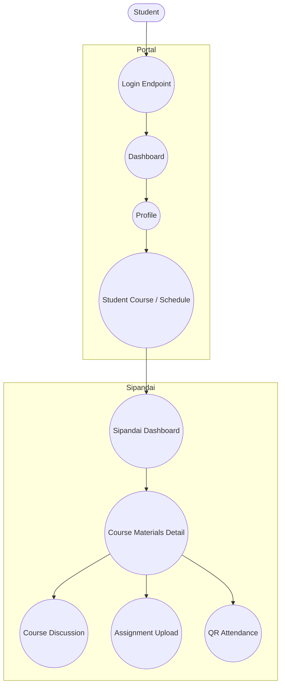

## CIC Portal Scraping Use Case

The scraper emulates a student navigating the CIC portal to gather everything needed for course tracking and attendance. The diagram below outlines the complete login → course materials → QR attendance journey.

### Flow Notes
- **Portal Frontend vs Sipandai**: Student Course and Sipandai Dashboard surface the same classes, but Sipandai exposes additional per-course data that fuels the scraper’s downstream steps.
- **Course Materials Context**: Discussion, assignment upload, and QR attendance all share the same course detail context (`id=30061`, `courses_id=8987`) to mirror how students interact with a single class session.
- **Scraper Implication**: Each use case maps to an entry of the endpoint catalogue in `config/portal.php` (`php artisan portal:endpoints`), so the diagram can guide API endpoints or queued jobs that need these artifacts.
